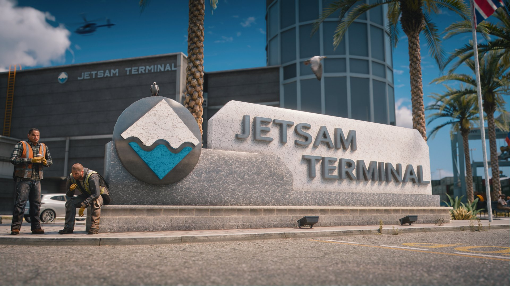
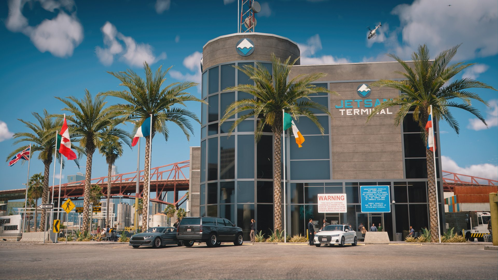
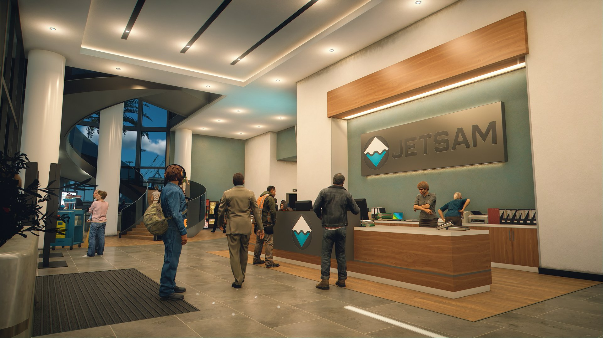
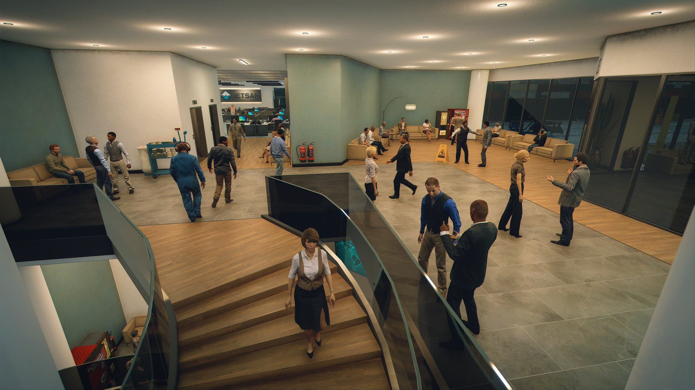
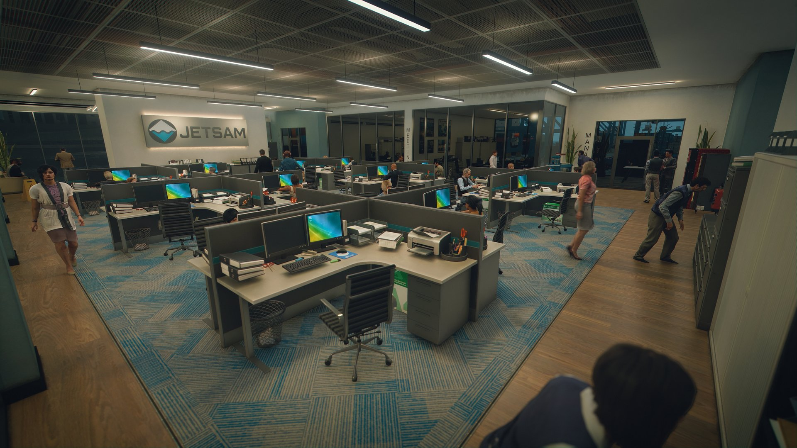
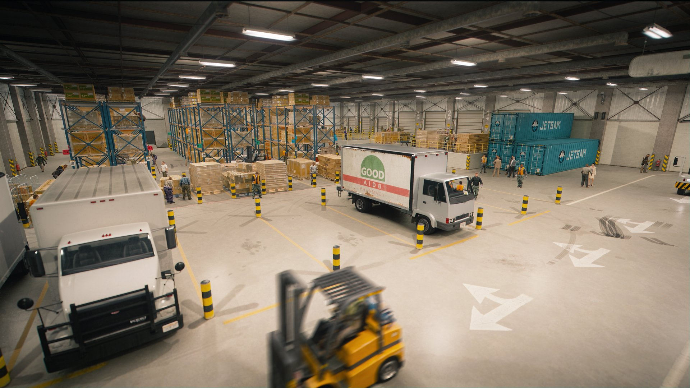
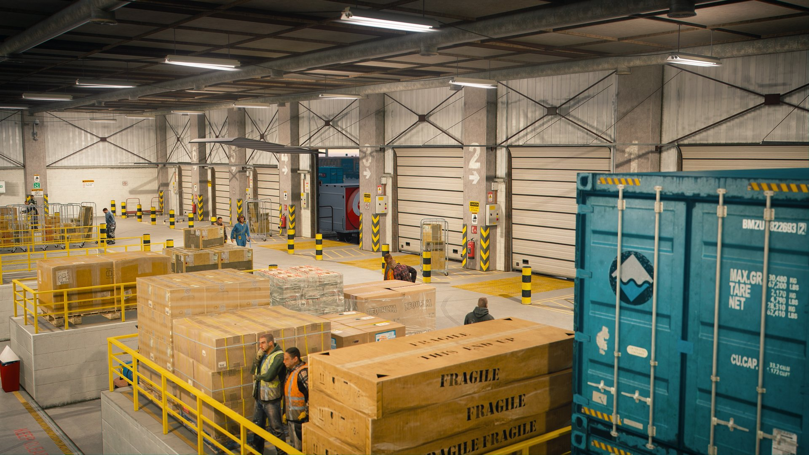
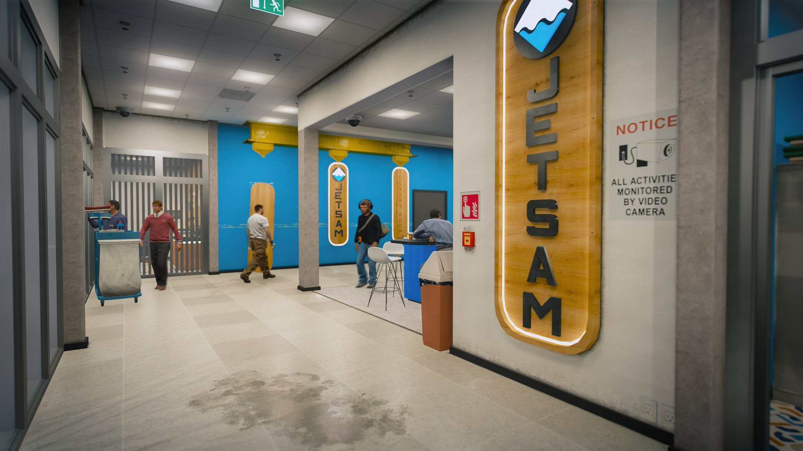
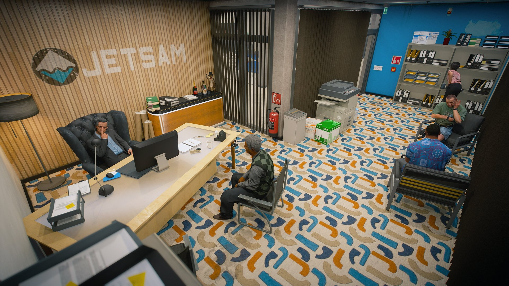
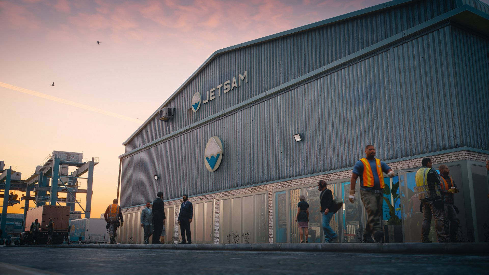

# 🚢 JetSam HQ & Warehouses


**Official asset for FiveM — available on CFX Portal and Prompt's Mods Store**




**JetSam HQ & Warehouses** brings the JetSam shipping company to the **Port of Los Santos**: a two-floor HQ office and two warehouse buildings, an office block and a large warehouse hall. It ships with two scripted features, **moving elevators** in the office and four **lift platforms** in the warehouse hall, plus full **interior audio** (occlusion, room acoustics, ambience and door sounds) through our shared `prompt_audio` resource.


**ox\_lib** is the only script requirement. No framework needed: both resources are standalone. **prompt\_audio 1.0.8 or newer** carries all the interior audio. **ox\_target** is optional: without it, interactions use an on-screen `[E]` prompt. **ox\_doorlock** is only needed for the door lock SQL.



**Jobs for this map:** [JetSam Dock Jobs](../scripts/jetsam-dock-jobs/README.md) adds four connected port jobs here: gantry crane, container handler, warehouse forklift and truck delivery. It is only included in the **JetSam Map & Script bundle**, not with the map on its own.


<details>

<summary>📸 Screenshots</summary>

<figure><figcaption><p>JetSam Terminal sign at the HQ</p></figcaption></figure>

<figure><figcaption><p>JetSam HQ exterior</p></figcaption></figure>

<figure><figcaption><p>HQ lobby and reception</p></figcaption></figure>

<figure><figcaption><p>HQ lobby and staircase</p></figcaption></figure>

<figure><figcaption><p>Open-plan office</p></figcaption></figure>

<figure><figcaption><p>Warehouse hall</p></figcaption></figure>

<figure><figcaption><p>Warehouse hall and dock doors</p></figcaption></figure>

<figure><figcaption><p>Warehouse 1</p></figcaption></figure>

<figure><figcaption><p>Warehouse 1 office</p></figcaption></figure>

<figure><figcaption><p>Warehouse exterior</p></figcaption></figure>

</details>

***

### Installation Instructions



#### Step 1 — Install the map

Download the resource from the [CFX Portal](https://portal.cfx.re/assets/granted-assets?page=1\&sort=asset.updated_at\&direction=asc\&search=Prompt%27s+-+Jetsam).

After downloading, **you will get two folders**:

<pre><code><strong>prompt_jetsam
prompt_jetsam_warehouse
</strong></code></pre>

| Folder | Contains |
| --- | --- |
| `prompt_jetsam` | JetSam HQ office and its elevators |
| `prompt_jetsam_warehouse` | Warehouse 1 (office block) and Warehouse 2 (hall) with its lift platforms |

Drag and drop **both** inside your `resources` directory. When done, the full paths should look like this:

<pre><code><strong>resources/prompt_jetsam
resources/prompt_jetsam_warehouse
</strong></code></pre>



#### Step 2 — Install prompt\_audio

`prompt_audio` is our free shared audio resource. It holds the audio data for our maps, including all of JetSam's interior audio. JetSam needs **version 1.0.8 or newer**.

* **Don't have it yet?** Download it from the [CFX Portal](https://portal.cfx.re/assets/granted-assets?page=1\&sort=asset.updated_at\&direction=asc\&search=Prompt%27s+-+Audio). Place it so the path is `resources/prompt_audio`.
* **Already have it from another Prompt Studio map?** Check the `version` line in `prompt_audio/fxmanifest.lua`. If it's older than `1.0.8`, replace the folder with the latest version.



#### Step 3 — Add to your server.cfg

Start everything **after** ox\_lib (and after ox\_target if you use it), in this order:

<pre class="language-cfg"><code class="lang-cfg">start ox_lib
<strong>start prompt_audio
start prompt_jetsam
start prompt_jetsam_warehouse
</strong></code></pre>



#### Step 4 — Import the door locks (ox\_doorlock)

Using ox\_doorlock? Import the SQL from the **Doorlock SQL** tab below into your database. It adds all 27 doors. Skip this step if you don't use ox\_doorlock.



#### Step 5 — Full server restart

Do a **full server restart**. A `restart` / `ensure` in the console is not enough: audio data is cached, so the new prompt\_audio data only loads on a full restart.

Then check the three interiors:

| Location | Coordinates |
| --- | --- |
| **JetSam HQ** (office lobby entrance) | `815.62, -2999.50, 6.53` |
| **Warehouse 1** (office block entrance) | `1239.91, -3200.37, 6.18` |
| **Warehouse 2** (hall) | `1197.4, -3153.9, 6.5` |

If all three interiors load and you hear the room audio inside, installation was successful ✅

[](https://discord.gg/rKbHHdfZFU)



***

### Additional Information



#### 📦 What's in the download

| Resource | Version | Contains |
| --- | --- | --- |
| `prompt_jetsam` | 1.0.1 | JetSam HQ office (interior `prompt_jetsam_int`) and its two elevators |
| `prompt_jetsam_warehouse` | 1.0.1 | Warehouse 1, the office block (`prompt_jetsamwh1_int`), and Warehouse 2, the hall (`prompt_jetsamwh2_int`), with four lift platforms |

#### 🏢 JetSam HQ

A two-floor office:

* Ground-floor entrance lobby
* 2nd-floor entrance
* Boss office
* Big open office with kitchen
* Office 1 and office 2
* Meeting room 1 and meeting room 2

#### 🏭 Warehouses

* **Warehouse 1** — the office block, entrance at `1239.91, -3200.37, 6.18`.
* **Warehouse 2** — the big warehouse hall with the four lift platforms.
* **9 dock doors** (`E-4` to `E-12` in the door SQL) that open automatically for vehicles.

#### 🛗 Elevators

Two lifts serve the ground floor and the 2nd floor. Pick the type in `Config.Elevator.Mode`:

| Mode | What players get |
| --- | --- |
| `'moving'` (default) | Moving cabins with sliding doors. The call buttons next to the landing doors light up while a lift travels to that floor. GTA lift sound and the Import/Export garage-lift announcer ("Elevator doors closing", "Elevator going up", "Level 2"…). Floor menu (ox\_lib) inside the cabin. Every ride is synced for all players. |
| `'lifts'` | Simple elevators. The static `lifts` entity set is shown and nothing moves. Press **E** at the landing doors, pick a floor, and you're teleported there behind a screen fade. |

**Riding a moving elevator:**

1. **Call it.** With ox\_target, target the call button next to the doors (**Call elevator (Ground Floor)** / **Call elevator (2nd Floor)**). Without ox\_target, stand at the call button and press **E** (`[E] Call elevator`).
2. **Pick a floor.** Step into the cabin, press **E** (`[E] Select floor`) and choose the floor.
3. **Ride.** The doors close, the lift travels (about 10 seconds) and the doors open on arrival.

There's no call option on the floor where a lift already stands: its doors are open there, just walk in.

#### 🏗️ Lift platforms

Four lift platforms in Warehouse 2, usable as loading dock, forklift lift or car lift. Each one raises and lowers between two levels (about 4.7 seconds per stroke) and carries whoever is on it, on foot or in a vehicle or forklift.

* **`[E]` prompt** on the platform, or up to 2.5 m in front of or behind it (not at the sides), from either level. In a vehicle or forklift, **E** works too.
* **ox\_target** on the two control boxes on the platform's corner posts: **Raise platform** / **Lower platform**.
* Crane hoist sound while moving.
* Synced: every player sees the same movement. Each platform does one stroke at a time.

#### 🔊 Interior audio

All interior audio lives in `prompt_audio` (1.0.8 or newer):

* **Audio occlusion** in all three interiors: walls, doors and glass muffle sound, and closed exterior doors keep the street out.
* **Room acoustics:** echo in the big warehouse hall, a livelier lobby and open office, natural small rooms.
* **Office:** radio in the kitchen, typing, desk activity and printers that print from the actual printer props, including the big photocopier in the boss office and the printers in both private offices.
* **Warehouse:** machinery hum, forklift reversing beeps, and metal, tool and pallet sounds across the hall.
* **Custom door sounds:** office doors, the glass doors in Warehouse 1 and roller sounds on the dock doors.


After installing or updating `prompt_audio`, always do a **full server restart**. Audio data is cached, so `restart prompt_audio` is not enough.


#### 🚪 Door locks

Ready-to-import ox\_doorlock SQL for all 27 doors, with the main entrances, the warehouse toilet and the dock doors unlocked by default. See the **Doorlock SQL** tab.

#### 🧩 Built for any server

* **Standalone:** no framework needed.
* **ox\_lib** powers the menus, text prompts and zones.
* **ox\_target** is auto-detected for the call buttons and platform controls. Without it, an `[E]` prompt is used.
* **Every player-facing text** is in the open config, ready to translate.



Both `config.lua` files are **open** (not escrowed). Restart your server after changing them.

| File | What it controls |
| --- | --- |
| `prompt_jetsam/config.lua` | Elevators (`Config.Elevator`): type, speed, doors, sounds, announcer, call buttons, texts |
| `prompt_jetsam_warehouse/config.lua` | Lift platforms (`Config.Platforms`): levels, speed, controls, prompt area, sound, texts |

#### Elevator type


```lua
Config.Elevator = {
    -- Elevator type:
    --   'moving' = moving elevators: animated cabin, sliding doors, call buttons, announcer voice
    --   'lifts'  = simple elevators: the static 'lifts' entity set is shown, and [E] at the landing
    --              doors opens a floor menu that teleports you to the chosen floor (nothing moves)
    Mode  = 'moving',
```


In `'lifts'` mode only `Interior`, `EntitySet`, `FloorLabels`, `Elevators[].floors`, `Elevators[].landings` and the texts `title`, `goTo`, `floor` and `useLift` are used. Everything else applies to `'moving'` mode.

<details>

<summary>Elevators — all options (<code>prompt_jetsam/config.lua</code>)</summary>

**General**

| Option | Default | What it does |
| --- | --- | --- |
| `Mode` | `'moving'` | `'moving'` = moving cabins, sliding doors, call buttons, announcer. `'lifts'` = static lifts and a teleport floor menu. |
| `Debug` | `false` | Prints elevator debug lines to the console and draws the cabin and call zones. |
| `Interior` | `coords = vector3(800.24, -2983.52, 8.50)`, `name = 'prompt_jetsam_int'` | The interior that holds the `lifts` entity set. |
| `EntitySet` | `'lifts'` | The static lifts baked into the MLO. Shown in `'lifts'` mode, hidden while the moving lifts run. |
| `CabinModel` | `'prompt_jetsam_prop_elev'` | Moving cabin model (the same cabin the `lifts` set uses). |
| `DoorModel` | `'prompt_jetsam_prop_liftdoor'` | Door leaf model, used for the cabin doors and the landing doors. |
| `StateBagPrefix` | `'jetsam_elevator_'` | GlobalState key prefix (`jetsam_elevator_1`, `jetsam_elevator_2`). |

**Ride**

| Option | Default | What it does |
| --- | --- | --- |
| `MsPerUnit` | `1400` | Travel time in ms per vertical metre. With the default floor heights a trip takes about 9.8 s (3 s minimum). An entry in `Elevators` can override it with its own `msPerUnit`. |
| `BezierCurve` | `'linear'` | Speed curve: `'linear'`, `'easeIn'`, `'easeOut'`, anything else = ease in and out. |
| `AutoOpenMenu` | `false` | `true` opens the floor menu the moment you step into the cabin. |
| `UseTarget` | `true` | ox\_target on the call buttons when ox\_target is running. With `false` (or without ox\_target) the call buttons use the `[E]` prompt. |
| `FloorHeights` | `[1] = 5.037592`, `[2] = 12.015913` | Cabin Z per floor. |
| `FloorLabels` | `[1] = 'Ground Floor'`, `[2] = '2nd Floor'` | Floor names shown in the menu (translate here). |

**Doors & cabin**

| Option | Default | What it does |
| --- | --- | --- |
| `CabinDoorOffsets` | two entries | Cabin door positions relative to the cabin, rotated by the elevator's heading. |
| `DoorSlide` | `0.72` | Metres each door leaf slides when opening. |
| `DoorMs` | `1000` | Door open / close time in ms. |
| `CabinLight` | `{ offsetZ = 2.35, color = { 255, 226, 199 } }` | Spotlight inside the cabin, drawn only while you're in the cabin or at its doors. `false` = off. |
| `FloorDoors` | per elevator, per floor | Landing door positions (`coords` / `coords2` = the two leaves, `w` = heading), on the exact coords of the `lifts` entity set. |

**Sounds & announcer**

| Option | Default | What it does |
| --- | --- | --- |
| `Sounds.move` | GTA passenger lift | Loop played from the cabin during the ride. The config lists four stock alternatives (see below). |
| `Sounds.doors` | `'MP_PROPERTIES_ELEVATOR_DOORS'` | Door open / close sound set. |
| `Voice` | Import/Export garage-lift voice | Announcer lines played from the cabin, one after another. `Voice = false` turns the announcer off. Set any single line to `false` to skip it. |

Announcer lines in `Voice`:

| Key | Line |
| --- | --- |
| `doorsClosing` | "Elevator doors closing" |
| `goingUp` / `goingDown` | "Elevator going up" / "Elevator going down" |
| `floors` | Tone + "Level 1" / "Level 2" |
| `doorsOpening` | "Elevator doors opening" (the doors open with it) |

To change the ride sound, swap the `move` line for one of the stock options listed in the config:

```lua
    -- Other stock options (swap the line):
    --   { set = 'LIFT_POSH_SOUNDSET', name = 'move', scriptBank = 'LIFTS' }                      -- luxury lift, smoother
    --   { set = 'dlc_ie_garage_elevator_sounds', name = 'elevator_ascending_loop',
    --     scriptBank = 'DLC_IMPORTEXPORT/GARAGE_ELEVATOR' }                                     -- Import/Export car lift, hydraulic
    --   { set = 'freight_elevator_sounds', name = 'motor_01', scriptBank = 'FREIGHT_ELEVATOR' }  -- freight lift, industrial
    --   { set = 'CRANE_SOUNDS', name = 'Move_U_D', ambientBank = 'Crane', speed = 0.9 }          -- prompt-dock crane
    Sounds = {
        move  = { set = 'LIFT_NORMAL_SOUNDSET', name = 'move', scriptBank = 'LIFTS' },   -- GTA passenger lift
        doors = 'MP_PROPERTIES_ELEVATOR_DOORS',
    },
```

**Call buttons**

All four call buttons are placed in the map, one per lift per floor. Each one is its own model, so each lights on its own.

| Option | Default | What it does |
| --- | --- | --- |
| `CallButton.model` | `'prompt_jetsam_elev_button_%d'` | Button model name. `%d` = the number from `Elevators[x].callButtons`. |
| `CallButton.distance` | `1.2` | `[E]` range at a call button when ox\_target isn't used. |
| `CallButton.light` | `true` | Lights the destination floor's button while the lift travels. |
| `CallButton.txd` / `CallButton.tex` | `'prompt_jetsam_elev_button'` / `'script_rt_pd_elevator'` | The texture the button light is drawn on. |

If a floor has no call button, `[E]` anywhere in front of its landing doors calls the lift instead.

**Elevators** (one entry per lift)

| Option | Default | What it does |
| --- | --- | --- |
| `id`, `name` | `1`, `'JetSam Elevator 1'` / `2`, `'JetSam Elevator 2'` | Lift number and name. |
| `baseCoords`, `heading` | shaft position, `90.0` | Cabin XY position and facing. |
| `floors` | `{ 1, 2 }` | Floors this lift serves. Omit = every floor in `FloorHeights`. |
| `callButtons` | `{ [1] = 1, [2] = 2 }` / `{ [1] = 3, [2] = 4 }` | Floor → call-button model number. |
| `motion` | `'velocity'` | Physics-carried ride, so riders are carried by the cabin floor. Omit = per-frame teleport mover. |
| `spawnZone` | radius `60.0` | The cabin and doors exist only while you're within this range. |
| `callZone` / `insideZone` | boxes | The area in front of the landing doors / inside the cabin. |
| `landings` | one `vector4` per floor | `'lifts'` mode only: the `[E]` point and teleport destination in front of the doors. |

**Texts** (translate here; `%s` = a floor name, `%d` = a floor number)

| Key | Default | Where it shows |
| --- | --- | --- |
| `title` | `'Elevator'` | Floor menu title (both modes) |
| `goTo` | `'Go to %s'` | Floor menu option description |
| `floor` | `'Floor %d'` | Floor name when `FloorLabels` has none |
| `useLift` | `'[E] Use elevator'` | `'lifts'` mode: at the landing doors |
| `selectFloor` | `'[E] Select floor'` | `'moving'` mode: inside the cabin |
| `call` | `'[E] Call elevator'` | `'moving'` mode: at the landing doors |
| `callTarget` | `'Call elevator (%s)'` | `'moving'` mode: ox\_target label on a call button |
| `moving` | `'Elevator is moving…'` | `'moving'` mode: while the lift travels |

</details>

<details>

<summary>Lift platforms — all options (<code>prompt_jetsam_warehouse/config.lua</code>)</summary>

| Option | Default | What it does |
| --- | --- | --- |
| `Debug` | `false` | Prints platform debug lines to the console, including why a request was rejected. |
| `Interior` | `coords = vector3(1197.37, -3153.94, 6.50)`, `name = 'prompt_jetsamwh2_int'` | The interior that holds the `lifts` entity set. |
| `EntitySet` | `'lifts'` | The static platforms baked into the MLO. Kept hidden while the moving platforms run. |
| `Model` | `'prompt_jetsam_wh_platform_anim'` | Moving platform model. |
| `Levels` | `down = 4.393908`, `up = 5.967894` | Platform Z at the two levels. |
| `MsPerUnit` | `3000` | ms per vertical metre: about 4.7 s per stroke (3 s minimum). |
| `BezierCurve` | `'easeBoth'` | Speed curve: `'linear'`, `'easeIn'`, `'easeOut'`, anything else = ease in and out. |
| `StateBagPrefix` | `'jetsam_wh_platform_'` | GlobalState key prefix (`jetsam_wh_platform_1` to `jetsam_wh_platform_4`). |
| `UseTarget` | `true` | ox\_target on the two control boxes when ox\_target is running. |
| `TargetRadius` | `0.45` | Size of each control-box target. |
| `TargetDistance` | `3.0` | ox\_target reach in metres. |
| `Controls` | two `vector3` | Control box positions on the platform's corner posts (platform-local, metres). |
| `RiderBox` | `min` / `max` box | Who counts as on the platform. Riders are carried; everyone else just watches it move. |
| `PromptBox` | `min` / `max` box | Where the `[E]` prompt shows: the rider box plus 2.5 m past both open ends (front / back, no sides: the next bay is only 2.7 m away), reaching down to the lower floor so it can be called from either level. |
| `Sound` | `{ ambientBank = 'Crane', set = 'CRANE_SOUNDS', name = 'Move_U_D', speed = 0.9 }` | Crane hoist loop while a platform moves. |
| `Bays` | 4 entries | One per platform: `coords` (XY), `heading`, `start` (the level after a server start, `'down'` or `'up'`). |

Default bays:

| Bay | Coords | Starts |
| --- | --- | --- |
| 1 | `1197.374917, -3165.933164` | down |
| 2 | `1197.374917, -3157.922666` | up |
| 3 | `1197.374917, -3149.855527` | down |
| 4 | `1197.374917, -3141.955137` | up |

**Texts** (translate here)

| Key | Default | Where it shows |
| --- | --- | --- |
| `raise` | `'[E] Raise platform'` | `[E]` prompt when the platform is down |
| `lower` | `'[E] Lower platform'` | `[E]` prompt when the platform is up |
| `moving` | `'Platform moving…'` | While the platform moves |
| `targetRaise` | `'Raise platform'` | ox\_target label on the control boxes |
| `targetLower` | `'Lower platform'` | ox\_target label on the control boxes |

</details>

#### Editable files

These files are listed in each resource's `escrow_ignore`, so you can open and edit them:

**`prompt_jetsam`**

| File(s) | What it is |
| --- | --- |
| `config.lua` | Elevator settings and texts |
| `stream/*.ytd`, `stream/**/*.ytd` | Textures: `prompt_jetsam_txd.ytd`, `prompt_jetsam_elev_button.ytd` |
| `stream/**/*.ymap`, `stream/**/*.ytyp`, `stream/**/*.ybn` | Placement, archetype and collision files |
| `stream/occlusion/*.ymt` | Audio occlusion data |
| `stream/vanilla/*.*` | The edited base-game files (see **Compatibility**) |
| `stream/ydr/unlocked/*.ydr` | 38 models: furniture and props, doors, the elevator cabin, landing doors and call buttons, windows and glass, room details and proxies, and the second shell |

**`prompt_jetsam_warehouse`**

| File(s) | What it is |
| --- | --- |
| `config.lua` | Platform settings and texts |
| `stream/**/*.ytd` | Textures (`stream/wh1/ytd/`, `stream/wh2/ytd/`) |
| `stream/**/*.ymap`, `stream/**/*.ytyp`, `stream/**/*.ybn` | Placement, archetype and collision files |
| `stream/*.ymf` | `prompt_jetsam_all_milo_manifest.ymf` |
| `stream/occlusion/*.ymt` | Audio occlusion data |
| `stream/ext/**/*.ydr` | The edited base-game models (see **Compatibility**) |

Everything else is escrowed: the elevator and platform scripts, and the models not listed above (in `prompt_jetsam`, the ones directly in `stream/ydr/`).



JetSam HQ & Warehouses edits these **base-game files** of the Port of Los Santos (`po1_06` block):

**`prompt_jetsam`** (`stream/vanilla/`)

* `hei_po1_06_strm_3.ymap`
* `hei_po1_occl_02.ymap` (occlusion)
* `hei_po1_06_8.ybn`, `hei_po1_06_11.ybn`, `hi@hei_po1_06_8.ybn`, `hi@hei_po1_06_9.ybn` (collision)
* `po1_06_decal.ydr`, `po1_06_emb.ydr`, `po1_06_glue_04.ydr`, `po1_06_new_terminal.ydr`, `po1_06_new_terminal_sig.ydr` (models)

**`prompt_jetsam_warehouse`** (`stream/ext/`)

* `hei_po1_06_long_1.ymap`, `hei_po1_06_strm_8.ymap`, `hei_po1_06_strm_10.ymap`
* `hei_po1_occl_02.ymap` (occlusion)
* `hei_po1_06_0.ybn`, `hi@hei_po1_06_1.ybn`, `hi@hei_po1_06_7.ybn` (collision)
* `po1_06_1_ema.ydr`, `po1_06_build143.ydr`, `po1_06_build149.ydr`, `po1_06_build161.ydr`, `po1_06_gg_post_decal.ydr`, `po1_06_glue_03.ydr`, `po1_06_tgrnd5.ydr`, `po1_06_tgrnd5_deca.ydr` (models)

Only one version of each file can load. Any other resource that ships one of these files, for example another map or map edit at the Port of Los Santos, conflicts with JetSam and needs a **merged version**.


`hei_po1_occl_02.ymap` ships in both JetSam resources. The two copies are identical, so it doesn't matter which one loads.


#### Merging

All of these files are open (not escrowed), so they can be merged. Merge them with the [**Vertex Hub Merger**](https://app.vertex-hub.com/merger).


Merging Prompt Studio maps with each other in Vertex Hub is **completely free**. No subscription required.


#### Not compatible with

* **Other maps that replace the same Port of Los Santos buildings.** Use one map per building.



Ready-to-import **ox\_doorlock** config: **27 doors** (7 office + 20 warehouse).

**Door names** follow the buildings and floors:

| Prefix | Where |
| --- | --- |
| `JetSam Office E-` | Office lobby entrance |
| `JetSam Office 1-` | Office ground floor |
| `JetSam Office 2-` | Office 2nd floor |
| `JetSam Warehouse 1-` | Warehouse 1 (office block) inner doors |
| `JetSam Warehouse E-` | Warehouse exterior doors (`E-1` to `E-3`) and the 9 dock doors (`E-4` to `E-12`) |

**Unlocked by default** (`"state":0`):

* `JetSam Office E-1` — office lobby entrance
* `JetSam Warehouse E-3` — Warehouse 1 entrance
* `JetSam Warehouse 1-2` — toilet
* `JetSam Warehouse E-4` to `E-12` — the 9 dock doors. They also open automatically for vehicles (`"auto": true`).

Every other door starts **locked**. Set `"state":0` on any door you want unlocked by default.

**Not included on purpose:** the 8 elevator doors. The elevator script moves them itself.


The ids use `DEFAULT`, so the SQL never collides with doors you already have. Import it as is.


<details>

<summary>JetSam HQ &#x26; Warehouses — ox_doorlock SQL (27 doors)</summary>

```sql
INSERT INTO `ox_doorlock` (`id`, `name`, `data`) VALUES
	(DEFAULT, 'JetSam Office 1-1', '{"model":217447762,"heading":270,"doors":false,"coords":{"x":805.9034423828125,"y":-2981.38037109375,"z":6.187494277954102},"state":1,"maxDistance":2}'),
	(DEFAULT, 'JetSam Office 2-1', '{"model":1370383791,"heading":270,"doors":false,"coords":{"x":807.3470458984375,"y":-2956.993408203125,"z":13.166547775268555},"state":1,"maxDistance":2}'),
	(DEFAULT, 'JetSam Office 2-2', '{"model":1370383791,"heading":270,"doors":false,"coords":{"x":807.975341796875,"y":-2968.608154296875,"z":13.166547775268555},"state":1,"maxDistance":2}'),
	(DEFAULT, 'JetSam Office 2-3', '{"model":1370383791,"heading":90,"doors":false,"coords":{"x":807.975341796875,"y":-2966.427734375,"z":13.166547775268555},"state":1,"maxDistance":2}'),
	(DEFAULT, 'JetSam Office 2-4', '{"model":1370383791,"heading":270,"doors":false,"coords":{"x":811.5523071289062,"y":-2976.55908203125,"z":13.166547775268555},"state":1,"maxDistance":2}'),
	(DEFAULT, 'JetSam Office 2-5', '{"model":1370383791,"heading":225,"doors":false,"coords":{"x":815.3218994140625,"y":-2990.66015625,"z":13.166547775268555},"state":1,"maxDistance":2}'),
	(DEFAULT, 'JetSam Office E-1', '{"doors":[{"model":-506344116,"heading":0,"coords":{"x":816.9683227539062,"y":-2999.50341796875,"z":6.525983810424805}},{"model":-506344116,"heading":180,"coords":{"x":814.2764282226562,"y":-2999.50341796875,"z":6.525983810424805}}],"coords":{"x":815.6223754882812,"y":-2999.50341796875,"z":6.525983810424805},"state":0,"maxDistance":2}'),
	(DEFAULT, 'JetSam Warehouse 1-1', '{"model":-35610440,"heading":90,"doors":false,"coords":{"x":1216.976806640625,"y":-3187.510498046875,"z":6.177539825439453},"state":1,"maxDistance":2}'),
	(DEFAULT, 'JetSam Warehouse 1-2', '{"model":-35610440,"heading":0,"doors":false,"coords":{"x":1219.25,"y":-3183.889892578125,"z":6.177539825439453},"state":0,"maxDistance":2}'),
	(DEFAULT, 'JetSam Warehouse 1-3', '{"model":1623547657,"heading":0,"doors":false,"coords":{"x":1222.61083984375,"y":-3196.33935546875,"z":6.177851676940918},"state":1,"maxDistance":2}'),
	(DEFAULT, 'JetSam Warehouse 1-4', '{"doors":[{"model":-1461709756,"heading":180,"coords":{"x":1227.9300537109375,"y":-3183.8798828125,"z":6.177539825439453}},{"model":1683753785,"heading":0,"coords":{"x":1225.3336181640625,"y":-3183.8798828125,"z":6.177539825439453}}],"coords":{"x":1226.6318359375,"y":-3183.8798828125,"z":6.177539825439453},"state":1,"maxDistance":2}'),
	(DEFAULT, 'JetSam Warehouse 1-5', '{"model":1623547657,"heading":0,"doors":false,"coords":{"x":1227.470458984375,"y":-3196.33935546875,"z":6.177851676940918},"state":1,"maxDistance":2}'),
	(DEFAULT, 'JetSam Warehouse 1-6', '{"model":1623547657,"heading":180,"doors":false,"coords":{"x":1227.913818359375,"y":-3196.33935546875,"z":6.177851676940918},"state":1,"maxDistance":2}'),
	(DEFAULT, 'JetSam Warehouse 1-7', '{"model":1623547657,"heading":180,"doors":false,"coords":{"x":1227.913818359375,"y":-3192.672607421875,"z":6.177851676940918},"state":1,"maxDistance":2}'),
	(DEFAULT, 'JetSam Warehouse 1-8', '{"model":464151082,"heading":270,"doors":false,"coords":{"x":1228.530029296875,"y":-3182.3017578125,"z":6.177539825439453},"state":1,"maxDistance":2}'),
	(DEFAULT, 'JetSam Warehouse E-1', '{"doors":[{"model":1683753785,"heading":0,"coords":{"x":1225.3377685546875,"y":-3175.193359375,"z":6.177539825439453}},{"model":-1461709756,"heading":180,"coords":{"x":1227.932373046875,"y":-3175.193359375,"z":6.177539825439453}}],"coords":{"x":1226.6351318359375,"y":-3175.193359375,"z":6.177539825439453},"state":1,"maxDistance":2}'),
	(DEFAULT, 'JetSam Warehouse E-2', '{"model":263193286,"heading":0,"doors":false,"coords":{"x":1239.460205078125,"y":-3180.197265625,"z":7.349727153778076},"state":1,"maxDistance":2}'),
	(DEFAULT, 'JetSam Warehouse E-3', '{"doors":[{"model":-1426887186,"heading":180,"coords":{"x":1238.6070556640625,"y":-3200.36767578125,"z":6.177851676940918}},{"model":-1426887186,"heading":0,"coords":{"x":1241.206787109375,"y":-3200.36767578125,"z":6.177851676940918}}],"coords":{"x":1239.906982421875,"y":-3200.36767578125,"z":6.177851676940918},"state":0,"maxDistance":2}'),
	(DEFAULT, 'JetSam Warehouse E-4', '{"model":1875520990,"heading":270,"doors":false,"coords":{"x":1185.1800537109375,"y":-3173.530029296875,"z":6.100419998168945},"state":0,"maxDistance":2,"auto":true}'),
	(DEFAULT, 'JetSam Warehouse E-5', '{"model":1875520990,"heading":270,"doors":false,"coords":{"x":1185.1800537109375,"y":-3168.219970703125,"z":6.100419998168945},"state":0,"maxDistance":2,"auto":true}'),
	(DEFAULT, 'JetSam Warehouse E-6', '{"model":1875520990,"heading":270,"doors":false,"coords":{"x":1185.1800537109375,"y":-3162.639892578125,"z":6.100419998168945},"state":0,"maxDistance":2,"auto":true}'),
	(DEFAULT, 'JetSam Warehouse E-7', '{"model":2067285178,"heading":270,"doors":false,"coords":{"x":1185.18115234375,"y":-3155.70654296875,"z":6.101271629333496},"state":0,"maxDistance":2,"auto":true}'),
	(DEFAULT, 'JetSam Warehouse E-8', '{"model":2067285178,"heading":270,"doors":false,"coords":{"x":1185.18115234375,"y":-3149.009521484375,"z":6.101271629333496},"state":0,"maxDistance":2,"auto":true}'),
	(DEFAULT, 'JetSam Warehouse E-9', '{"model":2067285178,"heading":270,"doors":false,"coords":{"x":1185.18115234375,"y":-3142.306396484375,"z":6.101271629333496},"state":0,"maxDistance":2,"auto":true}'),
	(DEFAULT, 'JetSam Warehouse E-10', '{"model":2067285178,"heading":270,"doors":false,"coords":{"x":1185.18115234375,"y":-3135.604736328125,"z":6.101271629333496},"state":0,"maxDistance":2,"auto":true}'),
	(DEFAULT, 'JetSam Warehouse E-11', '{"model":-1517774502,"heading":180,"doors":false,"coords":{"x":1189.47998046875,"y":-3110.669921875,"z":4.5271501541137695},"state":0,"maxDistance":2,"auto":true}'),
	(DEFAULT, 'JetSam Warehouse E-12', '{"model":-1517774502,"heading":180,"doors":false,"coords":{"x":1234.47998046875,"y":-3110.669921875,"z":4.5271501541137695},"state":0,"maxDistance":2,"auto":true}');
```

</details>



There are no exports or commands. The elevators and platforms are **server-owned**: their state lives in GlobalState, readable from any client or server script.

| Key | Fields |
| --- | --- |
| `jetsam_elevator_1`, `jetsam_elevator_2` | `currentFloor`, `targetFloor`, `isMoving`, `doorsOpen`, `departAt` |
| `jetsam_wh_platform_1` to `jetsam_wh_platform_4` | `level` (`'up'` or `'down'`), `target`, `isMoving`, `departAt` |

The prefixes come from `StateBagPrefix` in each config.

* The server only accepts a ride request from a player within **40 m** of the elevator shaft, or within **30 m** of the platform bay.
* The `lifts` entity set in `prompt_jetsam_int` and `prompt_jetsamwh2_int` is controlled by the scripts: shown in the office in `'lifts'` mode, hidden while the moving elevators or platforms run. Don't toggle it from other scripts.



<details>

<summary>The resources don't start</summary>

Make sure `ox_lib` starts **before** both JetSam resources, and that the folders are named exactly `prompt_jetsam` and `prompt_jetsam_warehouse`.

</details>

<details>

<summary>No interior audio (no muffled walls, no office or warehouse sounds, no custom door sounds)</summary>

1. `prompt_audio` must be installed, started **before** the JetSam resources, and be **version 1.0.8 or newer**. Check the `version` line in `prompt_audio/fxmanifest.lua`.
2. After installing or updating `prompt_audio`, do a **full server restart**. Audio data is cached; `restart prompt_audio` is not enough.

</details>

<details>

<summary>No elevator prompt, or the call button doesn't react</summary>

* Inside the cabin you get `[E] Select floor`. While the lift moves you get `Elevator is moving…`.
* At the landing: with ox\_target, target the call button next to the doors. Without ox\_target, stand within `1.2` m of the call button.
* There's no call option on the floor where the lift already stands. Its doors are open there: walk in.
* With `Config.Elevator.Mode = 'lifts'` there are no call buttons: press **E** in front of the landing doors.

</details>

<details>

<summary>The lift platform doesn't move, or there's no prompt</summary>

* Stand on the platform or right in front of / behind it (up to 2.5 m), not at its sides.
* With ox\_target, use the control boxes on the platform's corner posts.
* A platform does one stroke at a time. Wait until `Platform moving…` disappears.

</details>

<details>

<summary>Floating props, holes or missing ground at the Port</summary>

Another resource edits the same base-game files (see **Compatibility**). Merge them in the [Vertex Hub Merger](https://app.vertex-hub.com/merger), or remove the other map.

</details>

<details>

<summary>Doors don't lock</summary>

Import the SQL from the **Doorlock SQL** tab and make sure ox\_doorlock is running. The main entrances, the warehouse toilet and the dock doors start **unlocked** on purpose; every other door starts locked.

</details>

<details>

<summary>Anything else</summary>

Set `Debug = true` in the config of the part that misbehaves (`Config.Elevator.Debug` in `prompt_jetsam/config.lua`, `Config.Platforms.Debug` in `prompt_jetsam_warehouse/config.lua`), reproduce the problem, then send us the F8 and server console output on Discord.

[](https://discord.gg/rKbHHdfZFU)

</details>


