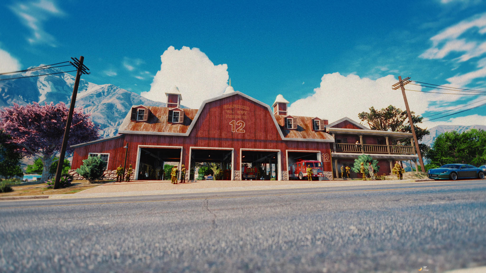

# 🚒 Grapeseed Fire Station

<figure><figcaption></figcaption></figure>


**Official asset for FiveM — available on CFX Portal and Prompt's Mods Store**




**Grapeseed Fire Station** is a new fire station for Grapeseed: four drive-through garage bays and a two-floor interior with reception, offices, a meeting room, kitchen, hangout area, locker room, bathrooms and a station gym. It ships with full **interior audio** (occlusion, room reverb and door sounds) through our shared `prompt_audio` resource.


No framework needed: the map is standalone. **prompt\_audio** carries the interior audio. **ox\_doorlock** is only needed for the door lock SQL. **Animations Core 2.0** is optional: it makes the gym machines usable.


***

### Installation Instructions



#### Step 1 — Install the map

Download the resource from the [CFX Portal](https://portal.cfx.re/assets/granted-assets?page=1\&sort=asset.updated_at\&direction=asc\&search=Prompt%27s+-+Grapeseed+Fire+Station).

After downloading, **you will get a folder named**:

<pre><code><strong>prompt_grapeseed_firestation
</strong></code></pre>

Drag and drop it inside your `resources` directory. When done, the full path should look like this:

<pre><code><strong>resources/prompt_grapeseed_firestation
</strong></code></pre>



#### Step 2 — Install prompt\_audio

`prompt_audio` is our free shared audio resource. It comes with the map as a separate package and holds the interior audio for our maps, including this station's.

* **Don't have it yet?** Download it from the [CFX Portal](https://portal.cfx.re/assets/granted-assets?page=1\&sort=asset.updated_at\&direction=asc\&search=Prompt%27s+-+Audio). Place it so the path is `resources/prompt_audio`.
* **Already have it from another Prompt Studio map?** Replace the folder with the latest version from the Portal. Older versions don't include this station's audio.



#### Step 3 — Add to your server.cfg

Start the shared resources **before** the map:

<pre class="language-cfg"><code class="lang-cfg">start prompt_audio
start prompt_doortuning
<strong>start prompt_grapeseed_firestation
</strong></code></pre>



#### Step 4 — Import the door locks (ox\_doorlock)

Using ox\_doorlock? Import the SQL from the **Doorlock SQL** tab below into your database. It adds all 21 doors. Skip this step if you don't use ox\_doorlock.



#### Step 5 — Full server restart

Do a **full server restart**. A `restart` / `ensure` in the console is not enough: audio data is cached, so the new prompt\_audio data only loads on a full restart.

Then go to **1965.04, 4625.70, 41.23** (main entrance). If the station loads and you hear the room audio inside, installation was successful ✅

[](https://discord.gg/rKbHHdfZFU)



***

### Additional Information



#### 🚒 Garage

Four drive-through bays with roller doors at both ends, a workshop corner and turnout gear racks.

#### 🏠 Interior

Reception, two offices, a meeting room, kitchen, hangout area (sofas, armchairs, TV), locker room and bathrooms, over two floors.

#### 🏋️ Gym

A station gym with mirrors. With Animations Core 2.0 its machines are usable, see the **Gym** tab.

#### 🔊 Interior audio

Sound is muffled through walls and closed doors, every room has its own reverb, and all doors have open and close sounds.

#### 💡 Lighting & LOD

Interior lighting optimized for performance, with daylight still coming through the windows. Night LOD and distant lights keep the station lit from far away, and an interior LOD shows it from up to 200 m.



The station picks the gym version on its own:

| Installed | Gym |
| --- | --- |
| **Animations Core 2.0** | 13 usable machines: 2 flat benches, 2 bench presses, 2 exercise bikes, a 2-piece cable station, a lat pull, a row pull, a leg press and 2 speed bags |
| **Limited Animations Core** | 11 usable machines, no bench presses (the limited core has no bench-press animation) |
| **No core** | Static gym props, nothing to set up |

Start the core anywhere in your `server.cfg`. There's nothing to configure.

The tyre, the dumbbell racks and the food table have no animated version and always stay static.


```lua
Config.GSFireGym = {
    mode = 'auto',   -- 'auto'   = animated when a core runs, static props otherwise
                     -- 'static' = always the static props
}
```


Type `/gsfiregymcheck` in-game to see which mode is active.



Grapeseed Fire Station edits these **base-game files** (`stream/vanilla/`):

* `hei_cs2_02_critical_0.ymap`, `hei_cs2_02_grass_0.ymap`, `hei_cs2_02_long_0.ymap`, `hei_cs2_02_strm_0.ymap`, `hei_cs2_02_strm_5.ymap`
* `cs2_occl_02.ymap` (occlusion)
* `vw_lodlights_small002.ymap`, `vw_lodlights_medium003.ymap`, `vw_distlodlights_small002.ymap`, `vw_distlodlights_medium003.ymap` (distant lights)

Only one version of each file can load. Any other resource that ships one of these files, for example another map in Grapeseed, needs a **merged version**.

#### Merging

All of these files are open (not escrowed), so they can be merged. Merge them with the [**Vertex Hub Merger**](https://app.vertex-hub.com/merger).


Merging Prompt Studio maps with each other in Vertex Hub is **completely free**. No subscription required.


#### Not compatible with

* **Other maps that replace the same Grapeseed lot.** Use one map per location.



Ready-to-import **ox\_doorlock** config: **21 doors (24 door leaves)**, generated from the map files and verified against every door in the map.

**Door names:**

| Prefix | Where |
| --- | --- |
| `E-1` to `E-8` | The 8 garage roller doors |
| `E-9` to `E-11` | Main entrance and the two upper-floor outside doors |
| `1-` | Ground floor |
| `2-` | Upper floor |

* `E-9` (main entrance) starts **unlocked**. Every other door starts **locked**.
* The garage doors open automatically for vehicles (`"auto": true`).
* **Not included on purpose:** the two toilet stall doors, and one upper-floor door that's modelled standing open (it would lock open).


The ids use `DEFAULT`, so the SQL never collides with doors you already have. Import it as is.


<details>

<summary>Grapeseed Fire Station — ox_doorlock SQL (21 doors)</summary>

```sql
INSERT INTO `ox_doorlock` (`id`, `name`, `data`) VALUES
	(DEFAULT, 'Grapeseed Fire Station 1-1', '{"model":1301176373,"heading":291,"doors":false,"coords":{"x":1933.5455322265625,"y":4621.34912109375,"z":40.86229705810547},"state":1,"maxDistance":2}'),
	(DEFAULT, 'Grapeseed Fire Station 1-2', '{"model":1301176373,"heading":291,"doors":false,"coords":{"x":1935.810302734375,"y":4615.53271484375,"z":40.86331558227539},"state":1,"maxDistance":2}'),
	(DEFAULT, 'Grapeseed Fire Station 1-3', '{"model":1301176373,"heading":111,"doors":false,"coords":{"x":1956.6256103515625,"y":4633.5263671875,"z":40.85007095336914},"state":1,"maxDistance":2}'),
	(DEFAULT, 'Grapeseed Fire Station 1-4', '{"doors":[{"model":833398898,"heading":291,"coords":{"x":1960.09423828125,"y":4626.6845703125,"z":41.24374008178711}},{"model":-2079273687,"heading":111,"coords":{"x":1959.31640625,"y":4628.69970703125,"z":41.24911117553711}}],"coords":{"x":1959.705322265625,"y":4627.6923828125,"z":41.24642562866211},"state":1,"maxDistance":2}'),
	(DEFAULT, 'Grapeseed Fire Station 1-5', '{"model":-1044232057,"heading":201,"doors":false,"coords":{"x":1965.9571533203125,"y":4635.9951171875,"z":41.2274169921875},"state":1,"maxDistance":2}'),
	(DEFAULT, 'Grapeseed Fire Station 1-6', '{"model":1897310001,"heading":111,"doors":false,"coords":{"x":1966.3216552734375,"y":4632.80029296875,"z":41.22871398925781},"state":1,"maxDistance":2}'),
	(DEFAULT, 'Grapeseed Fire Station 1-7', '{"model":-1044232057,"heading":111,"doors":false,"coords":{"x":1967.205810546875,"y":4630.529296875,"z":41.22649383544922},"state":1,"maxDistance":2}'),
	(DEFAULT, 'Grapeseed Fire Station 1-8', '{"model":-1044232057,"heading":111,"doors":false,"coords":{"x":1968.7423095703125,"y":4634.43603515625,"z":41.22533416748047},"state":1,"maxDistance":2}'),
	(DEFAULT, 'Grapeseed Fire Station 2-1', '{"model":-1044232057,"heading":291,"doors":false,"coords":{"x":1957.7923583984375,"y":4632.55615234375,"z":44.92629623413086},"state":1,"maxDistance":2}'),
	(DEFAULT, 'Grapeseed Fire Station 2-2', '{"model":-1044232057,"heading":111,"doors":false,"coords":{"x":1966.49755859375,"y":4633.2470703125,"z":44.9293327331543},"state":1,"maxDistance":2}'),
	(DEFAULT, 'Grapeseed Fire Station E-1', '{"model":-708779562,"heading":201,"doors":false,"coords":{"x":1935.21728515625,"y":4628.63427734375,"z":41.593605041503906},"state":1,"maxDistance":6,"auto":true}'),
	(DEFAULT, 'Grapeseed Fire Station E-2', '{"model":-708779562,"heading":21,"doors":false,"coords":{"x":1940.6287841796875,"y":4614.63427734375,"z":41.5905647277832},"state":1,"maxDistance":6,"auto":true}'),
	(DEFAULT, 'Grapeseed Fire Station E-3', '{"model":-1181179476,"heading":201,"doors":false,"coords":{"x":1940.865966796875,"y":4630.8408203125,"z":41.595001220703125},"state":1,"maxDistance":6,"auto":true}'),
	(DEFAULT, 'Grapeseed Fire Station E-4', '{"model":-1181179476,"heading":21,"doors":false,"coords":{"x":1946.328125,"y":4616.8583984375,"z":41.59552001953125},"state":1,"maxDistance":6,"auto":true}'),
	(DEFAULT, 'Grapeseed Fire Station E-5', '{"model":-1181179476,"heading":201,"doors":false,"coords":{"x":1946.7113037109375,"y":4633.12109375,"z":41.59856414794922},"state":1,"maxDistance":6,"auto":true}'),
	(DEFAULT, 'Grapeseed Fire Station E-6', '{"model":-1181179476,"heading":21,"doors":false,"coords":{"x":1952.1585693359375,"y":4619.13330078125,"z":41.59107208251953},"state":1,"maxDistance":6,"auto":true}'),
	(DEFAULT, 'Grapeseed Fire Station E-7', '{"model":-708779562,"heading":201,"doors":false,"coords":{"x":1952.3682861328125,"y":4635.32763671875,"z":41.58896255493164},"state":1,"maxDistance":6,"auto":true}'),
	(DEFAULT, 'Grapeseed Fire Station E-8', '{"model":-708779562,"heading":21,"doors":false,"coords":{"x":1957.80615234375,"y":4621.33984375,"z":41.592857360839844},"state":1,"maxDistance":6,"auto":true}'),
	(DEFAULT, 'Grapeseed Fire Station E-9', '{"doors":[{"model":-742527874,"heading":201,"coords":{"x":1964.074951171875,"y":4625.322265625,"z":41.24039077758789}},{"model":-1236553318,"heading":21,"coords":{"x":1966.0850830078125,"y":4626.12548828125,"z":41.24039077758789}}],"coords":{"x":1965.080078125,"y":4625.7236328125,"z":41.24039077758789},"state":0,"maxDistance":2}'),
	(DEFAULT, 'Grapeseed Fire Station E-10', '{"model":542410178,"heading":201,"doors":false,"coords":{"x":1966.9935302734375,"y":4626.5068359375,"z":44.92751693725586},"state":1,"maxDistance":2}'),
	(DEFAULT, 'Grapeseed Fire Station E-11', '{"doors":[{"model":-742527874,"heading":291,"coords":{"x":1971.105224609375,"y":4633.50927734375,"z":44.94197463989258}},{"model":-1236553318,"heading":111,"coords":{"x":1970.302978515625,"y":4635.5185546875,"z":44.94197463989258}}],"coords":{"x":1970.7041015625,"y":4634.513671875,"z":44.94197463989258},"state":1,"maxDistance":2}');
```

</details>



#### Seating

For sit scripts: `tuco_gr_fire_chair`, `tuco_gr_fire_bar_chair`, `tuco_gr_fire_armchair`, `tuco_gr_fire_hall_chair`, `tuco_gr_fire_sofa_1`, `tuco_gr_fire_sofa_2`, `prop_off_chair_01`, `p_clb_officechair_s`

The TV in the hangout area is `prop_tv_flat_02`.

#### Entity sets

| Entity set | Contents | On by default |
| --- | --- | --- |
| `gym` | The static gym machines | Yes. The gym script turns it off while an Animations Core runs |

See [Entity Sets](../extra-content/entity-sets.md) for how to toggle an entity set by hand.



<details>

<summary>No interior audio (no muffled walls, no reverb, no door sounds)</summary>

1. `prompt_audio` must be installed, started **before** the map, and up to date. Older versions don't include this station's audio: replace the folder with the latest version from the Portal.
2. After installing or updating `prompt_audio`, do a **full server restart**. Audio data is cached; `restart prompt_audio` is not enough.

</details>

<details>

<summary>The gym machines aren't usable</summary>

Make sure Animations Core 2.0 is running, then type `/gsfiregymcheck` in-game: it shows which gym mode is active. If `gym/config.lua` has `mode = 'static'`, set it back to `'auto'`.

</details>

<details>

<summary>Floating props, missing walls or doubled geometry</summary>

Another resource edits the same base-game files (see **Compatibility**). Merge them in the [Vertex Hub Merger](https://app.vertex-hub.com/merger), or remove the other map.

</details>

<details>

<summary>Anything else</summary>

Contact us on Discord and tell us what you see.

[](https://discord.gg/rKbHHdfZFU)

</details>


