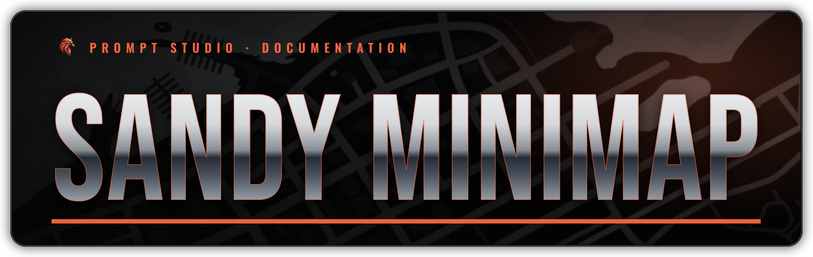
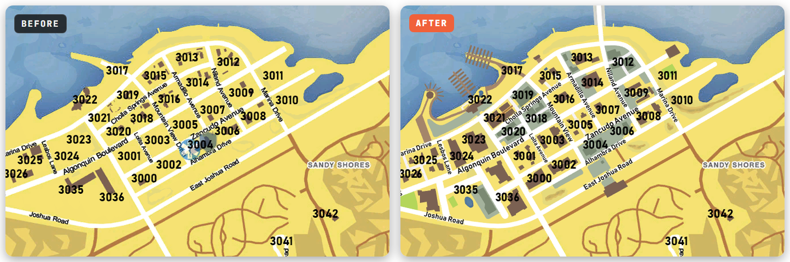

# 🧭 Sandy Minimap Generator

<figure><figcaption></figcaption></figure>

The game's minimap still shows the old Sandy Shores. The **Sandy Minimap Generator** draws the Sandy maps you run into it — the new downtown, the marina, the bridge, the airfield — in the minimap style your server already uses.

<a href="https://vertex-hub.com/prompt/minimap/sandy-rework" class="button primary">Open the Minimap Generator</a>

<figure><figcaption><p>Postal style, every Sandy map selected</p></figcaption></figure>

***

### How to use it



#### Step 1 — Tell it which maps you run

Paste the link from your server console — the same one the [**Sandy MapData**](sandy-mapdata.md) uses — or open the **Minimap Builder** and pick your maps.



#### Step 2 — Choose the minimap your server uses

**Classic GTA V**, **Postal**, or **Custom** for any other minimap. See the tabs below.



#### Step 3 — Check the preview

Switch between **Before** / **After** and **Pause map** / **Radar** to see how it will look in game.



#### Step 4 — Generate and install

Click **Generate** and install the download as described for your style below. Restart the server fully (not a resource refresh) and reconnect ✅




Run only **one** minimap resource at a time.


***

### Additional Information



For servers **without** a minimap mod. Your Sandy maps are drawn into the game's own minimap models and textures, so it looks like the normal GTA map.

The download is built on our server in about a minute and comes as its own resource:

```cfg
ensure prompt_sandy_minimap_classic
```



For servers running the **postal map**. The download is the complete postal map with your Sandy maps added; postal codes and street names stay.

1. Remove (or stop) your current postal map resource.
2. Put the new folder in your `resources` and start it:

```cfg
ensure prompt_sandy_minimap_postal
```



For **any other minimap**. Drop your minimap's `.ytd` files (`minimap_*.ytd`, `minimap_sea_*.ytd`) or the resource `.zip` on the page, and your Sandy maps are drawn on top of it.

* **Match my map's colours** — picks up your map's ground, road, building and water colours.
* **Keep my map's labels** — puts your postal codes, street names and icons back on top of the new Sandy pieces. Turn on **Show them on the preview** and click a label to leave it out.

The download holds only the changed `.ytd` files: copy them into the `stream` folder of **your** minimap resource, replacing the old ones.



* [Sandy Shores Downtown](sandy-downtown.md)
* [Custom Roads & Traffic](custom-roads-and-traffic.md)
* [The Corner](the-corner.md)
* [University](university.md)
* [Sandy Fire Station V2](sandy-fire-station-v2.md)
* [Sandy Hospital V2](sandy-hospital-v2.md)
* [Sandy Apartments](sandy-apartments.md)
* [Sandy Bank](sandy-bank.md)
* [Sandy Market](sandy-market.md)
* [Sandy Motel](sandy-motel.md)
* [Sandy Mechanic](sandy-mechanic.md)
* [Sandy Illegal Garage & Gas Station](sandy-illegal-garage-and-gas-station-with-carwash.md)
* [Sandy Church](sandy-church.md)
* [Sandy Car Dealership](sandy-car-dealership.md)
* [Sandy City Hall](sandy-city-hall.md)
* [Sandy Houses](sandy-houses.md)
* [Sandy Train Station](sandy-train-station.md)
* [Sandy Sheriff](sandy-sheriff.md)
* [Sandy Airport](sandy-airport.md)
* [Sandy Marina](sandy-marina.md)
* [Boat House](boat-house.md)
* [Gym](../civilian-maps/gym-5-locations.md) and [Horny's Burgers](../civilian-maps/hornys-burgers-4-locations.md) — their Sandy Shores locations

The original **Sandy Hospital** and **Sandy Fire Department** don't change the minimap, so there is nothing to draw for them.



<details>

<summary>The minimap still shows the old Sandy Shores</summary>

Restart the server fully (not a resource refresh) and reconnect. Make sure only one minimap resource is running.

</details>

<details>

<summary>My map's postal codes or street names disappeared (Custom)</summary>

Turn on **Keep my map's labels** before you generate. Labels on photo-style (satellite) maps can't be picked up.

</details>

<details>

<summary>The Sandy colours don't match my map (Custom)</summary>

Click **Match my map's colours**, then fine-tune the colour swatches and opacity.

</details>

Still stuck? Open a ticket on [Discord](https://discord.gg/rKbHHdfZFU) with a screenshot of your minimap.


