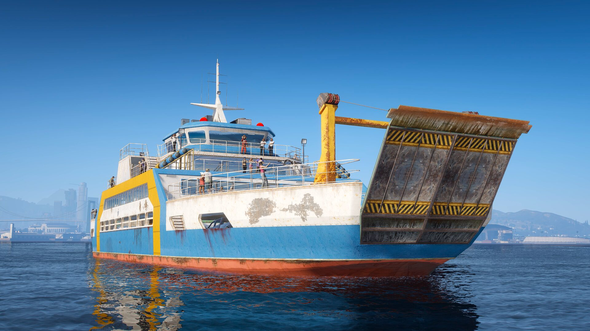
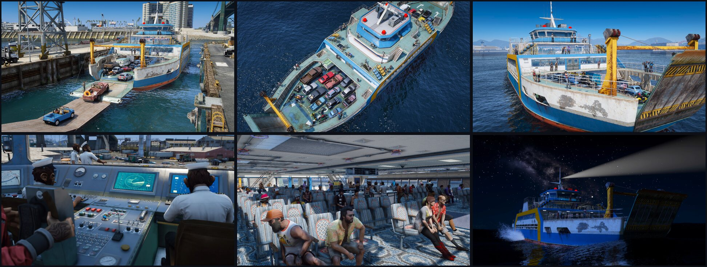

# Drivable Ferry

A 77 m car ferry that players drive. Take the helm on the bridge, lower the bow or stern ramp at a quay, let cars drive on, and sail. Cars parked on the car deck ride along without sliding, passengers sit in the lounge, and the bridge, lounge and cabins are a real interior you walk through while the ferry sails.

* **Helm and captain panel.** Steer with the normal boat keys. The panel shows speed, heading and the ramps, and its engine telegraph is a cruise control.
* **Car ramps.** A bow and a stern ramp, lowered and raised by hand. A lowering ramp stops where it touches the quay; a ramp with a car on it will not rise.
* **Cars ride along.** An empty car standing on the car deck is held where it stands for the crossing. Getting in lets it go.
* **Seats and interior.** 94 seats, doors that open as you walk up, and lights that come on at night.
* **Kept afloat.** A sunk or capsized ferry is put back upright on the water, and its fuel stays full.


**No required dependencies.** The framework, target, vehicle keys, fuel script and `ox_lib` are detected when they run. On a server with none of them the ferry still works: the prompts are drawn by the script and staff are set by an ACE.


<figure><figcaption><p>Under way off Los Santos.</p></figcaption></figure>

<figure><figcaption><p>Loading at the quay, a full car deck, passengers, the bridge, the lounge, and at night.</p></figcaption></figure>


The Drivable Ferry showcase.


***

### Requirements

* FiveM server with **OneSync** on.

Optional, detected automatically:

* **Framework**: `qbx_core`, `qb-core` or `es_extended`, for staff by job. Without one, staff is an ACE.
* **Vehicle keys**: `qbx_vehiclekeys`, `qb-vehiclekeys`, `qs-vehiclekeys`, `wasabi_carlock`, `MrNewbVehicleKeys`, `Renewed-Vehiclekeys`, `vehicles_keys`, `cd_garage` or `okokGarage`. With one, the players who hold keys to a ferry may take its helm. Any other keys script works through two functions you fill in (see [Custom bridges](developers.md#custom-bridges)).
* **Fuel**: `ox_fuel`, `LegacyFuel`, `cdn-fuel`, `ps-fuel` or `lc_fuel`. The ferry is kept full so a fuel script never strands it.
* [**`ox_lib`**](https://github.com/overextended/ox_lib): notifications and the text UI on servers without qb-core, qbox or ESX.
* [**`ox_target`**](https://github.com/overextended/ox_target): only if you want the seats as target options instead of the `[E]` prompt.


**Tested in game** on qb-core with `qb-vehiclekeys`, and on a standalone server with `ox_lib` and `ox_target`.

**Supported, not run in game by us:** the ESX and qbox frameworks and the other keys and fuel scripts in the list (written from their documentation). If something does not work on yours, send us the [`ferry_debugdump`](troubleshooting.md#support-dump) output on Discord.


***

### Installation



#### Copy the resource

Drop `prompt_ferry` into your `resources` folder. Keep the folder name: the exports use it.



#### Add to server.cfg

Start it **after** your framework, keys script, fuel script, target and `ox_lib`:

```
ensure prompt_ferry
```



#### Let staff spawn ferries

```
add_ace group.admin command.ferry allow
add_ace group.admin ferry.access allow
```

`command.ferry` allows `/ferry` and `/ferry_delete`. `ferry.access` makes a player staff: staff may take the helm of any ferry. On a framework server you can also make jobs staff (see [Access](configuration.md#access)).



#### Turn showcase mode off

Open `config.lua` and check:

```lua
Config.access = {
    ...
    showcase = false,
}
```

With `showcase = true` every player may spawn and delete ferries and take any helm. It is meant for filming and demos, and the server console warns about it at every start.



#### Start the server

On the first start the resource creates `hooks/hooks_client.lua`, `hooks/hooks_server.lua` and `hooks/hooks_shared.lua` from the `.example.lua` templates. Updates never overwrite them.



***

### First-boot checklist

When the bridges are resolved, the server console prints a report that starts with `========== prompt_ferry ==========`.

| Line | What to look for |
| --- | --- |
| `Framework` | `qbox`, `qbcore`, `esx` or `standalone`. `NONE FOUND` means no framework was found: staff then comes from the ACE |
| `Target` | `ox_target`, `qb-target` or `none`. Only the seats use a target, and only when you turn that on |
| `Access` | Who counts as staff. `SHOWCASE` means everyone: turn it off for a live server |
| `Spawn ace` | The ACE for `/ferry` and `/ferry_delete` (`command.ferry`) |
| `Keys` | The keys script in use, and the helm rule (`keys`, `staff` or `everyone`) |
| `Modules` | The features that are on |
| `Language` | The language in use (`auto` follows `ox:locale`) |
| `Ferries` | How many ferries are in the world |

In game, type `/ferry_info`: your side prints to F8, the server side to the server console.

***

### Getting a ferry

* **`/ferry`** spawns one centred on you, facing the way you face. Swim out to open water first: the ferry is 77 m long, and the spot needs at least 4 m of water under it. `/ferry <x> <y> <z> [heading]` spawns it at those coordinates instead; the server console uses the same form without the slash.
* **`/ferry_delete`** removes the nearest ferry within 100 m. From the console it removes every ferry.
* **Garages and spawn menus:** the vehicle model is `prompt_ferry` (a boat). A ferry spawned by any script is picked up like one from `/ferry`. Ferries from a garage keep their own plate; ferries from `/ferry` get `FERRY001`, `FERRY002` and so on.

With the default helm rule (`keys`), the player who spawned a ferry may take its helm, and gets keys to it when a keys script runs.


Restarting `prompt_ferry` removes every ferry in the world. A ferry left behind when the resource stops would crash the players near it.


***

### What's inside

<table data-view="cards"><thead><tr><th>Section</th><th></th><th data-card-target data-type="content-ref">Link</th></tr></thead><tbody><tr><td><strong>Sailing the Ferry</strong></td><td>The helm, the captain panel, ramps, docking, cars on deck, seats</td><td><a href="sailing.md">Sailing the Ferry</a></td></tr><tr><td><strong>Configuration</strong></td><td>Access, helm rules, speeds, keys, distances, languages</td><td><a href="configuration.md">Configuration</a></td></tr><tr><td><strong>For Developers</strong></td><td>Hooks, exports, events, state bags, commands, custom bridges</td><td><a href="developers.md">For Developers</a></td></tr><tr><td><strong>Troubleshooting</strong></td><td>No helm prompt, cars, ramps, lights, support dump</td><td><a href="troubleshooting.md">Troubleshooting</a></td></tr></tbody></table>
