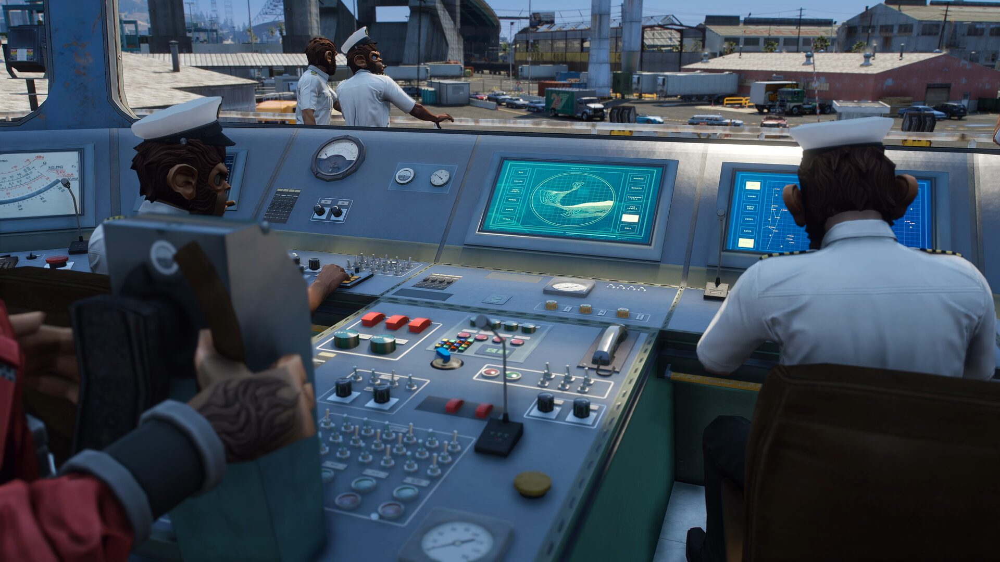
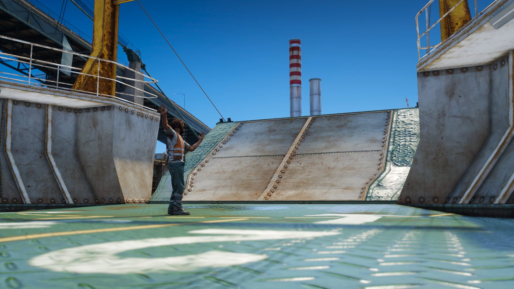
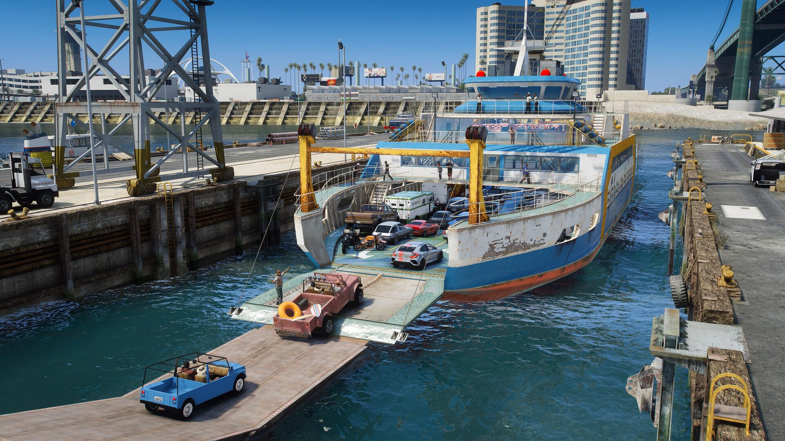
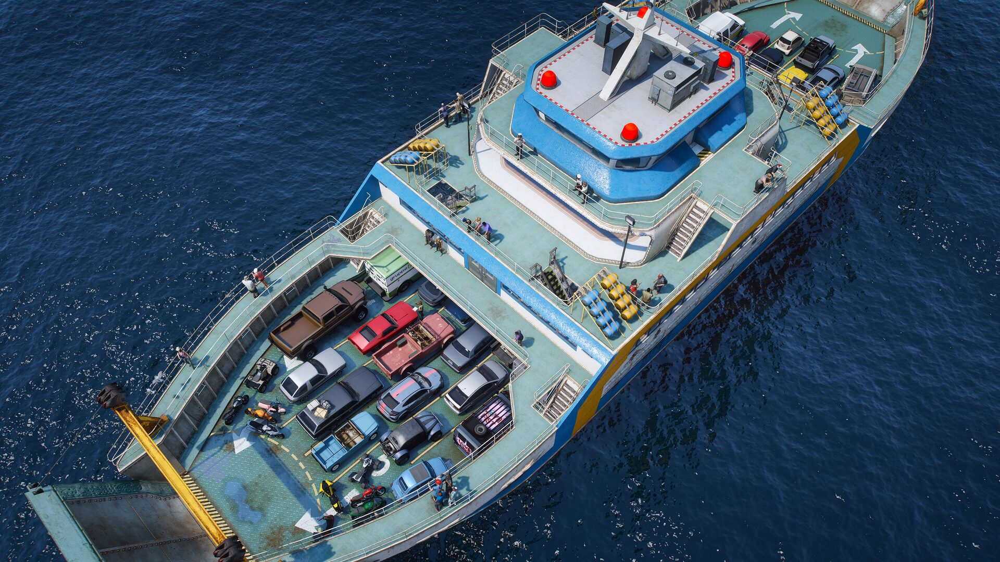
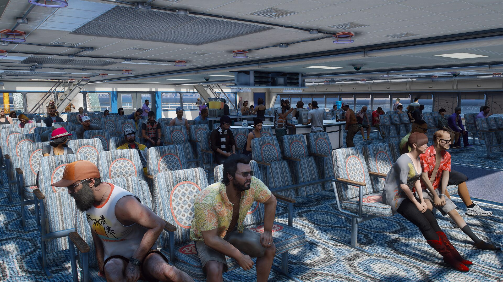
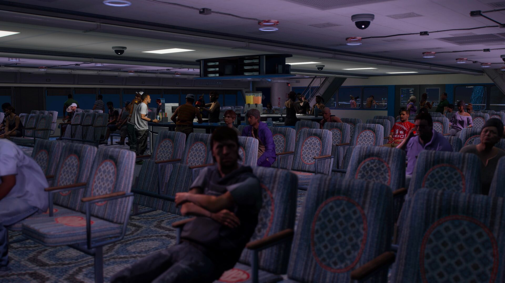
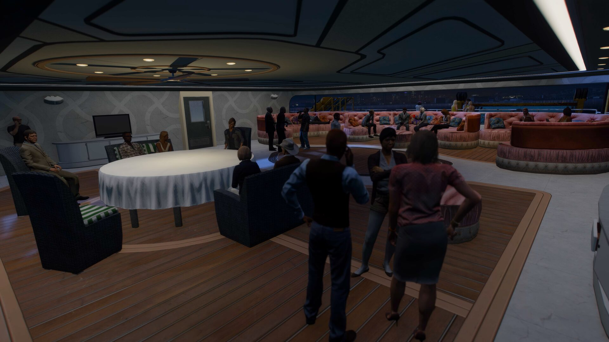
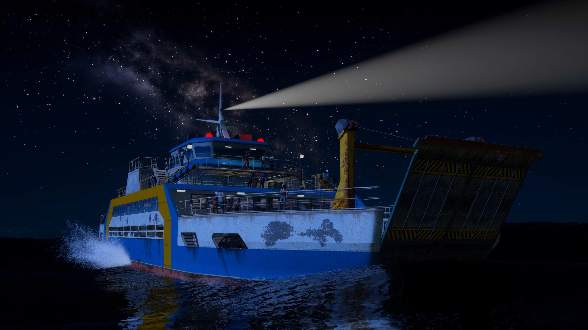
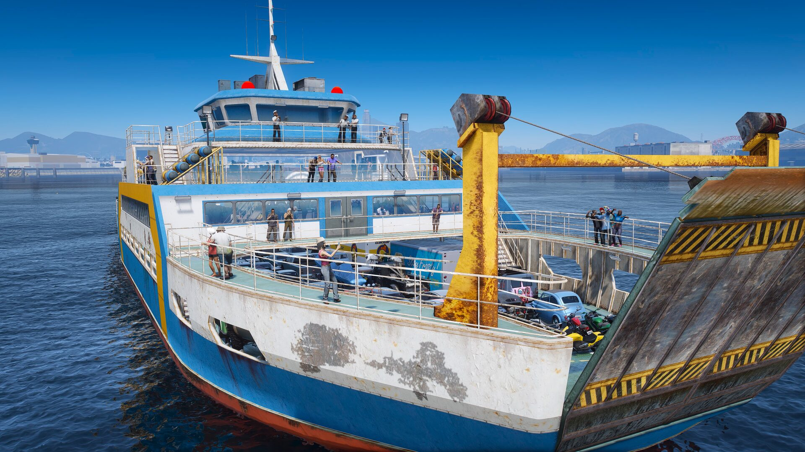
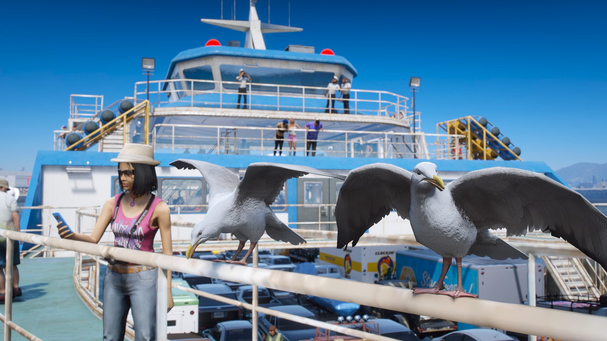

# Sailing the Ferry

### Keys

| Key | What |
| --- | --- |
| **E** | At the wheel: take the helm. At a seat: sit down, and **E** again to stand up |
| **W** / **S** | Ahead / astern. Either one cancels the cruise control |
| **A** / **D** | Steer |
| **F** | Leave the helm |
| **G** | Show or hide the captain panel |
| **~** | Give the captain panel the mouse while you keep driving. **ESC** gives it back |
| **[** / **]** (hold) | Lower / raise the bow ramp |
| **End** / **Home** (hold) | Lower / raise the stern ramp |

Players rebind every ferry key in **Settings > Key Bindings > FiveM**; they are listed under names starting with "Ferry:". The defaults are set in the config (see [Configuration](configuration.md#keys)).

***

### The helm

Walk onto the bridge, up to the wheel, and press **E** at the `Take the helm` prompt. You sit at the helm and drive the ferry like a boat.

<figure><figcaption>
The bridge.
</figcaption></figure>

* **Who may:** by default the players who hold keys to that ferry (with a keys script), or the player who spawned it (without one), and staff. See [Access](configuration.md#access).
* **Speed:** up to 15 m/s (54 km/h, about 29 knots). The ferry gathers speed slowly, about 9 s from a standstill to full speed, and turns a 194 m circle at full speed.
* **Someone already there:** one player at the helm. A player who gets into the driver seat some other way (an admin warp, a keys script) and may not steer is put out of the seat.

***

### The captain panel

The panel comes up at the top of the screen when you take the helm. **G** hides it and shows it again. Press **~** to use its buttons with the mouse while you keep steering, and **ESC** to give the mouse back.

| Part | What it does |
| --- | --- |
| **Speed and heading** | Speed in knots and km/h, the compass heading |
| **Engine telegraph** | The cruise control: astern on the left, STOP on top, ahead on the right. Click a position and the ferry holds that speed with no key held: **SLOW / HALF / FULL AHEAD** (5, 10, 15 m/s) or **SLOW / HALF / FULL ASTERN** (2, 3.5, 5 m/s). **STOP** brings it to rest. Pressing **W** or **S** yourself hands control back to you (`Cruise control off.`) |
| **Ramps** | Bow and stern: hold a button to lower or raise that ramp. The label shows what the ramp does: `Lowering`, `Raising`, `Fully down`, `Held`, `On the ground`, `Car on ramp` |
| **Dock** | Docks and undocks the ferry (see [Docking](#docking)) |

***

### Car ramps

The bow and the stern each have a car ramp. Hold the ramp key (or the panel button) to move it, and let go to stop it where it is. `/ferry_ramp bow` or `/ferry_ramp stern` at the helm sends that ramp all the way down, or all the way up when it is already down.

* **Lowering** stops by itself where the ramp touches the quay, a slipway, an object or another vehicle (`On the ground`).
* **Raising** stops while a car is on the ramp (`A vehicle is on the bow ramp: it stays down.`).
* **Speed limit:** while any ramp is open the ferry cannot go faster than 2 m/s (7 km/h), and a ramp only lowers when the ferry is slower than 2.5 m/s.
* Closed ramps are part of the ferry's hull and hold cars on the deck while sailing.

<figure><figcaption>
A lowered ramp, seen from the car deck.
</figcaption></figure>

***

### Docking

Docking holds the ferry still and level, so cars can drive on and off over a lowered ramp without the ferry drifting away from the quay.

1. Bring the ferry alongside or bow-on to the quay and slow it almost to a stop (1 m/s or less).
2. Click **Dock** on the panel, or type `/ferry_park`. The ferry is held in place: `Docked: the ferry is held in place. Dock again to sail.`
3. Lower a ramp and let the cars drive on or off.
4. Raise the ramps, click **Dock** again (`Undocked: free to sail.`) and sail.

<figure><figcaption>
Docked, with a ramp on the quay: the cars drive on.
</figcaption></figure>

***

### Cars on the car deck

A car parked on the car deck rides along the whole crossing without sliding, bouncing or sinking.

<figure><figcaption>
A full car deck at sea.
</figcaption></figure>

* **When:** an empty car (nobody in it) that has stood still on the car deck for 2 seconds while the ferry is under way is held to the deck where it stands. When the ferry docks or undocks, the cars on the deck are held first, so tightly packed cars do not jump.
* **While docked:** no car is newly held, so cars drive on and off freely. Cars that were held before the ferry docked stay held until someone gets in.
* **Getting in:** a player getting into a held car lets it go. It stays where it stood and drives off normally.
* **Cars with people in them** are not held: they sit on the deck under the game's own physics, like a car on any moving vehicle.
* **What counts:** cars, motorbikes, trailers and amphibious vehicles. The ramps are not part of the car deck.


On a ferry run by another script (an automatic ferry line that nobody steers), held cars stay held until the ferry has docked, also with people in them. **F** next to the car puts you straight into a free seat, and **F** inside puts you out beside it. See [Scripted ferries](developers.md#scripted-ferries).


***

### Seats

The ferry has 94 seats. Walk up to one and press **E** at the `Sit down` prompt; **E** again stands you up. You stay seated while the ferry sails. One player per seat (`Someone is sitting there.`).

With `ox_target` you can show the seats as target options instead of the prompt (`Config.Seats.interaction = 'auto'`, see [Seats](configuration.md#seats)).




<figure><figcaption>
The passenger lounge.
</figcaption></figure>




<figure><figcaption>
The lounge in the evening.
</figcaption></figure>



***

### Aboard

* **The interior:** the bridge, the lounge and the cabins are a walkable interior. Players within 150 m of a ferry see it, with the ferry's detailed model.
* **Doors** swing open as a player walks up to them and close when nobody is near. A script can lock them (see [Exports](developers.md#exports)).
* **Lights** come on at night.
* **Standing on deck:** players standing on the ferry are not knocked over by its rolling and pitching.
* **Kept afloat:** a ferry that sinks or capsizes is put back upright on the water, and a damaged ferry is repaired. Its fuel stays full.




<figure><figcaption>
Tables and sofas inside.
</figcaption></figure>




<figure><figcaption>
At night the lights come on.
</figcaption></figure>






<figure><figcaption>
Passengers on every deck.
</figcaption></figure>




<figure><figcaption>
On deck.
</figcaption></figure>


