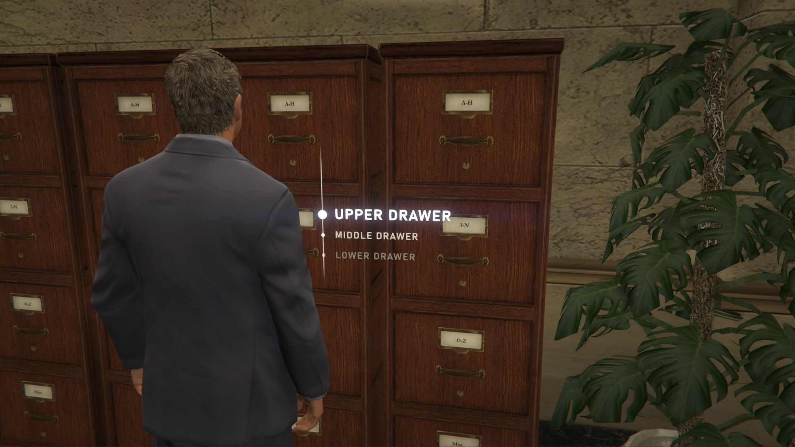
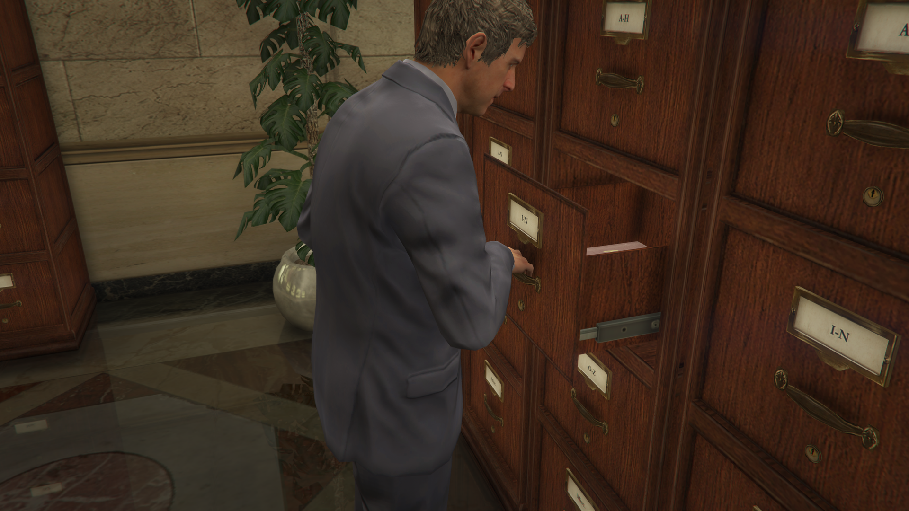
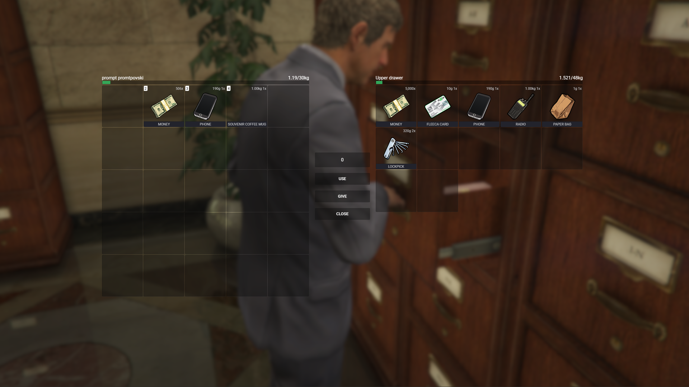
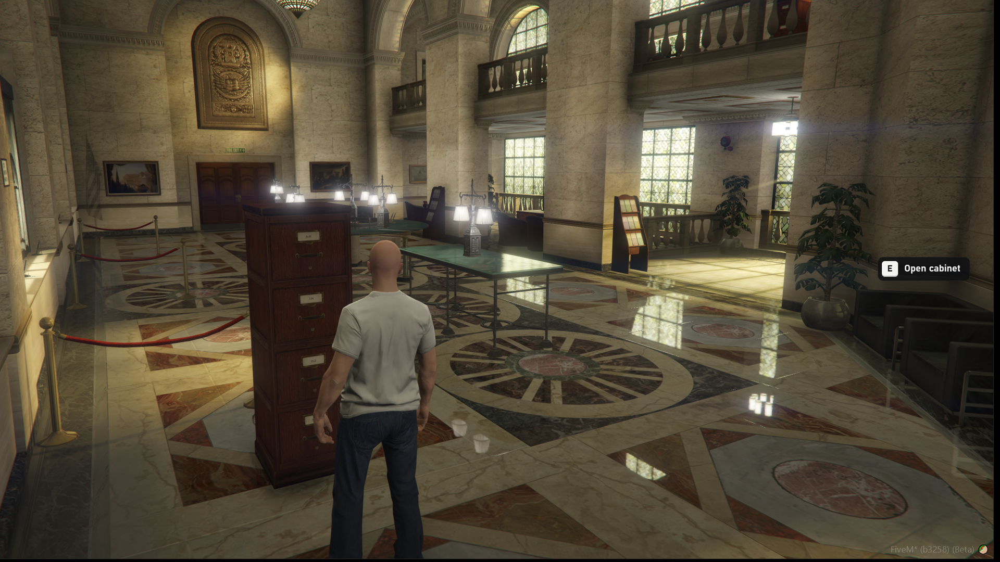
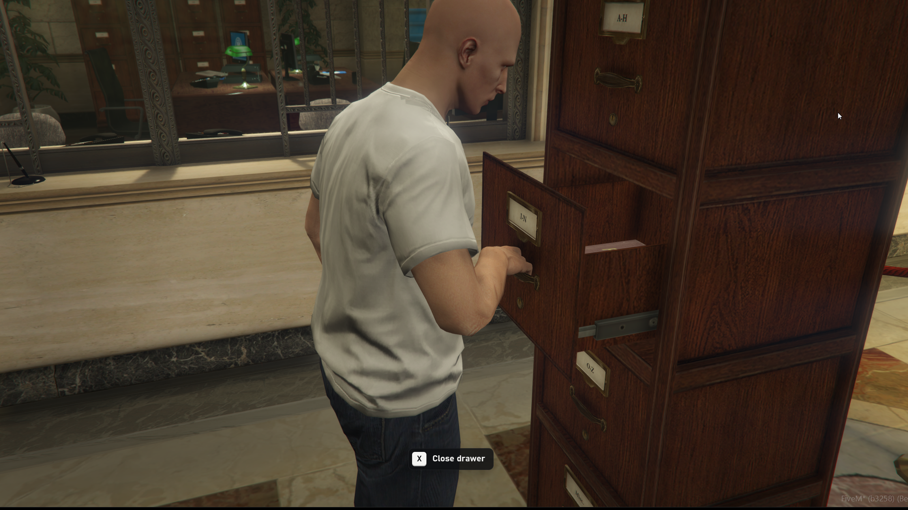

# Interactive Storage

Filing cabinets that open. A player walks up to a cabinet and picks a drawer from a list. The character then pulls that drawer out with an animation while the camera moves to it. Every drawer is a stash in your server's inventory, and closing the inventory shuts the drawer.

It works on two kinds of cabinets:

* **GTA's own cabinets.** 46 filing cabinet models that already stand in GTA interiors, and in MLOs that reuse them, open the same way. You do not place anything.
* **Placed cabinets.** `/storcreator` puts one of the 16 cabinet models anywhere in the world, in game. Placed cabinets are saved and show for everyone.

Other players nearby see the drawer and the character move. One player uses a cabinet at a time.


**No required dependencies.** The framework, target, inventory and `ox_lib` are detected when they run. Without an inventory the drawers still open and close, they just hold nothing.


<figure><figcaption><p>The drawer list stands beside the player.</p></figcaption></figure>

***

### Requirements

* FiveM server.

Optional, detected automatically:

* **Inventory**, for the drawer stashes: `ox_inventory`, `qb-inventory` (2.0 or newer), `tgiann-inventory` or `qs-inventory`. Any other inventory works through two functions you fill in (see [Custom inventory](configuration.md#custom-inventory)).
* **Target**: [`ox_target`](https://github.com/overextended/ox_target) or `qb-target`. Without one, a placed cabinet shows an `[E] Open cabinet` prompt; for GTA's own cabinets the player holds **ALT**, looks at the cabinet and presses **E**.
* **Framework**: `qbx_core`, `qb-core` or `es_extended`, for job-based access. Without one, access uses an ACE.
* [**`ox_lib`**](https://github.com/overextended/ox_lib): notifications on servers without qb-core, qbox or ESX, and the text UI if you switch the prompts to it.


**Tested in game** on qb-core with `ox_inventory`, `qb-inventory` 2.0, a custom inventory and no inventory, and with `ox_target`, `qb-target` and no target (the `[E]` prompt).

**Supported, not run in game by us:** `tgiann-inventory` and `qs-inventory` (written from their official documentation), and the ESX and qbox frameworks. If a drawer's stash does not open on yours, send us the [`stor_debugdump`](troubleshooting.md#support-dump) output on Discord.


***

### Installation



#### Copy the resource
Drop `prompt_interactive_storage` into your `resources` folder. Keep the folder name: the exports use it.



#### Add to server.cfg
Start it **after** your framework, target, inventory and `ox_lib`:
```
ensure prompt_interactive_storage
```
The target system is picked when the server starts. A target resource that starts later is only used after you restart `prompt_interactive_storage`.



#### Let staff place cabinets (optional)
```
add_ace group.admin stor.creator allow
```



#### Start the server
On the first start the resource creates `hooks/hooks_client.lua`, `hooks/hooks_server.lua` and `hooks/hooks_shared.lua` from the `.example.lua` templates. Updates never overwrite them. Players who were online during the first install should reconnect.




Every cabinet is open to every player out of the box. To restrict them, see [Access](configuration.md#access).


***

### First-boot checklist

When the bridges are resolved, the server console prints a report that starts with `========== prompt_interactive_storage ==========`.

| Line | What to look for |
| --- | --- |
| `Framework` | `qbox`, `qbcore`, `esx` or `standalone`. `NONE FOUND` means no framework was found: access then uses the ACE |
| `Target` | `ox_target`, `qb-target` or `none` (`none` = `[E]` prompts) |
| `Inventory` | The inventory the drawers use. `none` = the drawers hold nothing |
| `Access` | The `Config.access` rule. It only applies when `Config.Storage.access = true` |
| `Modules` | `creator, storage` |
| `Language` | The language in use (`auto` follows `ox:locale`) |

In game, type `/stor`: your side prints to F8, the server side to the server console.

***

### How it plays

```
[E] or target "Open cabinet" → the character walks to the drawer spot → drawer list
  → pick a drawer → it opens (animation + camera) → the stash opens
  → close the inventory → the drawer shuts → the camera glides back
```

* **The list:** Arrow Up / Down or the mouse wheel to choose, **E** or **Enter** to open, **Backspace** or **Esc** (or the Cancel row) to leave. Walking away from the cabinet closes it.
* **The walk:** the character walks to the drawer and turns to face it; there is no teleport. **X** during the walk cancels.
* **Shared stashes:** each drawer of each cabinet is its own stash. Everyone who opens that drawer sees the same items.
* **Closing:** the drawer shuts when the inventory closes. Without an inventory, or when the inventory does not come up within 3 seconds, an `[X] Close drawer` prompt shows instead.
* **Everyone sees it:** other players within 60 m see the drawer and the character animate. While someone uses a cabinet, nobody else gets its option.
* **Interruptions:** if the character dies, or another script downs or cuffs them, the scene lets go at once.
* **Sounds:** steel and wooden drawers have their own opening and closing sounds, played from the cabinet.

<figure><figcaption><p>The drawer opens with the character's hand on the handle.</p></figcaption></figure>

<figure><figcaption><p>The drawer's stash, here in ox_inventory. The stash is named after the drawer.</p></figcaption></figure>

The `[E]` and `[X]` prompts are drawn by the script itself. To use your server's text UI instead, set `Config.prompt = 'textui'` (see [Configuration](configuration.md#main-settings)).



<figure><figcaption><p>No target resource: the <code>[E] Open cabinet</code> prompt.</p></figcaption></figure>



<figure><figcaption><p>No inventory on screen: <code>[X] Close drawer</code> while the drawer is open.</p></figcaption></figure>



***

### What's inside

<table data-view="cards"><thead><tr><th>Section</th><th></th><th data-card-target data-type="content-ref">Link</th></tr></thead><tbody><tr><td><strong>Placing Cabinets</strong></td><td>/storcreator, the placer screen, move and remove</td><td><a href="placing-cabinets.md">placing-cabinets.md</a></td></tr><tr><td><strong>Configuration</strong></td><td>Access, inventories, distances, stash sizes, languages</td><td><a href="configuration.md">configuration.md</a></td></tr><tr><td><strong>For Developers</strong></td><td>Hooks, exports, commands, stash names, custom bridges</td><td><a href="developers.md">developers.md</a></td></tr><tr><td><strong>Troubleshooting</strong></td><td>No option, no stash, no access, support dump</td><td><a href="troubleshooting.md">troubleshooting.md</a></td></tr></tbody></table>
