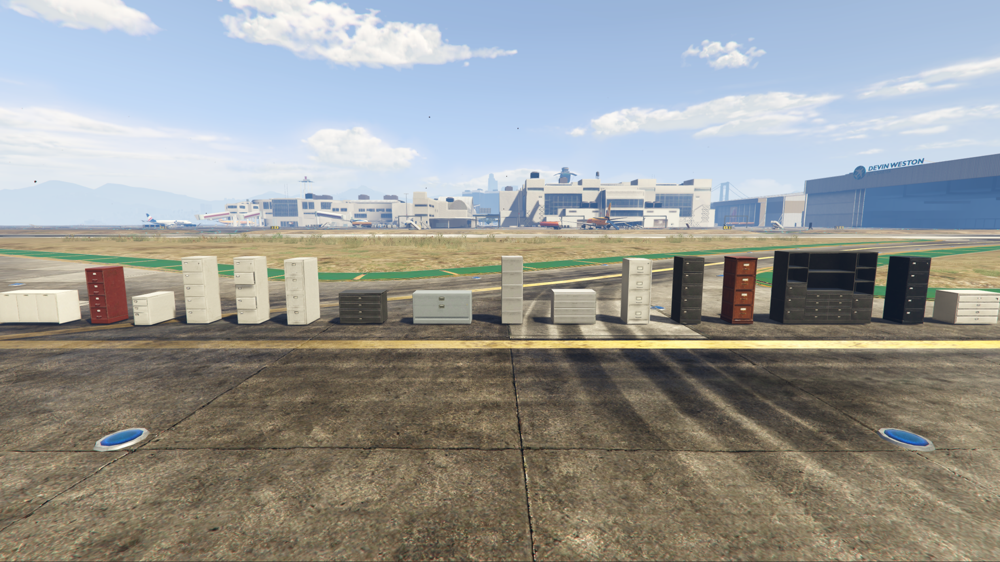

# Configuration

| File | What it controls |
| --- | --- |
| `config.lua` | Modules, language, framework / target / inventory / notify / prompt selection, access rule, debug |
| `config/storage.lua` | Who may open cabinets, distances, close key, sounds, camera, the GTA models that open, every cabinet's drawers and stash sizes |
| `config/creator.lua` | `/storcreator`: the ACE, distances and placer steps |
| `localization/<lang>.lua` | Every text players see, including the drawer names |
| `hooks/*.lua` | Your own rules and reactions (see [For Developers](developers.md#hooks)) |
| `bridge/*.lua` | Framework, target, inventory, notify, text UI and proximity adapters, with the `custom` functions |

All of these stay open under escrow. Restart `prompt_interactive_storage` after editing.

***

### Main settings


```lua
Config.Modules = {
    storage = true,
    creator = true,
}
Config.language  = 'auto'
Config.framework = 'auto'
Config.target    = 'auto'
Config.inventory = 'auto'
Config.notify    = 'auto'
Config.textUI    = 'auto'
Config.prompt    = 'nui'
Config.debug     = false
Config.Debug     = { storage = false, creator = false }
```


| Setting | Values |
| --- | --- |
| `Config.Modules.storage` | The cabinets and their drawer stashes. `false` registers nothing |
| `Config.Modules.creator` | `/storcreator` and the placed cabinets. Needs `storage` on |
| `Config.language` | `auto` (follows `setr ox:locale "xx"`) or `en` `de` `es` `fr` `ru` `pt` `sv` `no` `fi` `ar` `ko` `zh` |
| `Config.framework` | `auto` \| `qbox` \| `qbcore` \| `esx` \| `standalone` \| `custom`. `auto` checks `qbx_core`, `qb-core`, `es_extended` in that order. On a server without a framework, `standalone` skips the wait for one at boot |
| `Config.target` | `auto` \| `ox_target` \| `qb-target` \| `none` \| `custom`. `none` = prompts only |
| `Config.inventory` | `auto` \| `ox_inventory` \| `qb-inventory` \| `tgiann-inventory` \| `qs-inventory` \| `custom` \| `none`. `auto` takes the first one running, in that order (see [Inventories](#inventories)) |
| `Config.notify` | `auto` \| `ox_lib` \| `qb` \| `esx` \| `native` \| `custom`. `auto` uses qb-core's notify on qb-core and qbox, ESX's on ESX, else `ox_lib` if it runs, else the GTA feed |
| `Config.textUI` | `auto` \| `ox_lib` \| `qb` \| `native` \| `custom`. Only used for the prompts when `Config.prompt = 'textui'` |
| `Config.prompt` | `nui`: the script's own prompt plate for `[E] Open cabinet` and `[X] Close drawer`. `textui`: your server's text UI (`Config.textUI`). The placer screen is always the script's own |
| `Config.debug` | Verbose console for every module, plus `/stortest` and the debug commands. Keep `false` on a live server |
| `Config.Debug` | Console logging for one module (`storage`, `creator`) without turning on `Config.debug` |

***

### Access

Out of the box every player may open every cabinet. To restrict them, turn access on in `config/storage.lua` and set the rule in `config.lua`:


```lua
Config.Storage = {
    access = true,   -- false = everyone (default)
    ...
}
```



```lua
Config.access = {
    jobs          = { 'police' },
    minGrade      = 0,
    requireOnDuty = false,
    ace           = 'stor.access',
    showcase      = false,
}
```


* **With a framework** (qbox, qb-core, ESX): the player's job must be in `jobs`, with at least `minGrade`, and on duty if `requireOnDuty` is `true` (qbox and qb-core; ESX players always count as on duty). The ACE is not checked on these servers.
* **Standalone** (no framework, or `Config.framework = 'custom'` without `CustomGetJob`): the player needs the ACE:
  ```
  add_ace group.admin stor.access allow
  ```
* `showcase = true` lets everyone through. Demo servers only.

The server checks access when the player walks up to a cabinet and again before each drawer's stash opens. A refused player gets "You don't have access to this." For other rules (per cabinet model, items, duty from your own script) use the `canOpen` hook ([For Developers](developers.md#hooks)).

***

### Interaction and distances


```lua
Config.Storage = {
    access       = false,
    interaction  = 'auto',
    reach        = 2.0,
    claimRadius  = 5.0,
    stashRadius  = 3.0,
    viewDistance = 60.0,
    closeKey     = 73,
    menuDistance = 2.5,
    blendSpeed   = 2.5,
    approach = { speed = 1.0, timeout = 10000, slide = 0.6 },
}
```


| Setting | Default | What it does |
| --- | --- | --- |
| `interaction` | `'auto'` | `auto`: the target option when `ox_target` / `qb-target` runs, else prompts. `prompt`: always prompts (`[E]` at a placed cabinet; ALT + look + E at a GTA cabinet) |
| `reach` | `2.0` | How close the player must be for the target option or the `[E]` prompt (m) |
| `claimRadius` | `5.0` | Server check: the player must stand this close to use a cabinet (m). A player who ends up more than `claimRadius` + 5 m away loses the cabinet (checked every 5 s) |
| `stashRadius` | `3.0` | Server check: the player must stand this close to open a drawer's stash (m) |
| `viewDistance` | `60.0` | Other players' drawers animate on your screen within this range (m) |
| `closeKey` | `73` | GTA control id, **X** by default. Closes the drawer when no inventory is on screen, and cancels the walk to the cabinet |
| `menuDistance` | `2.5` | The drawer list closes when the player walks farther than this from the cabinet (m) |
| `blendSpeed` | `2.5` | How fast the character blends between animation steps |
| `approach.speed` | `1.0` | Walk speed to the drawer spot (1.0 = walk, 2.0 = run) |
| `approach.timeout` | `10000` | ms before the walk gives up and the character is set on the spot |
| `approach.slide` | `0.6` | The last stretch (m) is a smooth slide onto the exact spot; the camera starts moving here |

***

### Sounds and camera

Drawer sounds come from the resource's own sound bank. `Config.Storage.sound.enable = false` turns them off; `range` (default `20.0` m) is how far away they play. Leave the take names and timings as they are: they are matched to the animations.

`Config.Storage.camera` moves one scripted camera from the game view to the drawer list, to the open drawer, and back:

| Setting | Default | What it does |
| --- | --- | --- |
| `camera.enable` | `true` | `false` keeps the normal game camera the whole time |
| `camera.side` | `'auto'` | `auto` \| `right` \| `left`: the side the camera and the list stand on. `auto` picks the side with room |

The other camera values are framing rules worked out from each cabinet's size. They stop short of walls by themselves; leave them unless you know why you are changing them (developers can tune them live with `/stcam`, see [Debug commands](developers.md#debug-commands)).

***

### Cabinet models and stash sizes

<figure><figcaption><p>The 16 cabinet models.</p></figcaption></figure>

`Config.Storage.models` holds one entry per cabinet model. You may change:

* `stash`: one `{ slots, kg }` per drawer, in the same order as `drawers`. The defaults are measured from each model: 1 slot per 8 litres and 0.5 kg per litre of drawer space. The inventory gets the weight in grams (kg × 1000).
* `material`: `'steel'` or `'wood'`, which picks the drawer sound.

Leave `pedOffset`, `pedHeading`, `menuOffset`, `drawers`, `closeStop` and `focus` as they are: they match the animations of each model. The drawer names players see are in the language files (`storage_drawer_<id>`).

| Model | Material | Drawers | Stash per drawer (slots / kg) |
| --- | --- | --- | --- |
| `prompt_cabinet02` | wood | left, middle, right | 24 / 95 each |
| `prompt_ch_chint02_filing_cabinet` | steel | upper, middle, lower | 12 / 47 each |
| `prompt_filecab01` | steel | upper, middle, lower | 6 / 22, 5 / 21, 8 / 32 |
| `prompt_filecab_01a` | steel | upper, middle, lower | 11 / 42 each |
| `prompt_filecabtall_01` | steel | upper, middle, lower | 11 / 42 each |
| `prompt_filingcab` | steel | upper, middle, lower | 14 / 57 each |
| `prompt_lowcabdark01` | steel | upper, middle, lower | 17 / 68, 18 / 72, 18 / 70 |
| `prompt_lowfilecab` | steel | upper, lower | 19 / 75, 35 / 140 |
| `prompt_prop_cabinet_01` | steel | upper, middle, lower | 15 / 60 each |
| `prompt_prop_cabinet_01b` | steel | upper, middle, lower | 19 / 78, 17 / 67, 17 / 67 |
| `prompt_prop_cabinet_02b` | steel | upper, middle, lower | 19 / 77, 19 / 77, 18 / 73 |
| `prompt_tallcabdark01` | steel | upper, middle, lower | 10 / 42, 10 / 42, 11 / 43 |
| `prompt_v_corp_bk_filecab` | wood | upper, middle, lower | 12 / 48 each |
| `prompt_v_corp_cabshelves01` | wood | centre-right, centre-left, far right, far left | 6 / 24, 6 / 24, 13 / 53, 13 / 53 |
| `prompt_v_corp_filecabdark02` | steel | upper, middle, lower | 11 / 42 each |
| `prompt_v_corp_filecablow` | steel | upper, middle, lower | 10 / 40, 9 / 37, 9 / 37 |

The table is in the order the placer lists the models.

***

### GTA's own cabinets

The resource streams its own mesh under 46 GTA filing cabinet model names: same look, but with drawers that can move. When a player opens one, the original is hidden on the spot and the matching animated model (`twin` in `Config.Storage.replace`) takes its place for the scene.

<details>

<summary>The 46 GTA models that open</summary>

`v_corp_bk_filecab`, `v_corp_cabshelves01`, `v_corp_filecabdark01`, `v_corp_filecabdark02`, `v_corp_filecabdark03`, `v_corp_filecablow`, `v_corp_filecabtall`, `v_corp_filecabtall_01`, `v_corp_lowcabdark01`, `v_corp_tallcabdark01`, `v_med_cor_filingcab`, `v_med_corlowfilecab`, `v_ind_dc_filecab01`, `prop_cabinet_01`, `prop_cabinet_01b`, `prop_cabinet_02b`, `ch_chint02_filing_cabinet`, `xm_prop_x17_filecab_01a`, and the 28 Doomsday lab cabinets `xm_lab_cabinet01`, `02`, `03`, `06`, `007` to `014`, and `019` to `034`.

</details>

* To stop a GTA model from opening, remove its entry from `Config.Storage.replace`. The model keeps the resource's mesh (it looks the same), but no option shows and the server refuses it.
* Do not add entries: each one needs a mesh the resource streams.


If another resource also streams one of these 46 models, only one of the two wins.


***

### Inventories

| `Config.inventory` | Notes |
| --- | --- |
| `ox_inventory` | The stash is registered on every open. Only this script can open a `pstor_` stash: every other way of opening one by its name is refused |
| `qb-inventory` | Version 2.0 or newer |
| `tgiann-inventory` | Supported from its official documentation, not run in game by us. The stash is registered before it opens |
| `qs-inventory` | Supported from its official documentation, not run in game by us. Closing the inventory from the script uses qs-inventory's default event prefix `inventory` |
| `none` | No stash: the drawer opens and stays open until the player presses **X** |
| `custom` | Your own inventory (below) |

If you set an inventory that is not running, the server prints a warning at boot and the drawers open without a stash.


A drawer's stash only opens for the player standing at that cabinet, after the server's checks (distance, the cabinet lock, access, your `canOpen` hook). With `ox_inventory` the script also blocks every other way of opening such a stash. Other inventories decide that themselves: if yours lets a client open any stash by name, restrict it there.


#### Custom inventory

Set `Config.inventory = 'custom'` and fill in the two functions at the bottom of `bridge/inventory.lua` (server side):


```lua
-- Open stash `id` for player `src`. Return true when it opened.
--   opts = { label = 'Upper drawer', slots = 12, maxWeight = 47000 (grams), coords = vector3 }
function CustomStashOpen(src, id, opts)
    -- exports['my_inventory']:OpenStash(src, id, opts.label, opts.slots, opts.maxWeight)
    return false
end

-- Close that player's inventory (the drawer was shut some other way).
function CustomStashClose(src, id)
    -- exports['my_inventory']:Close(src)
end
```


The drawer shuts once the inventory leaves the player's screen. By default the script treats "the inventory is on screen" as "a NUI page has focus" (`CustomStashIsOpen` on the client, same file); replace it if your inventory has its own check. If your inventory tells the server when a stash closes, pass that on with `StashClosed(src, id)`:

```lua
AddEventHandler('my_inventory:closed', function(src, id) StashClosed(src, id) end)
```

***

### Creator settings


```lua
Config.Creator = {
    ace           = 'stor.creator',
    devMode       = false,
    maxDistance   = 50.0,
    spawnDistance = 60.0,
    ghostAlpha    = 150,
    rotateStep    = 5.0,
    heightRate    = 0.5,
    raycastRange  = 30.0,
    snapOffset    = 0.0,
}
```


| Setting | What it does |
| --- | --- |
| `ace` | The ACE that allows `/storcreator` |
| `devMode` | `true` = every player may place. Dev servers only |
| `maxDistance` | The server refuses placements farther than this from the player (m) |
| `spawnDistance` | A placed cabinet shows on a player's screen within this range (m) |
| `ghostAlpha` | How solid the preview is (0–255) |
| `rotateStep` | Degrees per mouse wheel notch |
| `heightRate` | Metres per second while Arrow Up / Down is held |
| `raycastRange` | How far from the camera the preview can be (m) |
| `snapOffset` | Metres added after the ground snap, if a model rests too high or too low |

***

### Languages

`Config.language = 'auto'` follows the server's `ox:locale` convar; or set one of `en` `de` `es` `fr` `ru` `pt` `sv` `no` `fi` `ar` `ko` `zh`. A text missing in that language, or a missing language file, falls back to English.

To change a wording, edit `localization/<language>.lua` (save as UTF-8). The drawer names are the `storage_drawer_*` keys; they are used in the drawer list and as the stash label. To add a language, copy `en.lua` to `<code>.lua` and translate the values.
