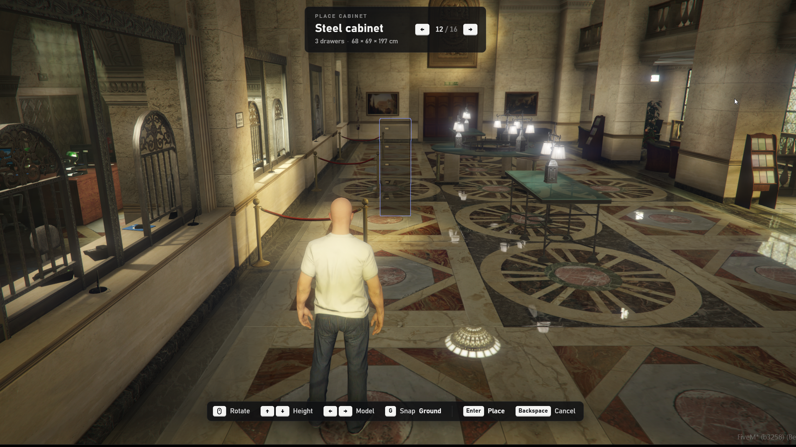

# Placing Cabinets

GTA's own filing cabinets open without any setup. To put cabinets anywhere else, use `/storcreator` in game. No coordinates to copy, no config to edit.

### Who can place

`/storcreator` needs this ACE:

```
add_ace group.admin stor.creator allow
```

On a dev server you can set `devMode = true` in `config/creator.lua` instead: then **every player** may place. Keep it `false` on a live server.


Opening a cabinet needs no permission. The ACE only controls who can place, move and remove cabinets.


***

### The placer

Run `/storcreator`. A see-through copy of the cabinet follows the spot you look at, and the placer screen opens. The card at the top shows the model: steel or wooden cabinet, its number of working drawers, its size, and where it is in the model list. The cabinet starts turned with its drawers toward you.

<figure><figcaption><p>The placer screen with the key bar at the bottom.</p></figcaption></figure>

| Control | Action |
| --- | --- |
| **Mouse wheel** | Rotate (5° per notch) |
| **Arrow Up / Down** | Raise / lower while held (0.5 m per second). Turns ground snap off |
| **Arrow Left / Right** | Previous / next cabinet model |
| **G** | Ground snap on / off |
| **Enter** | Place (or **Move here** when moving) |
| **Backspace** | Cancel |

The server refuses a spot farther than 50 m from you (`maxDistance`). The placer then shows **Too far away** and Enter does nothing until you come closer. All steps and distances are in `config/creator.lua` (see [Creator settings](configuration.md#creator-settings)).

***

### Commands

| Command | What it does |
| --- | --- |
| `/storcreator` | Place a cabinet |
| `/storcreator <model>` | Place, starting on that model, for example `/storcreator prompt_filecab01` |
| `/storcreator move` | Pick up the placed cabinet within 3 m of you and put it down again. The model stays the same |
| `/storcreator remove` | Remove the placed cabinet within 3 m of you. Run it again within 5 seconds to confirm |
| `/storcreator list` | Print every placed cabinet to F8: id, model, distance, position and heading |

`move` and `remove` only work on placed cabinets, not on GTA's own. The command does nothing while you are using a cabinet.

The model names and their drawers and stash sizes are listed in [Cabinet models and stash sizes](configuration.md#cabinet-models-and-stash-sizes).

***

### How placed cabinets work

* Every placed cabinet gets a 6-character id (shown when you place it and in `/storcreator list`).
* Its drawer stashes are named after that id, so a cabinet keeps its contents when you **move** it. Removing a cabinet does not delete its stashes from the inventory; a cabinet placed again gets a new id and new, empty stashes.
* Whoever is using a cabinet when it is moved or removed is sent out of it.
* Each player's game shows a placed cabinet while they are within 60 m of it (`spawnDistance`).

***

### Where placements are saved

Placed cabinets are kept in `data/placements.json` inside the resource folder. The server saves it within 5 seconds of a change and when the resource stops.


Keep `data/placements.json` when you update the resource. A new copy of the folder without it starts with no placed cabinets.


* A row the server cannot use (a model that is no longer in the config, broken coordinates) is skipped with a console line and stays in the file.
* A file the server cannot read (not valid JSON, or not in the expected format) is set aside as `data/placements.broken.json`, and the server starts with no placed cabinets.

Other resources can place and remove cabinets through the `AddPlacement` and `RemovePlacement` exports (see [For Developers](developers.md#exports)).
