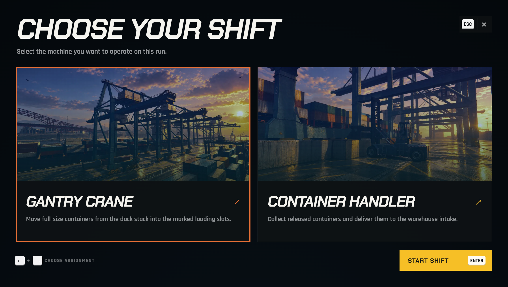

# JetSam Dock Jobs

Four connected jobs at the JetSam docks in the Port of Los Santos. Players **operate a gantry crane** from its cabin, move containers with the **Handler**, run the **warehouse forklift**, and take **truck delivery contracts** across the map in a Mule box truck or a Hauler with trailer.

The jobs feed each other: containers the crane unloads go to the warehouse, every container there becomes pallets for the forklift, and the trucks are loaded from that stock. Each job also works on its own.


The jobs take place on our **JetSam HQ & Warehouses** map (`prompt_jetsam` and `prompt_jetsam_warehouse`). Install and start the map first, or the forklift and truck area has no floor.


<figure><figcaption><p>The port dispatcher: pick the gantry crane or the container handler.</p></figcaption></figure>

***

### Requirements

* FiveM server (recent artifact recommended)
* **JetSam HQ & Warehouses** map: `prompt_jetsam` and `prompt_jetsam_warehouse`. The map needs [`ox_lib`](https://github.com/overextended/ox_lib); this script itself does not.

Optional, detected automatically:

* **Framework**: `qbx_core`, `qb-core` or `es_extended`. Needed for payouts. Without one, every job still works but no money is paid (see [Payments](configuration.md#payments)).
* **Target**: [`ox_target`](https://github.com/overextended/ox_target) or `qb-target`. Without one, players get press-E prompts.

***

### Installation



#### Copy the resource
Drop `prompt_jetsam_script` into your `resources` folder. Keep the folder name: exports and integrations use it.



#### Add to server.cfg
Start it after the JetSam map:
```
ensure prompt_jetsam
ensure prompt_jetsam_warehouse
ensure prompt_jetsam_script
```



#### Admin permission (optional)
Lets admins use the support and developer commands:
```
add_ace group.admin prompt_jetsam_script.admin allow
```



#### Start the server
On the first start the resource creates `hooks/hooks_client.js`, `hooks/hooks_server.js` and `hooks/hooks_shared.js` from the `.example.js` templates. Updates never overwrite them.



***

### First-boot checklist

| Check | What to look for |
| --- | --- |
| Detection | Type `/dock`: it shows the detected framework, target, language and enabled modules |
| Port dispatcher | The **JetSam Dispatch** blip on the map, with the dispatcher at the port |
| Warehouse dispatcher | Inside the JetSam warehouse, offering the forklift and truck jobs |
| Cranes | The gantry cranes stand on the quay when you get close |


The resource streams its own props (cranes, trailer ramp). Restart it only when nobody is near the port, and have players who were online during the first install reconnect.


***

### What's inside

<table data-view="cards"><thead><tr><th>Section</th><th></th><th data-card-target data-type="content-ref">Link</th></tr></thead><tbody><tr><td><strong>The Jobs</strong></td><td>How each job plays, controls and default pay</td><td><a href="jobs.md">jobs.md</a></td></tr><tr><td><strong>Configuration</strong></td><td>config.json reference — pay, shifts, trucks, access, languages</td><td><a href="configuration.md">configuration.md</a></td></tr><tr><td><strong>For Developers</strong></td><td>Hooks, exports, commands, custom bridge</td><td><a href="developers.md">developers.md</a></td></tr><tr><td><strong>Troubleshooting</strong></td><td>No floor, no pay, no prompt, support dump</td><td><a href="troubleshooting.md">troubleshooting.md</a></td></tr></tbody></table>
