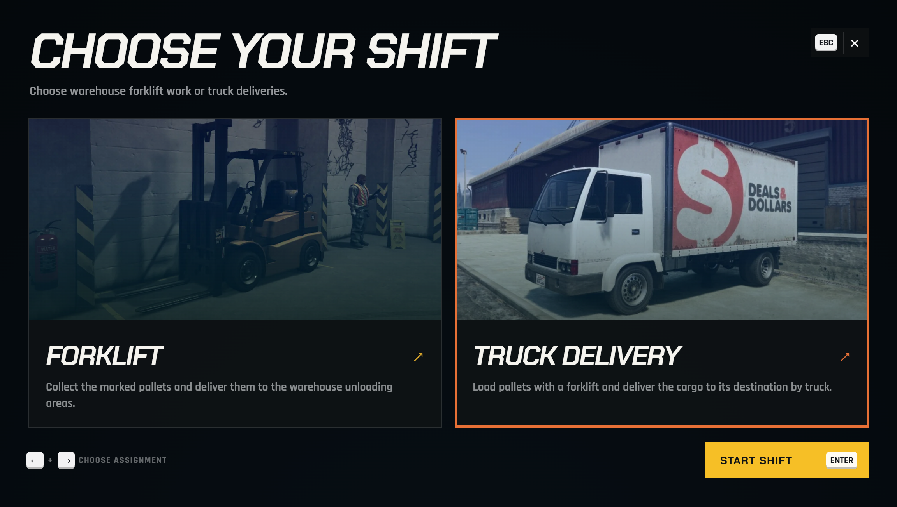
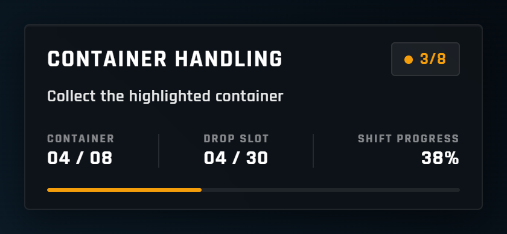
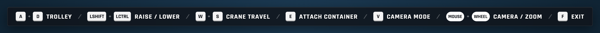
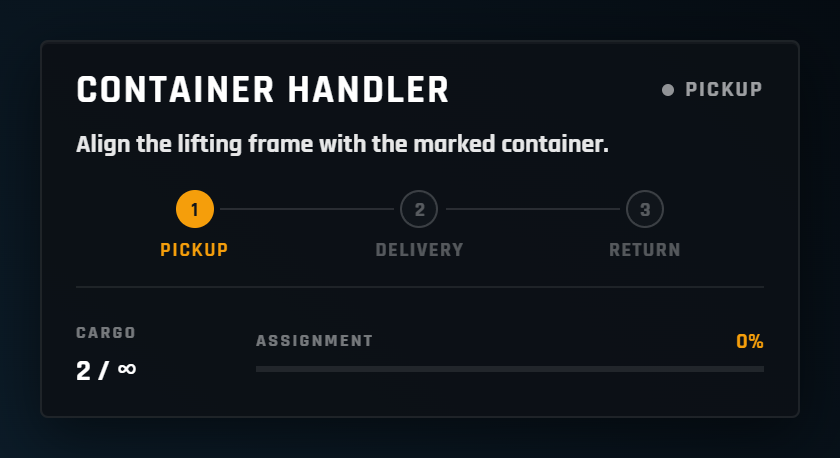
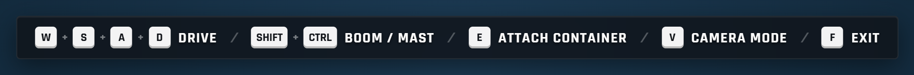
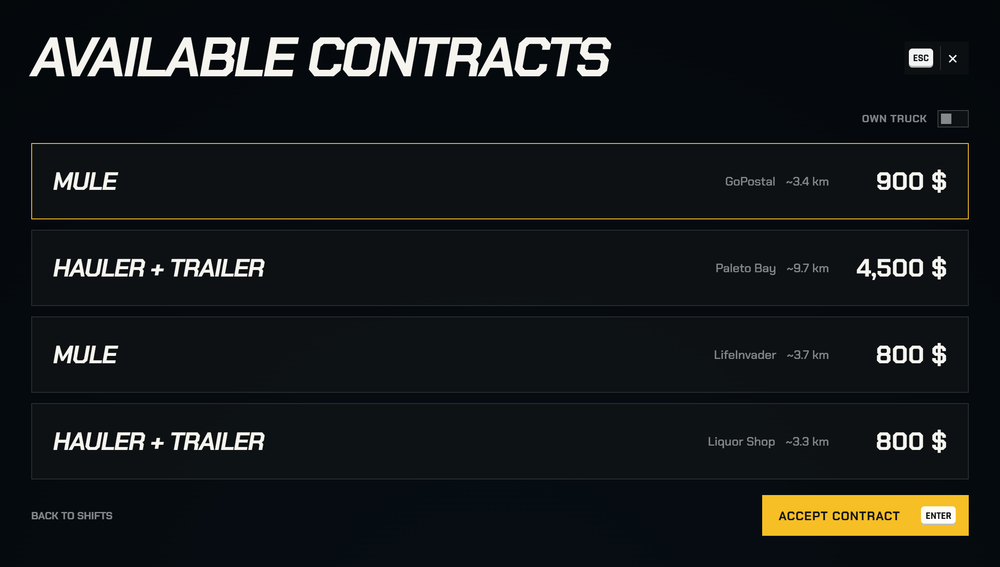
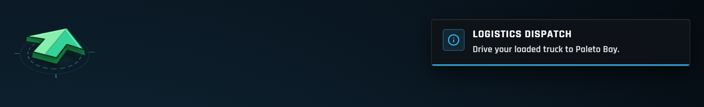
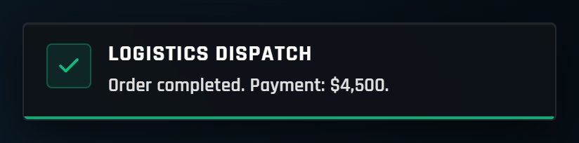

# The Jobs

There are two dispatchers:

| Dispatcher | Where | Jobs |
| --- | --- | --- |
| **Port dispatcher** | At the quay, marked with the **JetSam Dispatch** blip | Gantry crane, container handler |
| **Warehouse dispatcher** | Inside the JetSam warehouse | Warehouse forklift, truck delivery |

Talk to a dispatcher, pick a shift, and end it at the same dispatcher. Out of the box every job is open to everyone; job and ACE locks are optional (see [Access](configuration.md#access-job-locks)).

<figure><figcaption>
The warehouse dispatcher: forklift work or truck deliveries.
</figcaption></figure>

***

### How the jobs connect



#### Gantry crane
The operator moves containers from the dock stack into the marked drop slots on the quay.


#### Container handler
Handler drivers collect the released containers and bring them to the warehouse intake.


#### Warehouse forklift
Every container delivered to the warehouse adds **4 pallets** to the warehouse stock, which forklift drivers move to the unloading areas.


#### Truck delivery
Truck contracts are loaded from the warehouse shelves and the forklift yard stack, then driven to their destination.




Nobody has to be in the chain for a job to work. The handler has its own container supply when no crane is running, and the forklift stock refills itself when it runs empty.


***

### Gantry crane

Enter the **operator cabin** and move containers from the dock stack into the highlighted drop slots. The shift ends when the cargo work is done: bring the trolley back to its start position (the bridge), raise the spreader fully and exit the cabin.

| Key | Action |
| --- | --- |
| **W / S** | Crane travel along the rails |
| **A / D** | Trolley |
| **Left Shift / Left Ctrl** | Spreader up / down |
| **E** | Attach / detach a container |
| **V** | Change camera |
| **Mouse / wheel** | Look around, zoom |
| **F** | Exit the cabin |

Gamepads work too. Keyboard and gamepad bindings can be changed in [Configuration](configuration.md#crane-controls).

<figure><figcaption>
The shift panel: current container, target drop slot and shift progress.
</figcaption></figure>

<figure><figcaption>
The key hints follow the bindings set in the config.
</figcaption></figure>

* Three cranes stand on the quay and can be worked at the same time, one operator each. Everything the crane does is synced for every player nearby.
* A container can only be released on the ground, on another container, or inside the highlighted slot.
* If the drop zone is full, the operator waits until a handler driver clears slots.

**Default pay:** $500 per shift + $350 per container + $750 bonus for finishing the shift.

***

### Container handler

Get into the marked **Handler**, line its lifting frame up with the marked container, pick it up and set it down in the warehouse intake. The dispatcher then marks the next container. To finish, park the Handler in its marked bay, stop and get out.

<figure><figcaption>
The handler panel walks through pickup, delivery and return.
</figcaption></figure>

<figure><figcaption></figcaption></figure>

**Default pay:** $750 per delivered container.

***

### Warehouse forklift

Collect your forklift from its bay, slide the forks under the marked pallet, carry it to the marked unloading area and lower the forks. To finish, return the forklift to its bay, stop and get out.

**Default pay:** $650 per pallet.

***

### Truck delivery

The contract board at the warehouse dispatcher shows the available contracts: destination, vehicle, number of pallets, pickup, distance and pay. Payment is made after the delivery **and** the vehicle return.

<figure><figcaption>
The contract board. Turn on <strong>Own truck</strong> to see only the trailer contracts you can tow yourself.
</figcaption></figure>



1. Take the contract. The truck waits in its loading bay and a forklift is assigned to you. The contract says where to pick up the pallets: the warehouse shelves, the forklift yard stack or both.
2. Bring each pallet to the marked loading position behind the truck, set the forks to the height of the cargo floor and press **E** to load it (3 pallets fit).
3. Park the forklift back in its bay and get out.
4. Drive to the destination and stop inside the delivery area for 3 seconds to unload.
5. Drive back to the depot. A free return bay is assigned when you arrive; stop there and get out.


1. Take the contract. The trailer waits in its loading bay with its ramp down, and a forklift is assigned to you. The contract says where to pick up the pallets.
2. Bring each pallet to the marked loading position behind the trailer and press **E** to load it (7 pallets fit).
3. Park the forklift back in its bay and get out.
4. Take the delivery cab from the cab parking, or bring **your own truck**, and hitch the trailer.
5. Drive to the destination and stop inside the delivery area for 3 seconds to unload.
6. Back the trailer into the assigned return bay, unhitch it and pull the cab clear.
7. Job cab: park it in its marked bay and get out. Your own truck: just drive clear of the bay.



* Any truck that can tow the trailer counts as your own truck. Whether players may use their own truck is set by [`ownCab`](configuration.md#truck-contracts).
* If every return bay is taken, wait in the yard: a bay is assigned as soon as one frees up.
* On the road, an arrow at the top of the screen points to the destination.

<figure><figcaption>
The route arrow and the dispatch message.
</figcaption></figure>

<figure><figcaption>
Paid after the truck is back at the depot.
</figcaption></figure>
* Loading bays have roll-up doors, and a bay that is already occupied is skipped.

**Default pay:** set per destination, from $650 for a city store to $4,500 for Paleto Bay (20 destinations).
