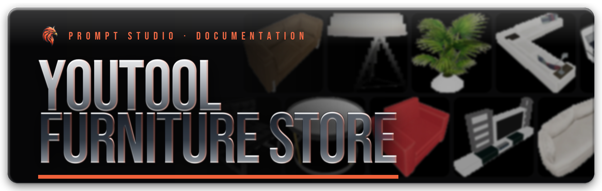

# YouTool Furniture Store

<figure><figcaption></figcaption></figure>

{% embed url="https://portal.cfx.re/assets/granted-assets?page=1&sort=asset.updated_at&direction=asc&search=Prompt%27s+-+YouTool+Furniture+Store" %}
**Official asset for FiveM — available on CFX Portal and** [**Prompt’s Mods Store**](https://store.prompt-mods.com/store/package/7744463)




YouTool Furniture Store turns the YouTool store map into a working furniture shop. Players walk into the store, open a tablet, browse a catalog of more than 2,000 furniture items, and check out. The furniture is delivered into a property they own in your housing script, where they place it with that script's own tools. Every store has an owner who sets the markup, hires staff and keeps the profit in the store's vault. Two stores ship ready to use: Sandy Shores (`youtool_sandy`) and Davis (`youtool_vespucci`).


**Framework:** QBCore, QBox, ESX or standalone, detected automatically.\
**Requires:** `ox_lib`, the `prompt_youtool` store map, and one [supported housing script](housing/README.md).


***

### What it does



#### For players

* Open the tablet anywhere inside the store
* Search, filter and browse by category
* Preview an item in 3D before buying
* Add items or whole furniture sets to the cart; sets come with a discount
* Check out and pick which property gets the delivery
* Optional phone app (lb-phone or sky\_phone) to order without visiting the store

See [Shopping](shopping.md).



#### For store owners

* The Console on the tablet, visible only to staff
* Markup per store, per category or per item
* A vault that collects the store's profit
* Sales history
* Hire staff and create positions with their own permissions
* Place display furniture and price tags in the store
* Stock and freight deliveries (Active mode)

See [Store Console](console/README.md).



#### For server owners

* 11 housing scripts, detected automatically
* Framework money, or a free or custom money mode
* One `Config.EconomyScale` to match your economy
* Corporate tools for base prices and product names
* A setup check in the server console with a support code
* 12 languages, owner hooks, open config files

See [Configuration](configuration.md).

<figure><figcaption>
The tablet shop: categories on the left, search and filters on top, prices on every item
</figcaption></figure>

***

### Requirements

| Resource | Needed? | Notes |
| --- | --- | --- |
| [`ox_lib`](https://github.com/overextended/ox_lib) | **Required** | The only hard dependency. FiveM won't start YouTool without it. |
| `prompt_youtool` | **Required** | The store map: the store interior and the price tag models. |
| A supported housing script | **Required for purchases** | Without one, players can browse but checkout is refused. See the table below. |
| [`ox_target`](https://github.com/overextended/ox_target) or `qb-target` | Recommended | Detected automatically (`Config.interactionMode = 'auto'`). Used for the furniture and the checkout till. The tablet still opens with its key without one. |
| `oxmysql` | Recommended | Most housing scripts need it. The setup check warns when it isn't running. |
| QBCore, QBox or ESX | Optional | Detected automatically. Without a framework (and with the default `Config.MoneySystem = 'auto'`), YouTool runs standalone and nothing costs money. |
| `lb-phone` or `sky_phone` | Optional | Adds the YouTool phone app. See [Phone app](shopping.md#phone-app-lb-phone-or-sky_phone). |

***

### Supported housing scripts

YouTool finds your housing script by its resource name, so keep the folder name as the script ships it. Run only one housing script.

| Housing script | Resource name | Tested with | Setup |
| --- | --- | --- | --- |
| qs-housing | `qs-housing` | 5.2.16 | [qs-housing](housing/qs-housing.md) |
| ps-housing | `ps-housing` | 2.0.7 | [ps-housing](housing/ps-housing.md) |
| nolag\_properties | `nolag_properties` | 2.4.12 | [nolag\_properties](housing/nolag-properties.md) |
| bcs\_housing | `bcs_housing` | 4.24.0 | [bcs\_housing](housing/bcs-housing.md) |
| rtx\_housing | `rtx_housing` | 30.6 | [rtx\_housing](housing/rtx-housing.md) |
| RxHousing (rxscripts) | `RxHousing` or `rxscripts_housing` | 2.5.0 | [RxHousing](housing/rxhousing.md) |
| vms\_housing | `vms_housing` | 1.5.1 | [vms\_housing](housing/vms-housing.md) |
| brutal\_housing | `brutal_housing` | 2.1.0 | [brutal\_housing](housing/brutal-housing.md) |
| rcore\_housing | `rcore_housing` | 1.1.4 | [rcore\_housing](housing/rcore-housing.md) |
| prp-property | `prp-property` | 1.1.0 | [prp-property](housing/prp-property.md) |
| kartik-properties | `kartik-properties` | Not tested in-game yet | [kartik-properties](housing/kartik-properties.md) |


`qb-houses`, `esx_property`, `loaf_housing`, `origen_housing` and `jg-housing` are **not supported**. The setup check tells you when it finds one of them.


***

### Quick start

1. Put `prompt_youtool` and `prompt_youtool_store_system` in your resources and add them to `server.cfg` after their dependencies.
2. Do the install step for your housing script.
3. Give yourself the `youtool.admin` ACE and make someone the owner of each store with `youtool_setowner`.
4. Restart and read the setup check in the server console.

The full steps are on the [Installation](installation.md) page.

***

### Where to next

* [Installation](installation.md): server.cfg order, store owners, the setup check, updating
* [Housing Integrations](housing/README.md): install steps for each housing script
  * [qs-housing](housing/qs-housing.md), [ps-housing](housing/ps-housing.md), [nolag\_properties](housing/nolag-properties.md), [bcs\_housing](housing/bcs-housing.md), [rtx\_housing](housing/rtx-housing.md), [RxHousing](housing/rxhousing.md), [vms\_housing](housing/vms-housing.md), [brutal\_housing](housing/brutal-housing.md), [rcore\_housing](housing/rcore-housing.md), [prp-property](housing/prp-property.md), [kartik-properties](housing/kartik-properties.md)
* [Shopping](shopping.md): the tablet, cart, sets, checkout and phone app
* [Store Console](console/README.md): the staff side of the tablet
  * [Staff & Permissions](console/staff-and-permissions.md)
  * [Markup, Vault & Sales](console/markup-vault-sales.md)
  * [Stock & Freight](console/stock-and-freight.md)
* [Configuration](configuration.md): every setting in `config.lua` and `config/`
* [Commands & Permissions](commands.md)
* [Catalog & Custom Furniture](catalog.md)
* [Languages](languages.md)
* [For Developers](developers/README.md)
  * [Hooks](developers/hooks.md)
  * [Exports & Events](developers/exports-and-events.md)
* [Troubleshooting](troubleshooting.md): the setup check explained, common problems, getting support
