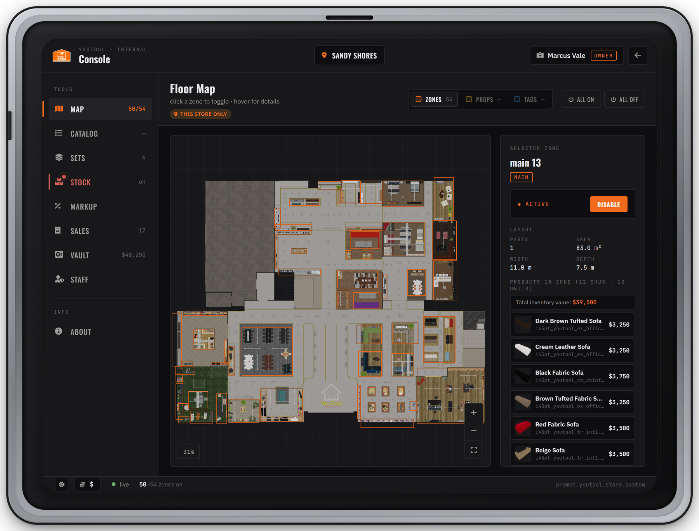

# Store Console

The **Console** is the manager mode of the same tablet players shop with. Store staff use it to run their store: turn showroom zones on and off, curate the catalog, build furniture sets, order stock, set the markup, read sales, manage the vault and hire staff.


Everything in the Console is **per store** and checked by the server. You only see the tools your position allows, and you can only manage the store you are standing in. Set up the owner first: see [Staff & Permissions](staff-and-permissions.md).


***

### Opening the Console

1. Walk into the store and open the tablet (`E`).
2. Press **CONSOLE** in the tablet header.
3. After a short sign-in screen the Console opens on the Floor Map. The arrow at the top right takes you back to the shop.

**Who sees the CONSOLE button:** anyone who holds at least one of these permissions at this store: `markup.view`, `markup.edit`, `delist.edit`, `sets.view`, `sets.edit`, `stock.view`, `stock.order`, `freight.dispatch`, `freight.cancel`, `placements.edit`, `zones.edit`, `vault.view`, `vault.withdraw`, `sales.view`, `staff.view`, `staff.edit`. Corporate admins (the `youtool.admin` ACE) see it too. Customers never do.

`markup.negative`, `freight.unload` and `vault.deposit` don't open the Console by themselves. A dock worker with only `freight.unload` unloads freight without it.

Staff with `placements.edit` can also aim at any catalog furniture in the store and pick **Edit in Manager**. The Console opens straight on that product in the Catalog.

**The sign-in screen** is a short animation with no password. It shows your character name and your position at this store: the owner sees **Owner**, staff see their position's name, and a corporate admin who isn't on the store's staff sees **Corporate**. The same name and position stay in the Console header next to the store name.

**Store scope.** Every tab works on the store you are standing in, marked **This store only**. The tablet only opens inside a store, and the server refuses changes for a store you are not in. Base prices and product names in the Catalog are the exception: they apply to all stores (see [Catalog](#catalog)).

***

### The sidebar

Tabs you have no permission to view are hidden. Controls you can see but not use are locked: hover them to read "Requires: …", and a **Read-only** banner shows on tabs you can view but not change.

| Tab | Shown with | Use it for |
| --- | --- | --- |
| Map | always | Showroom zones |
| Catalog | always | Products, visibility, displays |
| Sets | `sets.view` | Furniture bundles |
| Stock | `stock.view` | Stock levels and freight |
| Markup | `markup.view` | The store's margin |
| Sales | `sales.view` | Sales History |
| Vault | `vault.view` | The store's money |
| Staff | `staff.view` | Roster and positions |
| About | always | Info page |

#### Map

The **Floor Map** of the store. Turn zones of display furniture on and off for this store. Details in [Floor Map](#floor-map) below.

#### Catalog

The full product list with search, filters and sorting. Staff with `delist.edit` hide or show products at this store; `markup.edit` sets a markup for a single item; `placements.edit` uses **Place Display** to put the product in the showroom (see [Displays and price tags](#displays-and-price-tags)). Base prices and product names are corporate tools: they need the corporate admin ACE and apply to every store. **Add Product** only keeps a draft in your own game client; to add a product for real, see [Catalog & Custom Furniture](../catalog.md#adding-your-own-furniture).

#### Sets

Create furniture sets (bundles sold at a discount), place them in the showroom and remove them again. Needs `sets.view` to see and `sets.edit` to change. See [Sets in the showroom](#sets-in-the-showroom).

#### Stock

Stock bars per stock class and the freight order panel, paid from the store vault. Only used with `Config.EconomyMode = 'Active'`; in Passive mode the tab says stock is infinite. See [Stock & Freight](stock-and-freight.md).

#### Markup

The store's margin on top of the corporate price: one global value and one per category. See [Markup, Vault & Sales](markup-vault-sales.md).

#### Sales

Every completed sale at this store, newest first, with revenue and store profit. See [Markup, Vault & Sales](markup-vault-sales.md).

#### Vault

The store's balance, withdraw to your bank, deposit from your bank, and recent activity. See [Markup, Vault & Sales](markup-vault-sales.md).

#### Staff

The roster and the store's positions with their permissions. See [Staff & Permissions](staff-and-permissions.md).

#### About

A short information page about the Console.

**Footer.** The sun/moon button switches the Console theme. The coin button changes the currency symbol shown in **your own** Console only (saved on your PC). The symbol customers see comes from `Config.PriceAtlas.currency` and `Config.PriceTags.currency` in `config/price_tags.lua`.

***

### Floor Map

<figure><figcaption>
Floor Map: the store's zones, with the selected zone's status, size and products on the right
</figcaption></figure>

The store map is split into **zones**: blocks of display furniture built into the store interior. Every zone starts **on**. Turning a zone off removes that furniture from the store for every player, until it is turned on again. Each store keeps its own zone state (saved in `data/entity_set_state.json`).

* **Hover** a zone to see its name and whether it is on or off.
* **Click** a zone to select it. The panel on the right shows:
  * **Active / Inactive** with an **Enable** / **Disable** button (needs `zones.edit`).
  * **Layout:** number of parts, area, width and depth.
  * **Products in zone:** the catalog products in that zone with their prices and the total inventory value. Click a product to open it in the Catalog.
  * **Unlisted props:** furniture in the zone that is not in the catalog.
  * The zone's entity set name.
* **All on** / **All off** switch every zone at once (needs `zones.edit`).
* **Layers:** **Zones** shows or hides the zone outlines on the map. **Props** and **Tags** are shown greyed out and can't be switched in this version.
* **Zoom and pan:** mouse wheel or the **+** / **−** buttons to zoom, the frame button to fit the map, drag to pan.

The zone counter (for example `50/54`) on the Map tab and in the footer shows how many zones are on.

***

### Displays and price tags

On top of the furniture built into the store, staff with `placements.edit` can place their own **display furniture** anywhere in the store, each with an optional **price tag** that shows the live price.



#### Pick the product

Open the Console › **Catalog**, select a product and press **Place Display**. Or aim at that product in the store and pick **Edit in Manager**, then **Place Display**.



#### Position the display

The tablet closes and a see-through copy follows where you look. The controls are shown on screen:

| Key | Action |
| --- | --- |
| Mouse wheel | Rotate |
| `G` | Switch snapping between **Ground** (sits on the floor) and **Free** |
| `Enter` | Place |
| `Backspace` | Cancel |



#### Attach a price tag (optional)

The **Attach a price tag?** menu offers:

* **Large Tag** — item name and price
* **Small Tag** — price only
* **Skip — no tag**

Each option shows how many tags are left. Position the tag with the same keys. It starts in Free mode, so it doesn't drop to the floor.



#### Done

"Display placed" appears and the tablet opens again. Everyone in the store sees the display and its tag.



**Changing a display.** Aim at a display you placed and pick **Manage Display**:

* **Remove Display** — removes it and frees its tag.
* **Change Item** — enter a catalog item ID; the display switches to that product and its tag shows the new name and price.
* **Remove Price Tag** / **Attach Price Tag** — take the tag off, or add one to a display that has none.

Price tags always show this store's price, markup included, and update by themselves when a price or the markup changes. The currency symbol is `Config.PriceTags.currency` in `config/price_tags.lua`.

Limits per store: 416 large tags, 416 small tags (the tag props in the `prompt_youtool` map) and 600 displays. "No large tags available" means every tag of that size is in use: remove tags you don't need. Displays and tags are saved in `data/store_placements.json`.


Displays, price tags and showroom sets need `Config.PriceTags.enabled = true` in `config/price_tags.lua`. Sets also need `Config.Sets.enabled = true` in `config/sets.lua`.


***

### Sets in the showroom

A **set** is a bundle of furniture sold together at a discount. Each store has its own sets.



#### Create the set

Console › **Sets** › **New Set** (needs `sets.edit`). Give it a name (1–40 characters) and a discount (0–100 %). Click products in **Add from Catalog** to add them (search, category pills and sort help); click again or use **+** / **−** to change quantities. A set needs at least two different products. **Set Total** shows the normal total, the set price and the saving. Press **Save Set**.



#### Place it

On the set's card press **Place**. The tablet closes and you position each piece in turn, with the same keys as a display. The help text shows the set name, the piece and your progress (for example `2/5`). `Backspace` skips a piece.



#### Add the set price tag

After the last piece, **Place a set price tag?** asks for one tag for the whole set. **Place tag**, choose Large or Small and position it, or **Skip**. The tag shows the set name and the set price.



#### Check the card

"Set "name" placed". The card now shows **N placed in store**. Expand it to see each placement. A placement with skipped pieces shows **partial · 3/5 placed** and its tag adds "(partial)". Press **Complete** to place only the missing pieces.



Managing sets:

* **Edit** changes the name, discount or items. If you remove items or lower a quantity, extra pieces already placed in the store are removed; added items mark placements partial until you **Complete** them.
* The **×** next to a placement removes that placement (its pieces and tag) after **Yes**.
* The trash icon deletes the set and every placement of it.
* In the store, staff with `sets.edit` can aim at a set's price tag and pick **Manage Set Display** › **Remove Set Display**.
* Customers buy a placed set with **Add Set to Cart** or **View Set** on any of its pieces.

Placing a set's pieces needs `placements.edit` as well as `sets.edit`.

| Option (`config/sets.lua`) | Default | Meaning |
| --- | --- | --- |
| `Config.Sets.enabled` | `true` | Turn furniture sets on or off |
| `Config.Sets.maxItemsPerSet` | `20` | Different products one set may contain |
| `Config.Sets.maxInstancesPerStore` | `50` | Sets placed in the showroom, per store |
| `Config.Sets.maxDefinitions` | `100` | Sets one store can have |


A set is never sold below the **corporate cost** of its items. If the discount would push the price lower, checkout charges the corporate cost instead, which is more than the set price shown in the tablet. This happens when the discount is bigger than the store's margin allows: at a 20 % markup, any discount above about 16.7 % hits the floor. Keep set discounts within what the store's markup covers.


***

I don't see the CONSOLE button

You hold no Console permission at **this** store. The store owner has to hire you into a position with at least one Console permission (see the list under [Opening the Console](#opening-the-console)). Positions are per store, so staff of one store see nothing in another. Open and close the tablet again after you are hired.

I'm the server owner but only see Map, Catalog and About

The corporate admin ACE gives you the corporate catalog tools, not store permissions. To run a store yourself, make yourself its owner with `youtool_setowner`. See [Staff & Permissions](staff-and-permissions.md#corporate-admin-vs-store-roles).

A button is greyed out

Your position doesn't include the permission it needs. Hover it to see which one, then ask the owner (or anyone with `staff.edit` above your rank) to add it to your position.

"No large tags available" / "No small tags available"

All tags of that size are in use in this store. Remove price tags you don't need (**Manage Display** › **Remove Price Tag**) or use the other size.

