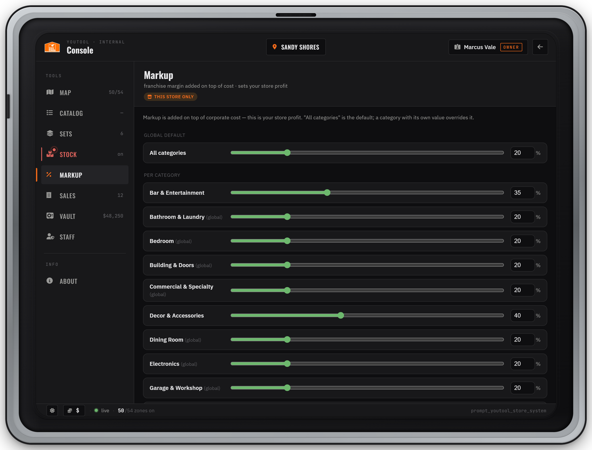
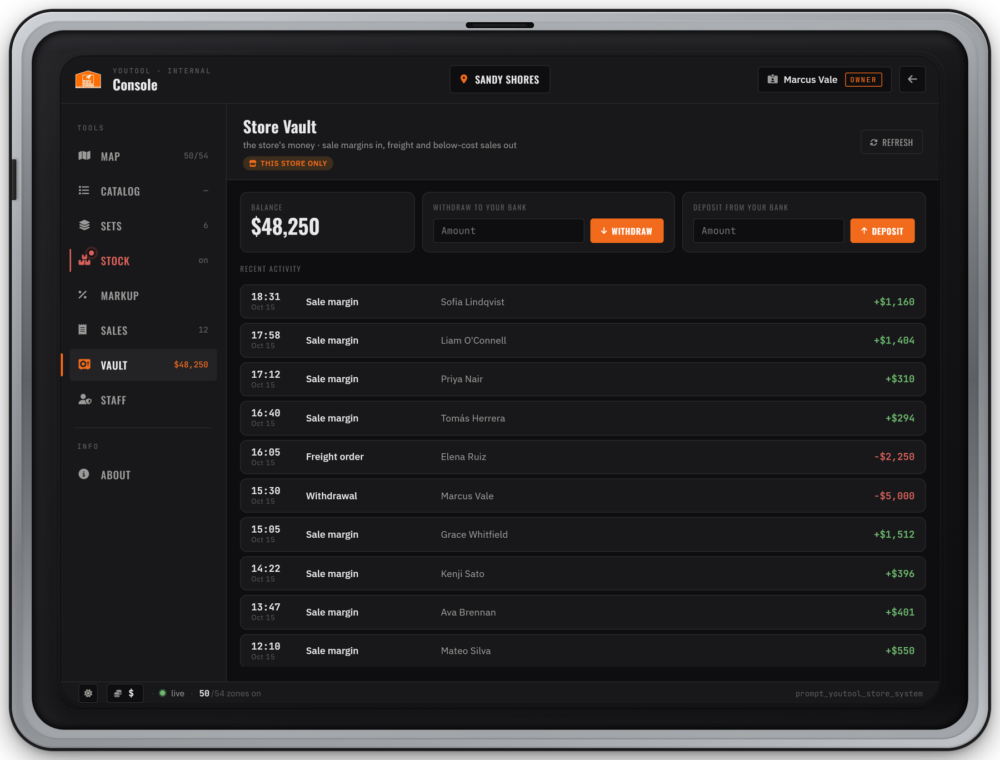
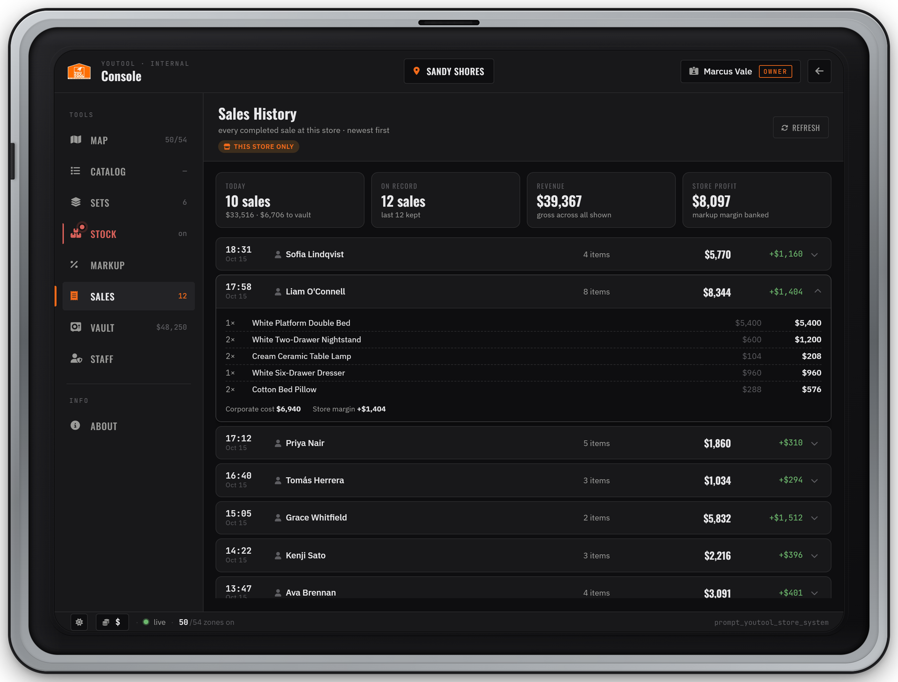

# Markup, Vault & Sales

Every YouTool store makes its money through **markup**: a percentage on top of the catalog's base price. On each sale the base price goes to corporate and the markup margin goes into that store's **vault**. Three Console tabs manage this: **Markup** (set your margin), **Vault** (the store's money) and **Sales** (what sold and what it earned).


Everything on this page is **per store**. Each store has its own markup, its own vault and its own sales history, and you only see the store you are standing in. How to open the Console is on the [Store Console](README.md) page.


***

## How the money flows

```
price the customer pays = base price × Config.EconomyScale × (1 + markup % / 100)
corporate base          = base price × Config.EconomyScale
store margin            = price paid − corporate base   → the store vault
```

The customer pays the full price from their **bank**. YouTool keeps the corporate base and puts the margin into the vault of the store that made the sale. For a phone order, that is the store the buyer picked in the app.

### Selling above cost

Base price $1,000, `Config.EconomyScale = 1.0`, markup **+20%**:

```
Customer pays $1,200 from their bank
   ├── $1,000  corporate base  → removed from the economy
   └──   $200  markup margin   → store vault  (+$200, "Sale margin")
```

With `Config.EconomyScale = 10.0` the same item costs $12,000: $10,000 corporate base, $2,000 to the vault.

### Selling below cost

Markup **−10%** on the same item:

```
Customer pays $900 from their bank
   corporate base is still $1,000
   └── the store vault pays the missing $100  (−$100, "Below-cost sale")
```

* Only a position with the `markup.negative` permission can set a markup below 0%.
* Before the customer is charged, YouTool checks that the vault can pay the loss. If the vault has less than $100 here, the checkout is refused with *"This store cannot cover its discount right now. Try again later."*
* The loss is taken from the vault **before** the customer pays. If the payment fails or nothing could be delivered, the money goes back to the vault ("Below-cost sale returned").

### Mixed orders are netted

The below-cost check runs on the **whole order**, not item by item. Items sold above cost pay for the ones sold below it.

| Order | Customer pays | Corporate base | Vault |
| ----- | ------------- | -------------- | ----- |
| Table $1,000 at +20% and lamp $500 at −10% | $1,200 + $450 = **$1,650** | $1,500 | **+$150** (one "Sale margin" entry, no vault check) |
| Table $1,000 at +5% and sofa $1,000 at −20% | $1,050 + $800 = **$1,850** | $2,000 | **−$150** (vault must hold at least $150) |

### Partial deliveries

The customer is only billed for what actually arrives. Items the store has no stock for (Active stock mode) are never charged. Items the housing script couldn't take are refunded at their own price. The vault gets the margin only for the items that arrived.

### Sets

A furniture set's discount comes out of the store's margin. At checkout a set is never charged less than the corporate cost of its items, so a set discount larger than the markup on those items stops at the corporate cost.

### Where corporate's share goes

Nowhere. The corporate base is **not paid into any account** (no society, boss menu or admin account). It leaves your server's economy, which keeps furniture from creating money. Only the margin stays in play, in the store vault.

***

## Markup tab

<figure><figcaption><p>The Markup tab: one global default and one value per category</p></figcaption></figure>

The tab has two sections:

* **Global default** (*All categories*): the markup for every category that has no value of its own.
* **Per category**: one row per catalog category. A row marked *(global)* follows the global default. Once you set a value on a category, it overrides the global default.

A single product can have its own markup too. Open the **Catalog** tab, select the product and change **Item markup**. That value replaces the category markup for this product only (the field is not shown for custom products you added yourself). There is no "reset" for an item or category value. Once set, it keeps overriding until you change it.

YouTool picks the markup for an item in this order: **item value → category value → global default**.

**Editing:** drag the slider or type a number. The value saves about half a second after you let go or stop typing, and a notice confirms it (*"Markup [global] set to 20%"*). Markup is a whole percent. The slider covers 0–100% (−100% to 100% if you may sell below cost). Type in the box for values above 100%.


Positions without `markup.edit` see the tab read-only. Positions without `markup.negative` can't go below 0%, and the server rejects it anyway (*"Not authorized to sell below cost"*).


### Starting values and the cap


```lua
Config.Markup = {
  global = 0,          -- % for every category without its own entry below
  categories = {
    -- ['Bar & Entertainment'] = 25,
  },
  maxPercent = 0,      -- highest markup % a manager may set; 0 = no cap (hard ceiling 10000%)
}
```


| Option | Default | Meaning |
| ------ | ------- | ------- |
| `global` | `0` | Starting global markup in %. `0` sells at base price (no store profit). |
| `categories` | `{}` | Starting markup per category, keyed by the exact category name from the catalog. |
| `maxPercent` | `0` | Highest markup anyone may set (global, category or item). `0` = no cap; the hard ceiling is 10000%. The Markup tab shows *"Server cap: max N%."* when a cap is set. |

The lowest possible markup is **−100%** (the item is free and the vault pays the whole base price).


`Config.Markup` only gives **starting values**. As soon as someone changes a store's markup in the Console, that store's values are saved to `data/markup.json` and win from then on. Editing `Config.Markup` later does not change a store that already has saved markup. Change it in the Markup tab instead.


### Price tags and price boards update live

When a store's markup changes, every player inside that store sees the new prices right away: the open tablet and cart, the price tags managers placed next to display furniture, set bundle tags and the price boards built into the store. Players in the other store are not affected.


```lua
Config.PriceTags = {
  enabled  = true,
  currency = { symbol = '$', position = 'before' },
}

Config.PriceAtlas = {
  enabled  = true,
  currency = { symbol = '$', position = 'before' },
}
```


| Option | Default | Meaning |
| ------ | ------- | ------- |
| `PriceTags.enabled` | `true` | Price tags that managers place next to display furniture. Each shows the live price including markup. |
| `PriceTags.currency` | `'$'`, `'before'` | Currency symbol and its position: `'before'` ($100) or `'after'` (100€). |
| `PriceAtlas.enabled` | `true` | Draws live prices on the store's built-in price boards. `false` means the script doesn't draw board prices; keep it `true`. |
| `PriceAtlas.currency` | `'$'`, `'before'` | As above, for the price boards. |

***

## Vault tab

<figure><figcaption><p>The Vault tab: balance, withdraw to bank, deposit from bank, last 50 entries</p></figcaption></figure>

Each store has its own vault. It starts at **$0** and fills with sale margins. It pays for freight orders and below-cost sales (see [Stock & Freight](stock-and-freight.md)).

| Part | What it does |
| ---- | ------------ |
| **Balance** | The vault's current money. |
| **Withdraw to your bank** | Moves an amount from the vault into **your own** bank account. Needs `vault.withdraw`. |
| **Deposit from your bank** | Moves an amount from **your own** bank into the vault, for example to fund freight or a below-cost sale. Needs `vault.deposit`. |
| **Recent activity** | The last **50** vault entries, newest first: time, type, who, amount. |

Rules:

* Amounts are whole dollars, at least $1.
* You can't withdraw more than the balance (*"Insufficient vault balance ($X)"*), and the vault never goes below $0.
* A deposit needs the money in your bank (*"Not enough money in your bank"*). The bank is charged first; the vault only grows once the money has left you.
* One withdraw or deposit per second per player.
* The boxes are hidden for positions without the matching permission. The balance updates live for everyone with the tab open.

### Ledger entry types

| Entry | Amount | When it appears |
| ----- | ------ | --------------- |
| **Sale margin** | + | A completed sale: the markup margin of the items that arrived. |
| **Below-cost sale** | − | A sale below cost: the vault paid corporate the difference. |
| **Below-cost sale returned** | + | The buyer's payment failed or nothing could be delivered, so the below-cost amount came back. |
| **Freight order** | − | A restock order. In delivery modes other than `instant` it also includes the unloading wages reserved for the order (when wages are paid from the vault). |
| **Freight refund** | + | A cancelled order's refund, or the reserved wage money left over after the last pallet is unloaded. |
| **Withdrawal** | − | Someone moved money to their bank. |
| **Deposit** | + | Someone moved money in from their bank. |

The *who* column shows the character name. Automatic refunds show `system`. Vault data is saved in `data/store_vaults.json`, which keeps the last 100 entries per store.

***

## Sales History tab

<figure><figcaption><p>Sales History: today, on record, revenue and store profit, with expandable sales</p></figcaption></figure>

Every completed sale at this store, newest first. Four cards sit on top:

| Card | Shows |
| ---- | ----- |
| **Today** | Number of sales today (by your PC's date), what they took in, and how much went to the vault. |
| **On record** | How many sales are kept. |
| **Revenue** | What customers paid, across all kept sales. |
| **Store profit** | The markup margin banked, across all kept sales. Below-cost sales subtract. |

Each row shows the time and date, the buyer's character name, how many items arrived, what the buyer paid, and the store margin (red when negative). Click a row to expand it:

* one line per item: quantity, name, price each, line total (up to 30 different items, then *"+ N more item(s) not itemised"*);
* **Corporate cost**, **Store margin** and, if any, **Refunded**.

A badge like **3/5** next to the item count means fewer items arrived than were ordered: the store had no stock for some (never charged), or the housing script couldn't take them (refunded). A checkout where nothing arrived is refunded in full and not listed.

The history keeps the **last 200 sales per store** (`data/store_sales.json`). Older sales drop off, so Revenue and Store profit cover those 200, not the store's whole life. Use **Reload sales** to refresh the list.

***

## Permissions

Owners set these per position in the [Staff tab](staff-and-permissions.md). Defaults for a new store:

| Permission | Lets a position | Owner | Manager | Worker |
| ---------- | --------------- | :---: | :-----: | :----: |
| `markup.view` | Open the Markup tab | ✓ | ✓ | – |
| `markup.edit` | Change global, category and item markup | ✓ | ✓ | – |
| `markup.negative` | Set markup below 0% (sell below cost, paid by the vault) | ✓ | – | – |
| `vault.view` | Open the Vault tab: balance and ledger | ✓ | ✓ | – |
| `vault.withdraw` | Withdraw from the vault to their own bank | ✓ | ✓ | – |
| `vault.deposit` | Deposit from their own bank into the vault | ✓ | ✓ | – |
| `sales.view` | Open the Sales History tab (buyer names and margins) | ✓ | ✓ | – |


Managers can **withdraw** from the vault by default. If only the owner should take money out, untick `vault.withdraw` on the Manager position.


Server owners can add their own rules on top (for example, a withdraw limit) with [Hooks](../developers/hooks.md).

***

## FAQ

<details>

<summary>Checkout says "This store cannot cover its discount right now"</summary>

The order as a whole is priced below corporate cost (negative markup) and the vault holds less than the difference. Deposit money into the vault, raise the markup, or wait for sales above cost to fill the vault.

</details>

<details>

<summary>I changed <code>Config.Markup</code> but the prices didn't change</summary>

The store already has saved markup in `data/markup.json`, and saved values win over the config. Change the markup in the Console's Markup tab.

</details>

<details>

<summary>The vault isn't growing</summary>

At 0% markup the customer pays exactly the corporate base and the margin is $0. Set a markup above 0% in the Markup tab.

</details>

<details>

<summary>Where does the corporate base go? Can it go to a job account?</summary>

It is removed from the economy on purpose and is not paid into any account. Only the store margin stays in play, in the vault.

</details>
