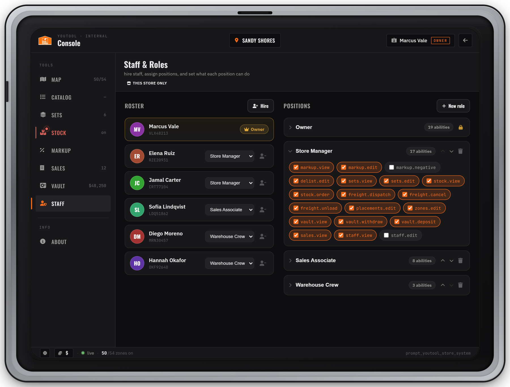

# Staff & Permissions

Every YouTool store has its own **owner**, its own **staff** and its own **positions** (roles). The owner decides what each position may do, permission by permission, in the Console's **Staff** tab. The server checks every action against these permissions; the tablet only hides what you can't use.


There are two kinds of access, and they don't overlap:

* **Store positions** — per store, set in the Staff tab. They run the store: markup, stock, vault, sets, displays, staff.
* **Corporate admin** — the `youtool.admin` ACE, server-wide. It changes the catalog for all stores (base prices, product names, new products). It gives **no** store permissions. See [Corporate admin vs store roles](#corporate-admin-vs-store-roles).


***

### Set the store owner

A new store has no owner, so nobody can open its Staff tab yet. You (the server owner) assign one.



#### Find the store id

Store ids are the `id` values in `Config.Stores` in `config.lua`. The two shipped stores are `youtool_sandy` (Sandy Shores) and `youtool_vespucci` (Davis).



#### Run the command in the server console

```
youtool_setowner <playerId|citizenid> <storeId>
```

Use the server id of an online player, or their character identifier: the `citizenid` on QBCore and QBox, the ESX `identifier` on ESX, the `license:` identifier on a standalone server.

```
youtool_setowner 3 youtool_sandy
```

The console confirms:

```
[YouTool Roles] ABC12345 is now OWNER of youtool_sandy
```



#### The owner takes over

The owner walks into the store, opens the tablet, presses **CONSOLE** and opens **Staff**. From here on the owner hires and manages everyone else.



What to know about the owner:

* Each store has exactly one owner. Running `youtool_setowner` again for the same store replaces the owner; the previous owner keeps no access there.
* The owner holds every permission at that store and can't be fired, demoted or edited from the Staff tab.
* Ownership is per store. The owner of Sandy Shores has no rights in Davis unless you make them owner or staff there too.
* Corporate admins can also run `youtool_setowner` in-game. It's a restricted command, so their group also needs FiveM's command permission (most `server.cfg` files already have `add_ace group.admin command allow`). The confirmation still prints to the server console.

***

### The Staff tab

<figure><figcaption><p>Staff &amp; Roles: the roster with each person's position, and the positions with their permissions</p></figcaption></figure>

Open it with Console › **Staff** (needs `staff.view`; changing anything needs `staff.edit`).

* **Roster** (left): the owner, marked with a crown, then every staff member with their name, identifier, a position dropdown and a remove button.
* **Positions** (right): one card per position, most senior first, with the number of permissions ("abilities"). Click a card to open its permission list. Hover a permission to read what it does.

Without `staff.edit` the tab is read-only. Positions at or above your own show a lock.

***

### Hire, move and fire staff



#### Press Hire

**Hire nearby** lists players within 10 m of you, with their name and distance. The owner and people already on staff are left out. Walk up to the person and press **Rescan** if they're missing.



#### Pick a position and hire

Choose the position from the dropdown next to the player and press **Hire**. You can only pick positions below your own.

To hire someone who isn't next to you, press **Enter ID** and type their Citizen ID (on ESX the ESX identifier, on standalone the license). They are hired into the lowest position you can assign; change it afterwards with the dropdown.



* **Change a position:** use the dropdown on the person's roster card.
* **Fire:** the remove button on their roster card.
* Changes apply at once. A newly hired player sees the **CONSOLE** button the next time they open the tablet.
* **Enter ID** doesn't check that the ID exists. A typo adds an entry nobody can use; remove it from the roster.
* A store holds at most **100** staff.

***

### Positions

Every store starts with three positions:

| Position | Permissions |
| --- | --- |
| **Owner** | All of them. Locked: always at the top, can't be edited, deleted or given to staff. Belongs to the store owner. |
| **Manager** | Everything except `staff.edit` and `markup.negative` (17 permissions). |
| **Worker** | `stock.view` and `freight.unload`. |

Manager and Worker are normal positions: rename them, change their permissions, move or delete them.

* **New role** asks for a name (1–32 characters, no `<` or `>`). The new position goes to the bottom of the list with no permissions. Open its card and tick the permissions it should have.
* **Rename:** click the name on the card and type.
* **Order:** the up and down arrows move a position. Higher means more senior, which decides who can manage whom (below).
* **Delete:** the trash icon. A position can only be deleted when nobody holds it ("Reassign this role's staff before deleting it").
* A store holds at most **30** positions, the Owner position included.

#### Who can change what

The owner can change everything at their store. Anyone else with `staff.edit` works under these rules:

* You can only manage positions **below** your own, and only hire, move or fire people whose position is below yours.
* You can't edit your own position, change your own position or fire yourself.
* You can't give a position a permission you don't hold yourself, or hire someone into a position that has one.
* You can't move a position up to your own level or above.

A corporate admin who is also on a store's staff with `staff.edit` counts as above every position at that store.

***

### Permission reference

All 19 permissions, in the order the Staff tab lists them:

| Permission | What it allows | Notes |
| --- | --- | --- |
| `markup.view` | See the store's markup in the Markup tab | Shows the Markup tab |
| `markup.edit` | Change the markup: global, per category, and per item in the Catalog | |
| `markup.negative` | Set a markup below 0 %, selling under cost. The vault pays corporate the difference on every sale | Needs `markup.edit` too. See [Markup, Vault & Sales](markup-vault-sales.md) |
| `delist.edit` | Hide or show products at this store (Catalog visibility) | |
| `sets.view` | See the store's furniture sets | Shows the Sets tab |
| `sets.edit` | Create, edit and delete sets; place, complete and remove them in the showroom | Placing pieces also needs `placements.edit` |
| `stock.view` | See stock levels (Active stock mode) | Shows the Stock tab |
| `stock.order` | Order freight to restock, paid from the vault | Ordered in the Stock tab |
| `freight.dispatch` | Send out the delivery truck for a shipment | In the Stock tab |
| `freight.cancel` | Cancel a shipment in progress | In the Stock tab |
| `freight.unload` | Unload delivered pallets at the dock and earn the unload wage | Works without the Console |
| `placements.edit` | Place, change and remove display furniture and price tags; the **Edit in Manager** target | See [Store Console](README.md#displays-and-price-tags) |
| `zones.edit` | Turn Floor Map zones on and off | See [Floor Map](README.md#floor-map) |
| `vault.view` | See the vault balance and its activity | Shows the Vault tab |
| `vault.withdraw` | Withdraw vault money to your own bank | In the Vault tab, so also give `vault.view` |
| `vault.deposit` | Deposit money from your own bank into the vault | In the Vault tab, so also give `vault.view` |
| `sales.view` | See Sales History: who bought what, and the margin on each sale | Shows the Sales tab |
| `staff.view` | See the roster and positions | Shows the Staff tab |
| `staff.edit` | Hire, fire, assign positions, create, rename, order and delete positions, change permissions | Also give `staff.view` so the tab shows |

Stock, freight and vault details are on [Stock & Freight](stock-and-freight.md) and [Markup, Vault & Sales](markup-vault-sales.md).


Need rules that permissions can't express, such as a withdrawal limit or blocking staff changes at certain hours? Use the server hooks (`vault.canWithdraw`, `staff.canEdit` and others). See [Hooks](../developers/hooks.md).


***

### Corporate admin vs store roles

Corporate admin is an ACE, `youtool.admin` by default (`Config.Roles.corporateAce` in `config.lua`). Grant it in `server.cfg`:


```cfg
add_ace group.admin youtool.admin allow
```


A corporate admin can:

* Edit base prices (`/youtool_setprice`) and product names (Console › Catalog). These apply to every store. See [Catalog & Custom Furniture](../catalog.md#corporate-changes).
* Preview any position with `/youtool_viewas`.
* Run `youtool_setowner`, `youtool_hire`, `youtool_fire` and `youtool_roles` in-game (with FiveM's command permission, see above). Other corporate-only commands are on [Commands & Permissions](../commands.md).

A corporate admin does **not** get store permissions. Unless they are also the owner or on the staff of a store, its Console shows them only Map, Catalog and About, and their position on the sign-in screen reads **Corporate**. To run a store yourself, make yourself its owner with `youtool_setowner`.


`Config.Manager.devBypass = true` gives **every player** every store permission and corporate admin. It is for development only. Keep it `false` on a live server, and use `/youtool_viewas` to check what a position can do.


***

### Commands

| Command | Run from | Who | Output |
| --- | --- | --- | --- |
| `youtool_setowner <playerId or citizenid> <storeId>` | Server console, or in-game | Console, corporate admin | Server console |
| `youtool_hire <storeId> <citizenid> <roleId>` | Server console, or in-game | Console, corporate admin | Server console |
| `youtool_fire <storeId> <citizenid>` | Server console, or in-game | Console, corporate admin | Server console |
| `youtool_roles [storeId]` | Server console, or in-game | Console, corporate admin | Server console |
| `/youtool_viewas <roleId>` (or `list`, `off`) | In-game, inside a store | Corporate admin | On-screen notification |
| `/youtool_whoami` | In-game | Anyone | Server console |

<details>

<summary><code>youtool_hire</code> / <code>youtool_fire</code> — manage staff from the console</summary>

The console versions of the Staff tab's Hire and remove buttons, for setting up a store or fixing it without going in-game.

```
youtool_hire youtool_sandy ABC12345 manager
youtool_fire youtool_sandy ABC12345
```

`roleId` is the position's id: `manager`, `worker`, or the id of a position the store created (ids like `r0a1b2`; list them with `youtool_roles`). The identifier must be exact; it isn't checked. These commands skip the Staff tab's rank rules and staff limit.

```
[YouTool Roles] ABC12345 hired as manager at youtool_sandy
[YouTool Roles] ABC12345 removed from youtool_sandy
```

</details>

<details>

<summary><code>youtool_roles</code> — print owners, positions and staff</summary>

Without a store id it prints every store.

```
youtool_roles youtool_sandy
```

```
[YouTool Roles] youtool_sandy  owner=ABC12345
    role owner "Owner" [locked] — 19 perms
    role manager "Manager" — 17 perms
    role worker "Worker" — 2 perms
    staff DEF67890 -> worker
```

Each `role` line shows the position id, its name and how many permissions it has. Each `staff` line shows an identifier and the position id it holds.

</details>

<details>

<summary><code>/youtool_viewas</code> — preview a position</summary>

See the store exactly as a position sees it: which tabs show, which buttons are locked, which targets appear. Stand inside the store and run:

```
/youtool_viewas manager
```

* `/youtool_viewas list` (or no argument) shows what you are previewing, the store and the position ids there.
* `/youtool_viewas off` (or `owner`) ends the preview.
* Use a position's id, not its display name. Custom positions have ids like `r0a1b2`.

While previewing, the server treats you as that position for real: anything the position can do, you can do, and the corporate tools are off. The preview lasts until you end it or the resource restarts. Needs the corporate admin ACE (or `devBypass`).

</details>

<details>

<summary><code>/youtool_whoami</code> — your identity and admin status</summary>

Run it in-game. The result prints to the **server console**, not to the player, so copy it from there (into a support ticket, for example):

```
[YouTool] src=3  corporateAdmin=false  framework=qbcore
[YouTool] ace[youtool.admin]=false
[YouTool] license=license:1a2b3c4d5e6f...
[YouTool] to grant corporate admin: add_ace identifier.license:1a2b3c4d5e6f... youtool.admin allow
[YouTool] store roles are per-store — see /youtool_roles <storeId>
```

Copy that line into `server.cfg` to make this player a corporate admin:

```cfg
add_ace identifier.license:1a2b3c4d5e6f... youtool.admin allow
```

Store positions are not shown here; check them with `youtool_roles <storeId>`.

</details>

***

<details>

<summary>"Not authorized (staff management)"</summary>

Your position doesn't include `staff.edit` at this store.

</details>

<details>

<summary>"You can only manage roles below your own" / "That person outranks you"</summary>

The position (or the person's position) is at or above yours. Ask the owner, or someone higher, to make the change, or to move that position below yours.

</details>

<details>

<summary>"You cannot grant permissions you do not hold"</summary>

The position you are editing or hiring into includes a permission your own position lacks. Only the owner, or someone who holds that permission, can give it out.

</details>

<details>

<summary>"Reassign this role's staff before deleting it"</summary>

Someone still holds the position. Move them to another position (or fire them) first.

</details>

<details>

<summary>I'm the server owner and can't open the Staff tab</summary>

The corporate admin ACE isn't a store position. Make yourself the owner: `youtool_setowner <yourPlayerId> <storeId>` in the server console.

</details>
