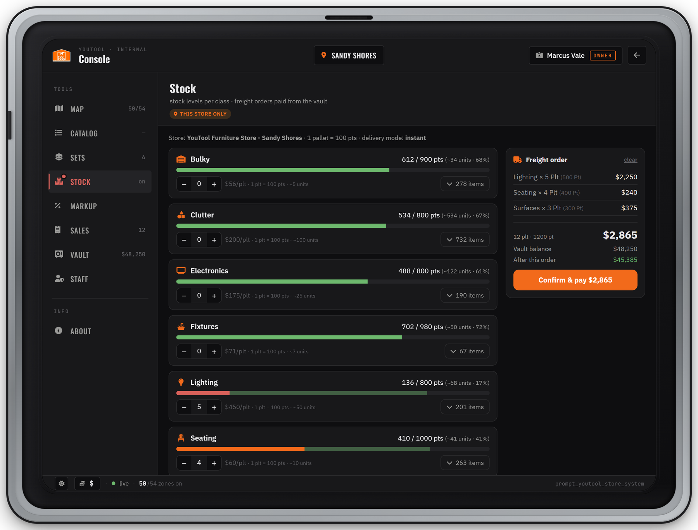

# Stock & Freight

By default YouTool stores never run out. Switch to **Active** stock and every store holds a limited stock per **stock class**. Sales use it up, and staff refill it by ordering **freight** in the Console's Stock tab, paid from the store vault. Depending on the delivery mode, the freight arrives instantly, on a timer, by the store truck or through your own logistics script. In every mode except instant it ends up as pallets on the store dock that employees unload box by box.


Stock is **per store**. The two shipped stores (`youtool_sandy`, `youtool_vespucci`) each have their own stock, their own vault and their own dock.


***

## Passive or Active


```lua
Config.EconomyMode = 'Passive'   -- 'Passive' | 'Active'
```


| Mode | What happens |
| ---- | ------------ |
| `'Passive'` (default) | Stores never run out. The Stock tab only shows *"Economy is in Passive mode — stock is infinite."* and freight can't be ordered. |
| `'Active'` | Every store keeps one stock pool per stock class. Each sold item removes its class's points; freight orders refill them. |

The first time a store runs in Active mode, every class is filled with `initialFill` points (capped at the class capacity, so with the shipped numbers every class starts **full**). Stock is saved in `data/store_stock.json`. Switching back to Passive and later to Active again keeps each store's saved stock.

***

## Stock classes

Every catalog item belongs to a stock class. Selling one unit removes that class's **points per unit** from the store's pool. The defaults in `config/stock.lua`:

| Class | Capacity (points) | Points per unit | ≈ Units when full |
| ----- | ----------------: | --------------: | ----------------: |
| `clutter` | 800 | 1 | 800 |
| `lighting` | 800 | 2 | 400 |
| `soft` | 700 | 2 | 350 |
| `electronics` | 800 | 4 | 200 |
| `surfaces` | 960 | 8 | 120 |
| `seating` | 1000 | 10 | 100 |
| `storage` | 960 | 12 | 80 |
| `fixtures` | 980 | 14 | 70 |
| `bulky` | 900 | 18 | 50 |


```lua
Config.Stock = {
  initialFill  = 1000,  -- points put into EACH class the first time a store runs in Active mode
  palletPoints = 100,   -- points in one pallet (the unit managers order)
  maxPoints    = 1000,  -- capacity of any class not listed in classMax
  lowPercent   = 20,    -- at or below this % of capacity a class shows as running low
  classMax    = { clutter = 800, lighting = 800, --[[ ... ]] },
  classPoints = { clutter = 1, lighting = 2, --[[ ... ]] },
}
```


| Option | Default | Meaning |
| ------ | ------- | ------- |
| `initialFill` | `1000` | Points put into each class the first time a store runs in Active mode (never more than the class capacity). |
| `palletPoints` | `100` | Points in one pallet, the unit you order. |
| `maxPoints` | `1000` | Capacity of any class not listed in `classMax`. |
| `lowPercent` | `20` | A class at or below this % of its capacity counts as running low. |
| `classMax` | see table | Capacity per class in points (the 100% mark on the stock bar). |
| `classPoints` | see table | Points one sold unit uses, per class. An item whose class is not listed here never runs out. |

### When a class runs out

* In the tablet's shop, items of that class show **"Out of stock at this store"** and can't be added to the cart.
* At checkout the server checks stock again, unit by unit. Units the store can't supply are **not sold and not charged**; the rest of the order goes through (*"Some items aren't in stock at this store (N not charged)."*). If nothing in the cart is in stock, the checkout stops with *"These items aren't in stock at this store"*.
* Points are removed only for the units that actually arrived in the buyer's house.

### Low-stock warning

When any class is at or below `lowPercent` of its capacity, the **Stock** button in the Console sidebar turns red with a dot. Hover it to see which classes are low (*"2 classes are running low: bulky, seating"*).

***

## Ordering freight

<figure><figcaption><p>The Stock tab: stock bar per class, pallet steppers and the freight order panel with the vault balance</p></figcaption></figure>



#### Pick pallets

In the Stock tab, use **+** / **−** on a class to add pallets to the draft order. Each row shows the class's points, approximate units and fill %, the price per pallet and how many units a pallet adds. A full class shows **FULL · can't order**, and the stepper stops at the number of pallets that still fit.



#### Check the order panel

The **Freight order** panel lists each class, the total, the **Vault balance** and the balance **After this order**. If the vault is short, the button reads *"Need $X more"*.



#### Confirm & pay

Press **Confirm & pay**. The vault pays and the order is fulfilled according to the [delivery mode](#delivery-modes).



### What an order costs

```
freight cost = points ordered × rate(class) × Config.EconomyScale
```

`rate(class)` is the class's entry in `Config.Freight.classCostPerPoint`, otherwise `costPerPoint`. You only pay for points that **fit**: ordering 2 pallets into a class with 150 points of room charges 150 points, and the last pallet is a half pallet.


```lua
Config.Freight = {
  costPerPoint = 1,            -- $ per point for any class not listed below
  classCostPerPoint = {
    clutter = 2.0, lighting = 4.5, soft = 2.5, electronics = 1.75, surfaces = 1.25,
    seating = 0.6, storage = 0.83, fixtures = 0.71, bulky = 0.56,
  },
}
```


| Class | $ per point | $ per full pallet (100 pts, EconomyScale 1.0) | Units per pallet |
| ----- | ----------: | --------------------------: | ---------------: |
| `clutter` | 2.0 | $200 | 100 |
| `lighting` | 4.5 | $450 | 50 |
| `soft` | 2.5 | $250 | 50 |
| `electronics` | 1.75 | $175 | 25 |
| `surfaces` | 1.25 | $125 | 12 |
| `seating` | 0.6 | $60 | 10 |
| `storage` | 0.83 | $83 | 8 |
| `fixtures` | 0.71 | $71 | 7 |
| `bulky` | 0.56 | $56 | 5 |

The shipped rates are set so the **cheapest item of each class breaks even at 20% markup**. A lower rate makes restocking profitable; a higher one loses money. With the default unloading wage (below), break-even for the cheapest item moves to about 25% markup.

**Unloading wages.** In every mode except `instant`, when `requireUnload = true` and `unloadWage.source = 'vault'`, the order also reserves the unloading wages from the vault: `unloadWage.perPallet × Config.EconomyScale` per pallet. The order panel adds the wage reserve to the total (*wages reserved $X*), so **Confirm & pay**, *After this order* and *Need $X more* all include it. Freight and wages are taken in one **Freight order** vault entry.

**Example** (defaults, `auto` mode): `seating` holds 850 of 1000 points and you order 2 pallets.

* 150 points fit → freight 150 × $0.60 = **$90** (one 100-point pallet and one 50-point pallet)
* Wage reserve 2 × $15 = **$30**
* The vault pays **$120**. Each box carried pays the worker $3 (10 boxes = $30).

### Order rules

* **One open shipment per store.** While a shipment is open, ordering is locked (*"Shipment in progress — unload or cancel it first"*).
* **One order can't bring more pallets than the store's dock has spots** (*"Order exceeds dock capacity (N pallet spots)"*). The shipped docks have 15 (Sandy Shores) and 19 (Davis) spots. This doesn't apply to `instant`.
* The vault must hold the full amount, otherwise: *"Vault short $X (need $Y, have $Z)"*. Staff with `vault.deposit` can top it up in the [Vault tab](markup-vault-sales.md#vault-tab).

***

## Delivery modes


```lua
Config.Delivery = {
  mode           = 'instant',   -- 'instant' | 'auto' | 'self' | 'logistics'
  requireUnload  = true,
  arrivalDelayMs = 180000,
  boxesPerPallet = 5,
  unloadWage     = { source = 'vault', perPallet = 15, account = 'cash' },
  claimIdleMs     = 300000,
  dockLeaveRadius = 60.0,
  renderRadius    = 200.0,
  dropBoxTtlMs    = 25000,
  vehicleKeys    = { system = 'auto' },
  truckTimeoutMs = 1200000,
}
```


| Option | Default | Meaning |
| ------ | ------- | ------- |
| `mode` | `'instant'` | How an order is fulfilled (tabs below). An unknown value falls back to `instant`. |
| `requireUnload` | `true` | `false` = when freight arrives, stock is credited directly: no pallets, no unloading, no wages. |
| `arrivalDelayMs` | `180000` | `auto` mode: time until the pallets arrive (3 minutes). |
| `boxesPerPallet` | `5` | Boxes an employee carries per pallet. |
| `unloadWage.source` | `'vault'` | `'vault'` = reserved from the store vault when the order is placed. `'mint'` = created from nothing (casual servers). |
| `unloadWage.perPallet` | `15` | Wage per pallet before `Config.EconomyScale`, paid per box (`perPallet / boxesPerPallet`) to whoever sets the box down. |
| `unloadWage.account` | `'cash'` | `'cash'` or `'bank'`. |
| `claimIdleMs` | `300000` | A claimed pallet is released after 5 minutes without progress. |
| `dockLeaveRadius` | `60.0` | The claim is also released when the worker goes farther than this (m) from the dock and from every storage drop point. |
| `renderRadius` | `200.0` | Players see dock pallets within this range (m). |
| `dropBoxTtlMs` | `25000` | How long a set-down box stays visible in storage. |
| `vehicleKeys` | `{ system = 'auto' }` | `self` mode: who gives the truck keys (see the `self` tab). |
| `truckTimeoutMs` | `1200000` | `self` mode: a run not finished in 20 minutes is cancelled (truck removed, order can be dispatched again). |



Stock is credited **the moment the order is paid**. No truck, no pallets, no unloading, no wages. The vault is charged only for the points actually credited, and you get *"Freight delivered: N pts for $X"*.

No delivery layout is needed.



The order is paid and the shipment shows **In transit**. After `arrivalDelayMs` (default 3 minutes) the pallets appear on the store dock and everyone with `freight.unload` gets *"Freight at the … dock — N pallet(s) to unload"*. Then [unload them](#unloading-pallets).

A shipment in transit survives a server restart and arrives on schedule.



An employee fetches the freight with the store truck.

1. After the order the shipment shows **Awaiting truck dispatch** (*"Freight ordered — dispatch the truck from the Stock tab"*).
2. Someone with `freight.dispatch` presses **Dispatch truck** in the Stock tab. A truck (the warehouse's `truckModel`, `mule` by default) spawns on the first free truck spawn at the store, gets a full tank and unlocked doors, and the dispatcher gets the keys: *"Truck is outside — drive to the warehouse and load the freight"*.
3. Follow the route to the warehouse (*"YouTool Distribution — … — load freight"*). Within `loadRadius` of the load point, press **[E] Load the freight**.
4. Follow the route back to the store dock and drive the loaded truck into the dock lane. The truck is removed and the pallets appear (*"Dock reached — unloading the truck…"*).

Only the employee who dispatched the truck can load and deliver it. The server checks that the truck itself is at the warehouse and the dock, and that the trip took a believable time.

**The run is reset** (truck removed, shipment back to *Awaiting truck dispatch*, *"Freight truck was lost — dispatch it again from the Stock tab"*) when the truck is destroyed, the driver leaves the server, the run takes longer than `truckTimeoutMs`, or the server restarts.

If every truck spawn is blocked, you get *"Truck spawns are blocked — move the vehicles there"*. YouTool removes its own abandoned freight trucks from a spawn on its own, but never a player's vehicle.

**Vehicle keys** (`Config.Delivery.vehicleKeys`):

| `system` | Keys given by |
| -------- | ------------- |
| `'auto'` | The first one running of `wasabi_carlock`, `qbx_vehiclekeys`, `qb-vehiclekeys` |
| `'wasabi'` / `'qbx'` / `'qb'` | That script only |
| `'none'` | No keys are given |

For any other key script, set `vehicleKeys.custom = function(src, plate, netId) ... end`. It runs on the server.



Your own delivery resource handles the transport.


```lua
Config.Logistics = {
  enabled         = false,
  resource        = '',        -- name of the partner resource
  fallbackDelayMs = 0,         -- 0 = arrive immediately
}
```


When an order is placed and the partner resource is running, YouTool fires the server event `youtool:freight:shipmentCreated` with the shipment (id, store, warehouse, dock center, pallets). When the delivery reaches the store, the partner calls `exports.prompt_youtool_store_system:FreightArrived(shipmentId)`. Only the configured partner resource may call it. The pallets then appear on the dock for unloading. Details: [Exports & Events](../developers/exports-and-events.md).

If `enabled` is `false`, `resource` is empty or the partner isn't running, the pallets arrive on their own after `fallbackDelayMs`. With the default `0`, they arrive immediately.



While a shipment is open, the Stock tab shows a strip with its state (*Awaiting truck dispatch*, *In transit*, *At the dock — unload it*), each pallet's progress (*3/5 boxes*, *✓ stocked*), the freight cost, the wages still reserved, and the **Dispatch truck** / **Cancel** buttons. Shipments are saved in `data/freight_shipments.json`.

***

## Unloading pallets

When freight reaches the dock, the pallets stand on the store's dock spots. Anyone with `freight.unload` at that store (Workers have it by default) can unload them. The dock is outside the store, so you don't need to be inside.



#### Claim a pallet

Target a pallet and choose **Claim & unload pallet**. One pallet per worker at a time; a pallet someone else claimed shows *"Another worker has this pallet"*.



#### Take a box

Target your pallet and choose **Take a box**. You need to stand at the pallet.



#### Carry it to storage

An orange marker shows which storage drop point this box goes to. Walk there and press **[E] Set the box down**. You get the per-box wage right away (default $3 in cash).



#### Repeat

After `boxesPerPallet` boxes (default 5) the pallet is done and its points go into stock: *"Pallet unloaded · +100 pts seating · wages $15"*. When the last pallet is done, the shipment closes and any wage money left over goes back to the vault.



* **Stop unloading** (on your pallet) releases it. Boxes already carried stay counted, so someone else can finish it.
* A claim is released on its own after `claimIdleMs` without progress (5 minutes), when the worker disconnects, or when they go farther than `dockLeaveRadius` (60 m) from the dock and the storage area.
* Stock is credited **per finished pallet**. A half-unloaded pallet adds nothing until its last box is down.
* With `unloadWage.source = 'mint'`, wages are created instead of coming from the vault, and no wage reserve is taken at order time.
* With `requireUnload = false`, arriving freight goes straight into stock (*"Freight arrived and was stocked automatically"*). No pallets, no wages.


Pallets are claimed through the target script (`ox_target` or `qb-target`). With `Config.interactionMode = 'none'`, or with no target script running, nobody can unload. In that case use `instant` mode or set `requireUnload = false`.


***

## Cancelling an order

Someone with `freight.cancel` can cancel the open shipment from the strip in the Stock tab. Press **Cancel** twice: the first press changes the button to *"Really cancel? (refunds un-unloaded)"*. An `instant` order is complete the moment it's paid and can't be cancelled.

On cancel, one **Freight refund** goes back to the vault:

* the freight cost of every pallet **nobody started** unloading, plus
* whatever is left of the reserved wages.

Pallets with at least one box carried are **not refunded**, and because stock only counts finished pallets, their points are lost too. Finished pallets are already in stock. A `self` mode truck that is still out is removed.

**Example**, continuing the order above ($90 freight + $30 wages, 2 pallets): the first pallet was fully unloaded ($15 in wages paid), the second is untouched. Cancelling refunds $30 (second pallet) + $15 (wages left) = **$45**. If 2 boxes of the second pallet had already been carried, only the $9 of wages left would come back. The second pallet's $30 and its 50 points would be lost.

***

## The delivery layout

`config/delivery_layout.lua` holds the coordinates for every mode except `instant`: the warehouses, and per store the dock, the pallet spots, the storage drop points and the truck spawns. It ships matching the YouTool MLOs at their default positions. Edit it only if you moved a store or something on your map blocks a spot.

**Per store** (`DeliveryLayout.stores.<storeId>`):

| Field | Used for |
| ----- | -------- |
| `warehouse` | Key of the warehouse the store truck drives to (`self` mode). Shipped: Sandy Shores → `grapeseed`, Davis → `terminal`. |
| `dockCenter` | Middle of the dock. Pallets render for players within `renderRadius` of it; it's also the center for `dockLeaveRadius`. |
| `truckSpawns` | `vec4` spots where the store truck spawns. The first free one is used. |
| `dockZone` | Box (`center`, `size`, `rotation`) the loaded truck drives into to deliver. Without it, the driver gets an **[E] Unload the truck** prompt near `dockCenter` instead. |
| `dockSpots` | `vec4` pallet positions. The number of spots is the most pallets one order can bring. |
| `storageDrops` | `vec4` points where carried boxes are set down. Each box goes to a random one. |

**Warehouses** (`DeliveryLayout.warehouses.<key>`): `label` (shown on the route blip), `truckModel` (`'mule'`), `loadPoint` (`vec4`) and `loadRadius` (`25.0` m). The shipped warehouses are `terminal` (*YouTool Distribution — Terminal*) and `grapeseed` (*YouTool Distribution — Grapeseed*).

**Models**: `models.pallet = 'prop_pallet_02a'` and `models.box = 'prop_cs_cardbox_01'`.


Every store needs an entry under `DeliveryLayout.stores` for modes other than `instant`. A store without one fails to order with *"No delivery layout for <storeId>"*.


### Recording a new point



#### Stand on the spot

Go to the exact place in-game and face the direction the pallet, box or truck should face. Your position and heading are recorded.



#### Capture it

Run `/youtool_capture_spot <label>`, for example `/youtool_capture_spot dock_front_10`. It needs the corporate ACE (`youtool.admin`, see `Config.Roles.corporateAce`); for anyone else it does nothing. Labels may use letters, digits, `_` and `-` (up to 32 characters). You get *"Spot captured: <label>"*.



#### Paste it into the layout

Open `data/captured_spots.txt`. Each capture adds a line like `vec4(2683.29, 3462.60, 55.34, 247.3), -- dock_front_10 (by <your id>)`. Copy it into the right list in `config/delivery_layout.lua`. When the file grows past 64 KB, captures stop (*"captured_spots.txt is full, clear it first"*), so empty it now and then.



#### Restart and check

Restart the resource and check the new point in-game with a test order.



***

## Permissions

Owners set these per position in the [Staff tab](staff-and-permissions.md). Defaults for a new store:

| Permission | Lets a position | Owner | Manager | Worker |
| ---------- | --------------- | :---: | :-----: | :----: |
| `stock.view` | Open the Stock tab: stock levels and the open shipment | ✓ | ✓ | ✓ |
| `stock.order` | Order freight, paid from the vault (also shows the vault balance in the order panel) | ✓ | ✓ | – |
| `freight.dispatch` | Dispatch the store truck and drive the run (`self` mode) | ✓ | ✓ | – |
| `freight.cancel` | Cancel the open shipment | ✓ | ✓ | – |
| `freight.unload` | Unload pallets at the dock and earn the wage; receives the "freight at the dock" notices | ✓ | ✓ | ✓ |

Without `stock.order` the Stock tab is read-only (*"Read-only — you can view stock but not order freight."*). Server owners can add their own rules for ordering, dispatching, cancelling and unloading with [Hooks](../developers/hooks.md).

***

## FAQ

<details>

<summary>Ordering says "Freight is Active-mode only"</summary>

`Config.EconomyMode` is `'Passive'`. Set it to `'Active'` in `config.lua` and restart the resource.

</details>

<details>

<summary>"Vault short $X" or "Insufficient vault balance"</summary>

The vault can't pay the order. In modes other than `instant` the wage reserve is added on top of the freight shown on the button. Deposit money in the Vault tab or order fewer pallets.

</details>

<details>

<summary>"A shipment is already in progress — unload it first"</summary>

Each store has one open shipment at a time. Unload the pallets at the dock, or cancel the shipment in the Stock tab.

</details>

<details>

<summary>Pallets are on the dock but I can't claim them</summary>

Your position needs `freight.unload` at **that** store, and a target script must be running (`Config.interactionMode` not `'none'`). Stand next to the pallet and use the target eye.

</details>

<details>

<summary>The store truck spawned but I can't drive it</summary>

Check `Config.Delivery.vehicleKeys`. With `'auto'`, keys go through `wasabi_carlock`, `qbx_vehiclekeys` or `qb-vehiclekeys`. For another key script, add a `vehicleKeys.custom` function.

</details>

<details>

<summary>I set mode to 'logistics' and the pallets show up immediately</summary>

`Config.Logistics.enabled` is `false`, `resource` is empty, or the partner resource isn't started. YouTool then falls back to arriving after `fallbackDelayMs`, which is `0` by default.

</details>
