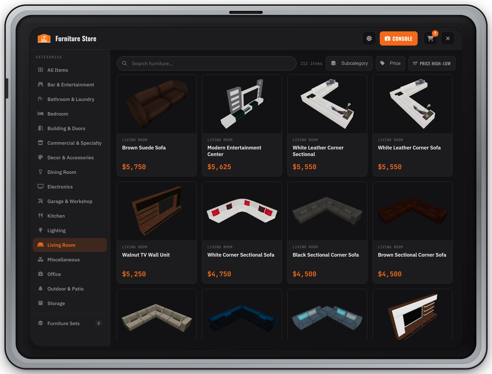
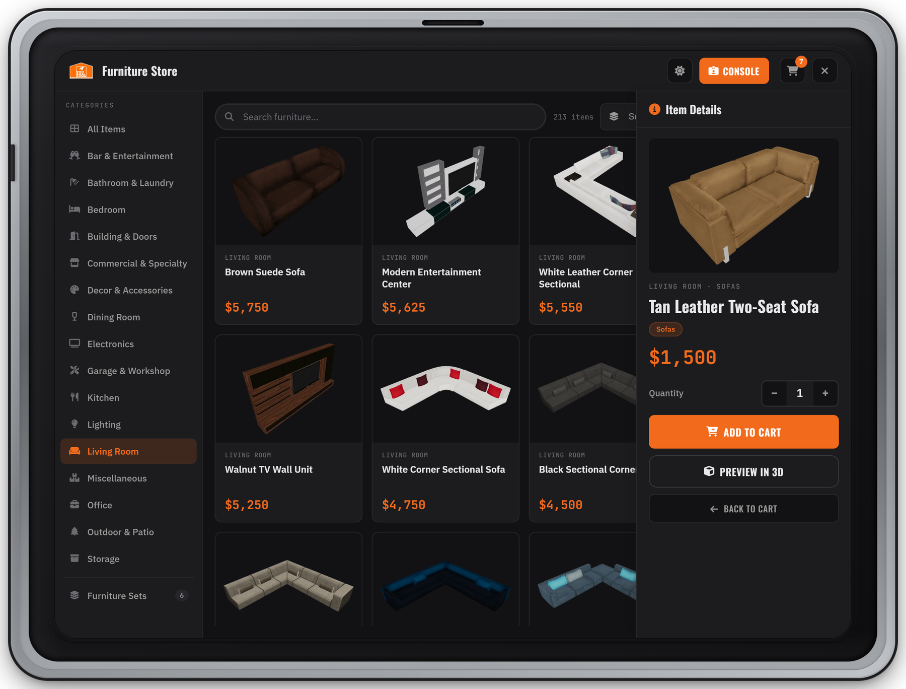
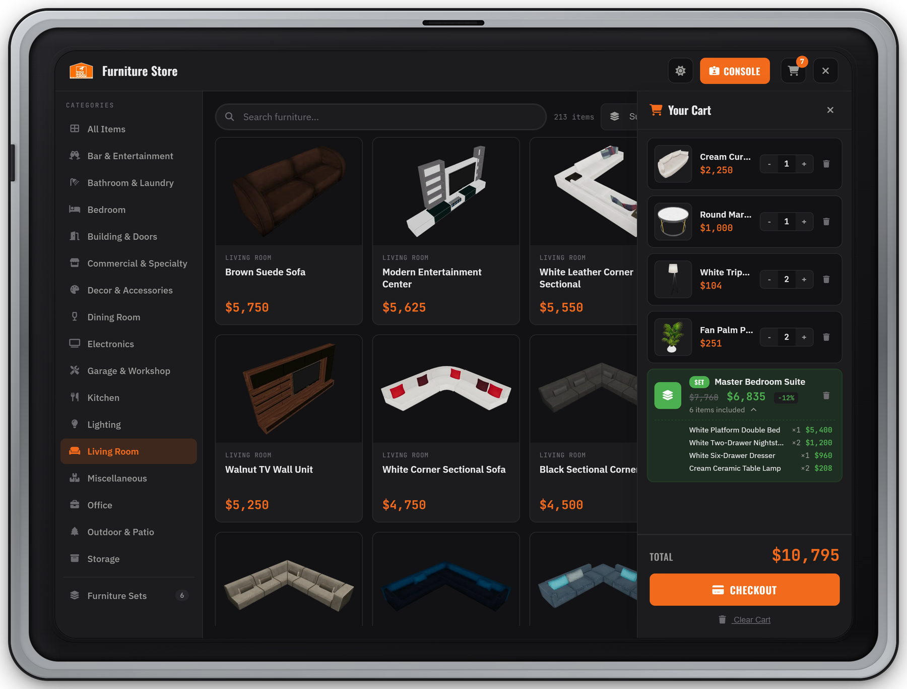
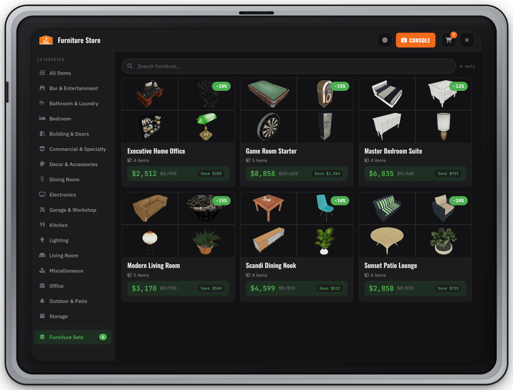
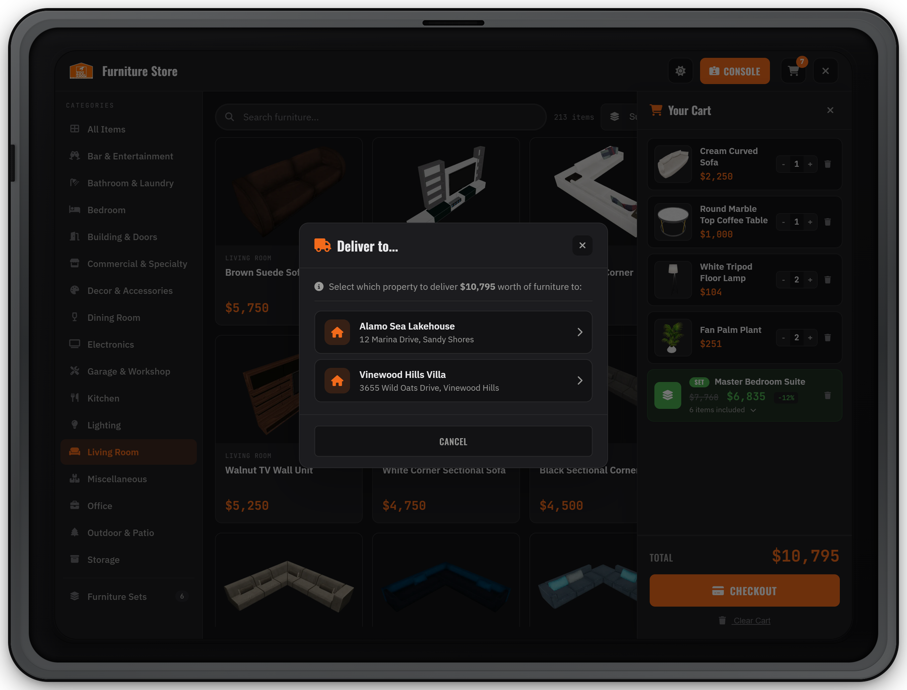
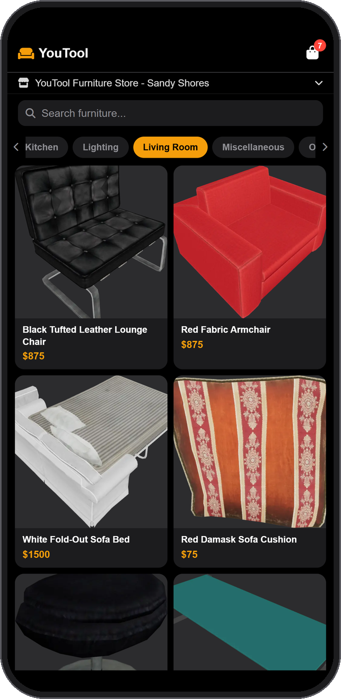

# Shopping

This page walks through YouTool from the player's side: walking into a store, browsing the tablet, previewing furniture in the room, filling the cart and checking out to a property. Use it to answer player questions or to write your own in-city guide.


Everything a player buys is delivered to a property they own, through your housing script. A player who owns no property can browse but can't check out. See [Housing Integrations](housing/README.md) for where the furniture shows up in each script.


***

### Walk in and open the tablet

1. Walk into a YouTool store. The store is detected by its interior, so the tablet becomes available as soon as you are inside.
2. A **`[E] Open Tablet`** prompt appears while the tablet is closed.
3. Press **`E`**. Your character holds a tablet and the store catalog opens.
4. Press **`E`** again, **`Esc`**, or the **X** button to close it. Leaving the store closes it too.

Players can rebind the key in **Settings › Key Bindings › FiveM › YouTool Tablet**. The prompt always shows the key they actually have bound.

| Option (`config/tablet.lua`) | Default | Meaning |
| --- | --- | --- |
| `Config.Tablet.showKey` | `'E'` | Starting key for the tablet. Players can rebind it; this only sets the default. |
| `Config.Tablet.prompt` | `'nui'` | The "Open Tablet" hint: `'nui'` (YouTool's own prompt), `'ox_lib'` (ox\_lib text UI) or `'none'` (no hint). |

The rest of the tablet options (cart size, target distance, sounds) are on the [Configuration](configuration.md) page.

***

### Shop straight from the showroom

The furniture on display in the store is shoppable. Aim at a piece with your target script (`ox_target` or `qb-target`) to get these options:

| Target option | Shows on | What it does |
| --- | --- | --- |
| **Add to Cart** | Any furniture in the store that is in the catalog | Adds one to the cart and shows "Item added to cart!" |
| **View in Tablet** | Same | Opens the tablet on that item's details |
| **Add Set to Cart** | A piece of a furniture set staff placed in the showroom | Adds the whole set to the cart |
| **View Set** | Same | Opens the set's details. If the piece belongs to more than one set, a **Choose Set** menu appears first |
| **Checkout** | The till | Opens the tablet on the checkout screen |

Staff with the right permissions get extra options (**Edit in Manager**, **Manage Display**, **Manage Set Display**). Those are covered in [Store Console](console/README.md#displays-and-price-tags).

The target range is `Config.Target.distance` (default `2.5` m; the till uses 2 m). With `Config.interactionMode = 'none'`, or `targetableProps = false` on a store in `Config.Stores`, there are no targets in the store, but the tablet still works.

***

### Browse the catalog

<figure><figcaption><p>The store tablet: categories on the left, search and filters on top, products with this store's prices</p></figcaption></figure>

* **Categories** — the sidebar lists **All Items** and every catalog category. **Furniture Sets** appears at the bottom when the store has at least one set.
* **Search** — matches the item name, model name, category and subcategory.
* **Subcategory** — narrows the current category to one subcategory.
* **Price** — choose **Less** (at or below) or **More** (at or above) and drag the slider. **Clear** resets the subcategory, price filter and search.
* **Sort** — the sort button cycles **Name A–Z**, **Name Z–A**, **Price Low–High**, **Price High–Low**.
* **Product cards** — category, name and price. The **+** button adds one to the cart; the cube button starts the [3D preview](#item-details-and-3d-preview).
* **Theme** — the moon/sun button switches the tablet between light and dark.

What the player sees depends on the store they are in:

* Prices already include **this store's markup**, so the same item can cost more in one store than another.
* Products the store's staff hid (delisted) don't appear.
* When a store sells an item below its base price, the card shows the old price crossed out and a **-X%** badge.
* With `Config.EconomyMode = 'Active'`, an item the store has no stock for shows **Out of stock at this store** and can't be added.

***

### Item Details and 3D preview

<figure><figcaption><p>Item Details: price, quantity, Add to Cart and Preview in 3D</p></figcaption></figure>

Click a product card to open **Item Details**: image, category and subcategory, name, price and a **Quantity** stepper (1 to 99). **Add to Cart** adds that many. Once the item is in the cart, the button reads **In Cart (n)** and the stepper changes the quantity in the cart directly. **Back to Cart** switches the side panel to the cart.

**Preview in 3D** lets the player see the item in the room before buying:

* The tablet hides and a see-through copy of the item follows where you look.
* Only you can see it. Nothing is spawned for other players and nothing is saved.
* It works inside the store only, and ends if you leave.

| Control | Action |
| --- | --- |
| Aim | Move the item to where you're looking |
| Mouse wheel or `Q` / `E` | Rotate |
| Left click or `Enter` | Drop it in place (it turns solid); press again to pick it back up |
| `Backspace` | End the preview and return to the tablet |

***

### The cart

<figure><figcaption><p>The cart: quantities per item, and a set expanded to show the items it includes</p></figcaption></figure>

Open the cart with the cart button in the header. The number on it counts items; each set counts as one.

* **Items** — use **-** and **+** to change the quantity, or the trash icon to remove the line.
* **Sets** — shown with a **SET** badge, the normal total crossed out, the set price and its discount. Click **N items included** to expand the list.
* **Checkout** — opens the checkout (see below).
* **Clear Cart** — empties the cart after a confirmation.

Limits:

* Adding from the tablet stops at `Config.Cart.maxItems` items (default `50`) with "Cart is full".
* One order can hold at most 200 items in total.
* A set can be in the cart only once ("This set is already in your cart").

**The cart is saved.** It belongs to the character (the license on a standalone server), not the store visit: it is kept when the player leaves the store, logs off, or the server restarts, and comes back the next time they enter any YouTool store or open the phone app. Prices are always recalculated for the store the player is checking out at. The cart is emptied after a successful purchase.

***

### Furniture Sets

<figure><figcaption><p>Furniture Sets: bundles at a discount, with the amount saved</p></figcaption></figure>

Sets are bundles of furniture that a store's staff put together and sell at a discount. Each store has its own sets.

* Click **Furniture Sets** in the sidebar to see them. Each card shows the discount, the number of items, the set price, the normal total and **Save $x**. The search box filters sets by name.
* Click a set to see its details: every item with its quantity under **Includes:**, and **Add Set to Cart**.
* Sets that staff placed in the showroom can be bought on the spot with the **Add Set to Cart** and **View Set** targets on any of their pieces. Their price tag shows the set name and set price.

The set price is the sum of the items at this store's prices, minus the set's discount, and it is exactly what checkout charges. A set is never sold below its items' corporate cost, so a discount bigger than the store's markup stops at that cost. See [Sets in the showroom](console/README.md#sets-in-the-showroom).

***

### Checkout

<figure><figcaption><p>A player who owns more than one property picks where the order is delivered</p></figcaption></figure>



#### Open the checkout

Press **Checkout** in the cart, or target the till and choose **Checkout**.



#### Confirm

The checkout lists every line and the total. Press **Confirm Purchase**. "Processing your order…" shows while the server charges the player and hands the furniture to the housing script.



#### Pick the property

If the player owns one property, the order goes straight there. If they own several, **Deliver to…** lists them (name and address). Pick one, or **Cancel** ("Purchase cancelled"). The choice stays open for 5 minutes; after that the player has to check out again.



#### Done

The tablet shows the result, for example "Purchase complete! 7 items added. Total: $10795", and the cart is emptied.



**Where the money comes from.** Checkout always charges the player's **bank** account. With `Config.MoneySystem = 'auto'` that is the framework's bank (QBCore, QBox, ESX); `'free'` charges nothing; `'custom'` calls your own money functions with the account `'bank'`. See [Configuration](configuration.md).

**Players only pay for what arrives.** Items the store has no stock for (Active mode) are not charged, and items the housing script refuses are refunded to the bank. The result message says so.

<details>

<summary>Checkout messages and what they mean</summary>

| The player sees | Why |
| --- | --- |
| Not enough money. Need: $X | The bank balance is below the order total. |
| You need to own a house to purchase furniture | The housing script reports no property for this character. |
| No housing system detected on this server | No supported housing script is running. See [Housing Integrations](housing/README.md). |
| Select a store before checking out | The player left the store before checking out. |
| X is no longer available | Staff hid this product after it went into the cart. Remove it and check out again. |
| Set "X" no longer exists | Staff deleted the set after it went into the cart. |
| These items aren't in stock at this store | Active stock mode, and the store has none of the ordered items. |
| Some items aren't in stock at this store (N not charged). | Part of the order was out of stock; only the rest was sold. |
| (N failed, refunded) | The housing script didn't accept some items; their price went back to the bank. |
| Too many items in one order (max 200) | Split the order. |
| This store cannot cover its discount right now. Try again later. | The store sells below cost and its vault can't pay the difference. See [Markup, Vault & Sales](console/markup-vault-sales.md). |
| No pending checkout | The property picker was left open too long. Check out again. |
| You don't have access to this. | A server hook blocked the purchase. See [Hooks](developers/hooks.md). |

</details>

***

### On-screen messages

YouTool never writes to the chat. Results on the tablet appear as a green (success) or red (error) banner at the bottom of the tablet. Actions outside the tablet, such as adding an item from a target, show as an on-screen notification.

***

### Phone app (lb-phone or sky\_phone)


{% column width="33.33%" %}
<figure><figcaption><p>The YouTool app in lb-phone</p></figcaption></figure>


{% column width="66.67%" %}
Players can order from anywhere through the **YouTool** app on **lb-phone** (resource `lb-phone`) or **sky\_phone** (resource `sky_phone`, tested with 1.1.7).

**Install:** nothing to copy and nothing to set in YouTool. YouTool finds the phone and adds the app by itself as a default app (installed for everyone, can't be removed). Start the phone before YouTool:

```cfg
ensure lb-phone      # or: ensure sky_phone
ensure prompt_youtool_store_system
```

If the phone starts later, or restarts, the app is added again when it starts. The server console tells you which case you're in, for example:

```
[YouTool Server] lb-phone detected (running) — phone app integration ENABLED
[YouTool Phone] SUCCESS — App registered with sky_phone (2112 catalog items)
```

**sky\_phone:** run it instead of lb-phone, not next to it: sky\_phone takes over the `lb-phone` name, so the two can't run together. Keep its custom apps switched on (the default, under `/phonepanel` when its configurator is on). Players can't open sky\_phone while they are downed or cuffed. The app follows the phone's light or dark mode.

**Using it:**

1. Open the app and **choose your store** from the list. Tap the store bar at the top to switch later.
2. Search, or swipe the category chips. Tap an item for its details and **Add to Cart**.
3. Open the bag icon, adjust quantities, then **Place Order** › **Confirm**.
4. Pick the property under **Deliver to…** if you own more than one.



What to know about phone orders:

* Prices, hidden products and stock are those of the store the player picked, and that store's vault gets the margin.
* Payment and delivery work exactly as at the tablet: bank account, one of the player's properties.
* The phone and the tablet share the same saved cart, and the same `Config.Cart.maxItems` limit applies.
* The phone has no Furniture Sets section and no 3D preview. Sets are bought at the store.
